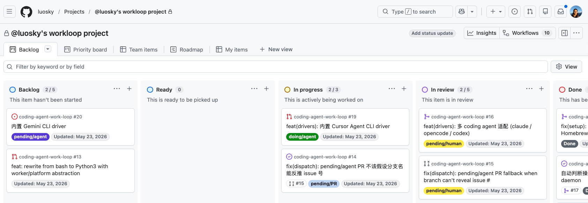
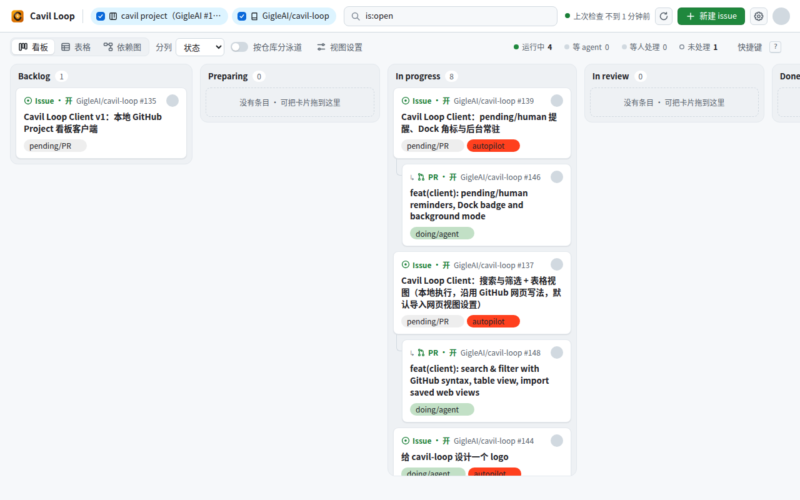
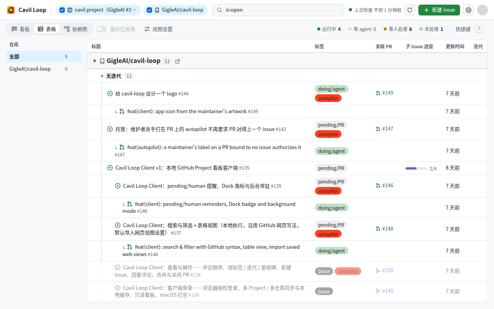
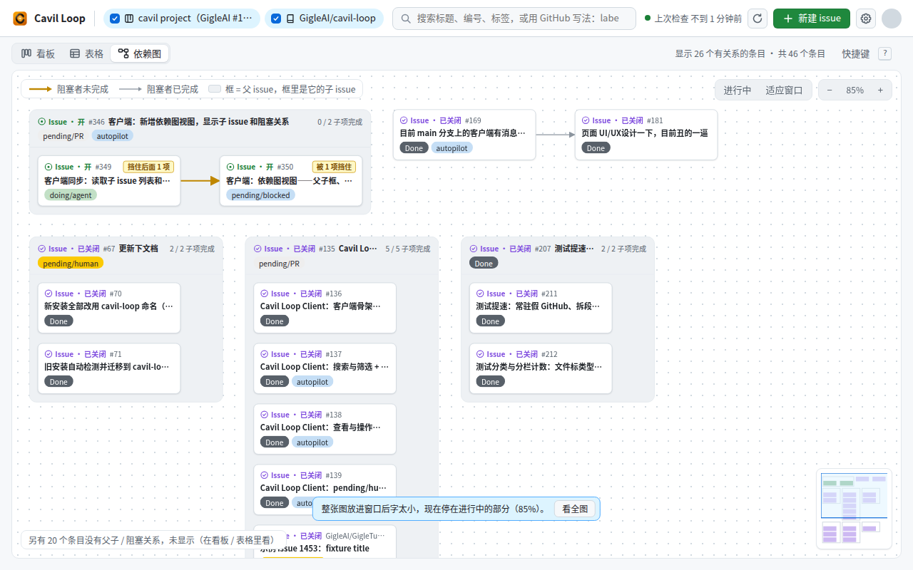

<p align="center"></p>

# cavil-loop

> **English** · [中文](README.zh.md)

> Send AI a batch of issues, async-review the PRs it ships — like working with a real teammate.
>
> Turn "babysitting AI step-by-step" into "sleep on it, review the PRs in the morning."

### Why the name

Cavil is the Cylon from *Battlestar Galactica* who says "I don't want to be human." That is the idea here: the agent does not need to pretend to be human, yet working with it feels like working with a real colleague — you hand it issues, it comes back with design proposals and PRs, and you review them.

## Two things in this repository

| | What it is | What it needs | Start here |
|---|---|---|---|
| **The daemon** | A background poller on your machine: label an issue `pending/agent` and a local AI agent picks it up, writes the design and the PR, and reports back on GitHub. Everything below this table is about it. | `git`, `gh`, `tmux`, `jq`, `flock`, an agent CLI; Linux or macOS | [Quick start](#quick-start) |
| **The Cavil Loop desktop client** | A GitHub issue / PR client that works on its own: issues together with their linked PRs, grouped by iteration / milestone, and a dependency graph of issues (across repositories). It can also install the daemon and hand items to it. | A GitHub account and a Mac — no daemon, no GitHub Project, no command-line tools | [Client guide](docs/client.md) |

Each one works without the other, and they work best together.

## What it is



A GitHub-label-driven workflow for **AI coding agents** (Claude Code / OpenCode / Codex / your own). Installed as an [Agent Skill](https://agentskills.io/home) on your machine — runs a 60-second background poller that watches your repos for label triggers, dispatches a local AI worker in an isolated git worktree to do design / coding / review work, and posts everything back as GitHub comments + PR commits.

Three things you should know up front:

- **Local, not cloud**: the AI worker is your local `claude` (or any other supported coding CLI) — your code never leaves your machine
- **GitHub is the interface**: labels (`pending/agent` / `pending/human` / `doing/agent`) drive everything; no web UI to learn
- **You stay in control**: every change goes through a PR review you sign off on; the tool merges nothing on its own unless you hand a specific issue over with the autopilot label (off by default)

**One GitHub repository is all you need — no GitHub Project required.** Dispatch looks only at the labels on issues / PRs. A GitHub Project is used by three optional features only, so skip it unless you want one of them: queueing by the Project's Priority field (the default is `priority/p*` labels), collecting several repositories' issues / PRs into one Project (off by default), and the client's columns by iteration or status (both values live in a Project).

## Why use it

Working with AI on code is normally **serial**: prompt → wait → read → respond → wait → read… You can't walk away, the AI's history is locked in some chat UI.

This tool fixes three things at once:

### 1. Sync → async parallel

You stop being "the person chatting with the AI" and become "the person reviewing the AI's PRs."

```
Before bed: open 10 issues, label each pending/agent, close laptop, sleep.
Morning:    10 PRs / design proposals sit on GitHub. Review them like a reviewer—
            merge what's good, comment + re-label what needs changes,
            AI does another round on its own (you stay hands-off).
```

Multiple requests run **truly in parallel** — each issue gets its own worker / worktree / git branch, no cross-blocking. Progress is visible at a glance via GitHub labels. The [official GitHub mobile app](https://github.com/mobile) handles review + comment + label, so you can keep things moving during the commute.

### 2. All process + artifacts traceable by issue number

Every artifact from an issue's run is filed under its **issue number**:

| Artifact | Where |
|---|---|
| Design proposal + discussion | issue comments |
| Code | dedicated worktree + `feature/issue-<N>` branch |
| AI's full conversation (incl. thinking + tool calls) | `~/.claude/projects/<encoded-cwd>/<uuid>.jsonl` |
| tmux pane history | `$STATE_DIR/sessions/<project>-issue<N>.log` |
| Review report | PR comment |

Six months later debugging some hairy code, wondering *why* it was written that way? Two levels of lookup, from light to heavy:

1. **GitHub issue/PR comments first** — design proposal, the discussion thread, review report all live here. `gh issue view 42 --comments` or browser, 5 seconds. 95% of "why is this code shaped this way" answers come from this level
2. **Resume the AI session if you need to dig deeper** — `cd <worktree>/issue-42 && claude --resume` drops you back into the AI's full conversation: every alternative considered, every dead-end explored, the reasoning chain not fully written out in the final PR comment

Either way: **not** scrubbing through nameless AI chat sessions or reconstructing intent from a one-line commit message.

#### Compounding effect: the longer you use this, the smarter your agent gets

This is the part that compounds over time — **decision history is readable by both humans and AI agents**.

When a *new* issue touches code that was last changed in issue #42, the AI worker runs `gh issue view 42 --comments` itself, pulls the full prior context (design rationale, alternatives weighed, trade-offs accepted), and proceeds informed. **No one has to spoon-feed it "here's the background, X was tried, Y didn't work because…" every single time.**

The more issues your project accumulates this way, the richer the searchable context becomes. AI agents working on month-6 issues land with an understanding of decisions made in month-1 — automatic onboarding without anyone writing onboarding docs.

Useful for:
- **Humans** debugging old code, onboarding teammates, post-mortem on regressions — read the issue thread first, resume session if needed
- **AI agents** picking up related work — they self-serve context via `gh issue view <N> --comments`, no human-in-the-loop briefing needed

Full retention policy + lookup / resume SOPs: [docs/persistence.md](docs/persistence.md).

### 3. Cheap (Pro/Max subscription, not API tokens)

| | Webhook + Anthropic API | This tool |
|---|---|---|
| Per-trigger model cost | Burns API tokens (every call $$) | `claude` CLI under your Pro/Max subscription — **no tokens** |
| Idle cost | Webhook infra + standby fees | **$0** (60s polling only hits GitHub API, not the model) |
| Long-running cost (6 months, dozens of issues/wk) | hundreds–thousands USD | flat \$20–\$200/month Pro/Max |

Especially good fit for 24/7 "AI auto-reviews + auto-fixes" patterns where webhook+API costs balloon.

## How it works

A **background poller** on your machine looks at GitHub every 60 seconds. When it sees an issue or PR labeled `pending/agent`, it spins up Claude Code locally in an **isolated working directory** to do the work — read comments, write code, run tests, commit, push, reply — then flips the label back to `pending/human` for your review. Everything stays as a paper trail in GitHub comments.



<sub>No animation in your viewer? See the [static version](docs/images/issue-lifecycle.en.static.svg) with every step's notes. Step 5 (design proposal) always happens; step 6 (independent review) only when the project turns on design review — without it the proposal comes straight to you.</sub>

Two trigger scenarios:

| Scenario        | Trigger                                      | What the AI does                                                                                                                                     |
| -----------------| ----------------------------------------------| ------------------------------------------------------------------------------------------------------------------------------------------------------|
| New request     | Add `pending/agent` to an issue              | Posts a **design proposal** comment first (asking how to approach it, whether to split PRs), then on your confirmation: branch → implement → open PR |
| Review feedback | Add `pending/agent` to a PR (with a comment) | Finds the AI session for this PR, reads the latest comment, and acts                                                                                 |

### Knobs (defaults work as-is; reach for these when you need them)

| To change | How | Details |
|---|---|---|
| **What counts as actionable** | `DISPATCH_MODE=greedy` — stop labelling items one by one; every open issue / PR is worked unless a blocking label (`pending/human` and friends) stops it | [architecture](docs/architecture.md) |
| **Who goes first** | When slots are full, the queue sorts by priority → stage → waiting time. Priority can come from `priority/p*` labels or straight from **GitHub's own Priority field** (`PRIORITY_SOURCE=project`) — reorder the options on the board and the tiers follow | [operations](docs/operations.md) |
| **Collect several repos on one board** | `AUTO_ADD_PROJECTS="myorg/4"` — the daemon adds this repo's open issues / PRs (and ones closed after it started) to the listed GitHub Projects every poll; GitHub Free's built-in auto-add only covers one repo per project. Add-only, off by default | [operations](docs/operations.md#auto-add-issues--prs-to-github-projects-optional-off-by-default) |
| **The prompt the AI reads** | The generic workflow ships with the skill; a project only writes its own delta (`<name>.extra.md`), appended after it. No need to fork the whole template — forking means never receiving upstream updates again | [operations](docs/operations.md) |
| **Which AI CLI runs** | `WORKER_AGENT=claude\|codex\|opencode\|cursor`, or write your own driver | [drivers](docs/drivers.md) |
| **Orchestration: another AI checks before you do** | Set `LABEL_PENDING_REVIEW` to turn on the review gate: every PR round with code changes goes to another AI (codex by default) first; a fail bounces back to the coding AI with concrete feedback, at most `REVIEW_MAX_ROUNDS` rounds (default 6), and only a pass reaches you. If the two AIs cannot agree it stops and waits for you. Add `REVIEW_DESIGN_PROPOSALS=true` and design proposals are reviewed before they reach you too. Multi-role relays (PM → dev → QA) are wired up with labels as well | [operations](docs/operations.md#optional-cross-review-gate-off-by-default) · [collaboration](docs/collaboration.md) |
| **Autopilot: hand an issue over end to end** | Set `LABEL_AUTOPILOT` (off by default; needs the review gate) and put that label on an issue: the design goes through the review gate only, and once the code review passes the daemon merges the PR itself — only the exact commit the reviewer saw, only if the label was put on the issue (or on an already-open PR) by a maintainer with write access, checks are green and nothing conflicts. Pull the label or add `pending/human` on the issue or the PR to stop it at any point | [operations](docs/operations.md#autopilot-label-optional-off-by-default) · [security](docs/security.md) |
| **Hook up an external requester bot (e.g. grokbot)** | Let another AI assistant file issues directly: when there is a question for it or the work is done, the item gets a waiting label and its webhook is called; it also hears when the PR is merged or closed. Off by default | [integration guide](docs/requester-bot.md) · [Grok bot](https://x.ai/bot/JrLKauAqSRAqNQtIP9BJQ) |

## What it **doesn't** do

- ❌ **Not a cloud service**: runs on your laptop / NAS. Machine off = it stops
- ❌ **Doesn't replace code review**: the AI changes code and auto-pushes, review is still your job. Protect main + require reviewers
- ❌ **Doesn't auto-merge on its own**: merging / closing PRs is your call — the only exception is an issue you explicitly put on autopilot (off by default, opt in per issue)

---

## Quick start

### 1. Install (once)

```bash
npx skills add GigleAI/cavil-loop -g
```

<details>
<summary>Manual install (without npx)</summary>

```bash
git clone https://github.com/GigleAI/cavil-loop.git ~/github/cavil-loop
mkdir -p ~/.agents/skills ~/.claude/skills
ln -s ~/github/cavil-loop ~/.agents/skills/cavil-loop
ln -s ~/.agents/skills/cavil-loop ~/.claude/skills/cavil-loop
```

`setup.sh` migrates Linux installations to immutable managed releases. The checkout remains available for development, but the running daemon follows the configured remote base branch instead of mutating that checkout.
</details>

### 2. Connect a project

```bash
bash ~/.agents/skills/cavil-loop/setup.sh ~/path/to/your-project
```

Or just say "install cavil-loop on ~/path/to/your-project" inside Claude Code — the AI will run it.

One command handles: per-project config, registering the background poller, creating `pending/agent` / `pending/human` etc. labels in the repo, starting the timer. Non-destructive, idempotent.

### 3. Keep running while logged out (optional)

```bash
sudo loginctl enable-linger $USER
```

Linux stops user services on logout by default; this keeps the poller alive when you're away.

### Or start from the desktop client (macOS)

Instead of the commands above, install the [desktop client](#client-desktop-board) and do steps 1 and 2 from its Settings page:

1. Install the [dependencies](#dependencies) and run `gh auth login` first — the client only checks what is missing, it does not install system software.
2. Download and install the client, then sign in with your GitHub account (enter the short code in the browser).
3. Settings → "数据来源" (sources): type `owner/repo` to add the repository (no Project needed).
4. Settings → "本机 daemon" (local daemon): click "安装" (install) — the same as the manual install in step 1 above.
5. Back in the sources list, click "接上 daemon" (connect) on the repository's row: pick an existing local copy or let it clone one, pick the agent, and click "开始" (start) once the pre-check passes — the same as `setup.sh` in step 2 above.

From then on, an issue labeled `pending/agent` gets picked up. Where to download and the details of each step are in the [client guide](docs/client.md#optional-connect-the-daemon) (the client's interface is Chinese for now).

## Dependencies

`git`, `gh` (run `gh auth login` first), `tmux`, `jq`, `flock`, `claude` (Pro/Max plan). `setup.sh` auto-detects the OS: Linux uses the built-in `systemd` user timer; macOS uses a `launchd` LaunchAgent (see [docs/operations.md → Scheduler by OS](docs/operations.md#scheduler-by-os)). Tested on Ubuntu 22.04 / 24.04; macOS supported, community testing welcome.

---

## Usage

### Scenario 1: New request

```bash
gh issue create --title "..." --body "..."     # say you get #42
gh issue edit 42 --add-label pending/agent
```

Within 60s the poller picks it up: builds an isolated working dir, starts Claude Code, writes code, opens a PR (with `Closes #42` in the body — work too big for one PR is split into sub-issues first), flips the label to `pending/human` for your review. Watch what the AI does: `tmux attach -t <project>-issue42`.

### Scenario 2: PR review feedback

```bash
gh pr comment N --body "rename foo to bar"
gh pr edit N --add-label pending/agent --remove-label pending/human
```

Within 60s the poller finds the AI session for this PR, feeds in your comment → AI edits → tests → push → reply → flip label.

### Scenario 3: Clarification question

```bash
gh pr comment N --body "why not pattern X here?"
gh pr edit N --add-label pending/agent --remove-label pending/human
```

AI sees it's a discussion question, replies without touching code, keeps label `pending/human` waiting for your next turn.

---

## Client (desktop board)

The Cavil Loop desktop client (`client/`, macOS) is a GitHub issue / PR client you can use **on its own** — with or without the daemon, with or without a GitHub Project. It puts several repositories and GitHub Project boards into one window:

- **Board** with columns by iteration / status / milestone, optional swimlanes per repository; each PR sits under the issue it links to.
- **Table** grouped by repository / iteration / status / milestone, sub-issues indented under their parent with their progress, cells editable in place.
- **Dependency graph**: parent issues drawn as boxes around their sub-issues, arrows from blocking to blocked issues, items from repositories outside your sources still drawn.
- **Search** in GitHub's web syntax, saved web views imported from a Project, the last synced data readable offline.
- **Changes** sent straight to GitHub: labels, iteration, status, milestone, replies, new issues, closing and merging; details float over the board or open as tabs.
- **With the daemon** (optional): install it and connect a repository from Settings, hand an item to the agent or put it on autopilot with one button, and get a system notification when something lands on `pending/human`.

| Board | Table | Dependency graph |
|---|---|---|
|  |  |  |

You sign in through the browser (GitHub's device flow); the credential goes into the macOS keychain. By default the client talks only to GitHub (`api.github.com`, `github.com` and GitHub's own avatar, image, file and release-download addresses); Tailscale machines are contacted only when you use the remote-daemon settings: opening the "add remote daemon" window asks every online device on your tailnet whether its remote entry is open, pairing talks to the one machine you picked, and afterwards only paired machines are contacted — always over HTTPS to `*.ts.net` names, never with a GitHub credential (details in the [client guide](docs/client.md#network-credentials-and-offline-use)). When it installs or connects the daemon, it runs the daemon's own scripts and a few fixed `git` / `systemctl` / `launchctl` commands on this machine; the window can send only fixed requests, the back end checks every argument, and the client's credential is never handed to the daemon, which keeps using `gh`'s own sign-in.

Packages are attached to the `client/v…` entries on this repository's [Releases](https://github.com/GigleAI/cavil-loop/releases) page: for now only development builds (tags `client/vX.Y.Z-dev.N`, marked Pre-release, Apple-silicon dmg only) — no stable release and no Intel package yet. **Install, first run and every feature: [docs/client.md](docs/client.md).** The developer notes are in [client/README.md](client/README.md) (Chinese).

---

## Read more

| Doc | About |
|-----|-------|
| [docs/client.md](docs/client.md) | The desktop client: install and first run without the daemon, board / table / dependency graph, search, editing, shortcuts, network boundary, connecting the daemon, features in progress |
| [docs/architecture.md](docs/architecture.md) | Five-state label machine, PR↔Issue closure (one PR, or split into sub-issues), why the design works this way |
| [docs/collaboration.md](docs/collaboration.md) | Multi-human + multi-agent workflows: PM → Dev → QA handoff via label suffixes (`pending/agent/PM`, `pending/human/Alex`, …) |
| [docs/requester-bot.md](docs/requester-bot.md) | Hooking up an external requester bot (grokbot as the example): integration steps, what the bot does on its side, troubleshooting |
| [docs/persistence.md](docs/persistence.md) | Where design proposals / discussions / code / Claude conversations / tmux history live, how to look them up later, how to resume from a break point |
| [docs/security.md](docs/security.md) | **Public-repo users must read.** Anonymous comments can contain prompt injection; how the defenses work |
| [docs/operations.md](docs/operations.md) | Full config, dispatch modes and queue order, prompt templates (base + project delta), multi-project, upgrades, macOS launchd, webhook trigger, swapping AI worker, troubleshooting |
| [docs/drivers.md](docs/drivers.md) | Worker agent drivers — built-in `claude` / `opencode` / `codex` / `cursor`, plus how to add your own |

## Note

This is an **Agent Skill** — a feature package loaded by AI coding tools like Claude Code. But you don't need Claude Code to run it: the background scripts are plain shell + `gh` CLI, scheduled by cron / systemd / launchd. Worker CLI is selected via `WORKER_AGENT=<name>`; built-in `claude` / `opencode` / `codex` / `cursor` drivers ship; add your own — see [docs/drivers.md](docs/drivers.md).

## License

MIT. See [LICENSE](LICENSE).
