# 设计原理

> [English](architecture.md) · **中文**

## Label 状态机（五态）

每个 issue 和 PR 都在五个标签之间流转。你用 `pending/agent` 把活交给 agent，其余由 daemon 和 worker 来翻；不用 attach 会话就能看出每条活走到了哪一步。

| Label | 谁标 | 含义 |
|------|------|------|
| `pending/agent` | 你 | 等 agent pick up（issue 待派工 / PR 有 review 反馈待修） |
| `doing/agent` | daemon | agent 正在 dispatching / worker tmux 正在处理 |
| `pending/human` | worker / daemon | 等你 review / merge / 决策 |
| `pending/PR` | worker（开 PR 时） | issue 工作已转 PR 跟踪；去看 PR |
| `Done` | daemon（auto-cleanup） | PR 合并后标 PR；issue 在**关闭为「已完成」**时标 |

<details><summary>细节：issue 什么时候打 <code>Done</code></summary>

issue 关闭为「已完成」时打 `Done`——被 `Closes #N` 带关，或你在网页上手动关闭并选「已完成」，同时摘掉残留的流程标签。issue 关不关始终由你决定，daemon 不会去关 issue；以「不做了 / 重复」关闭的不标 `Done`。

</details>

<details><summary>细节：可选的另外几个标签</summary>

- `pending/review`——复审关卡，见 [operations](operations.zh.md#交叉-review-关卡可选默认关闭)。
- `pending/merge`（只在配了托管标签时）——PR 上的「复审已通过，等 daemon 检查后合并」。
- `pending/blocked`（除非 `LABEL_PENDING_BLOCKED` 写成空值，否则开着）——「在等别的 issue / PR（本仓库的，或互通名单里别的仓库的），前置全部完成后 daemon 自动翻回 `pending/agent`」。
- `pending/later`（除非 `LABEL_PENDING_LATER` 写成空值，否则开着）——「暂缓：daemon 不自动捞它开工，打派工标签照常派」。
- 托管「模式标签」本身，打在 issue 上或已开好的 PR 上。daemon 从不摘维护者打的；它只把 issue 上的托管标签复制到绑定的 PR 上，授权没了再收回自己补的那份。托管 issue 合并即关，打 `Done` 并挂 `pending/human` 提醒人看；拆出的子项继承父 issue 的托管。见 [operations](operations.zh.md#托管标签可选默认关闭)。

</details>

### 关于 PR↔Issue 闭环关系：worker 在设计阶段就决定

worker 的设计提案在两种形态里选一种，你确认之后才写代码：**A**——一个 PR 关掉 issue；**B**——拆成 sub-issue，每个子项各开一个 PR。「一个 PR 还是拆」是**设计阶段共识**，不是 worker 默认行为。

| 场景 | PR body 用 | merge 时 issue 状态 | daemon auto-cleanup |
|------|-------|------|------|
| **A. 一个 PR**：一个 PR 全解决 issue | `Closes #N` | GitHub 自动关 | issue 加 Done（与 PR 同状态） |
| **B. 拆成 sub-issue**：一个 PR 装不下 | 父 issue 不开 PR；每个子项的 PR 用 `Closes #子号` | 父 issue 保持 open 当总表（`pending/PR`） | 子项各自加 Done；子项**全部**关闭时父 issue 翻 `pending/human` 并留一条汇总评论。daemon 不会关父 issue |

<details><summary>细节：为什么拆 sub-issue，而不是一个 issue 挂多个 PR</summary>

整个工具是「一个编号 = 一个分支 = 一个 worktree = 一个 session」。一个 issue 挂多个 `Refs #N` PR 时，后续 PR 只存在于评论里的一句话——没法排队、打 label、看进度——还得复用 merge 钩子已经当作「完工」的分支 / worktree。sub-issue 有自己的编号，派工 / worktree / 清理 / 周报原样适用。

已经合过一个 `Refs` PR、还剩活的 issue：下次派工时把剩余部分拆成 sub-issue。人手开的 `Refs #N` PR 照常处理（merge 后 issue → `pending/human`）。

</details>

<details><summary>细节：拆分怎么跑</summary>

1. 你确认 B 后，worker（`issue-comment.template.md` § A-split）逐个建子 issue、用 sub-issue 接口挂到父 issue 下、从父 issue 继承优先级 / Project iteration。没有前置的子项直接打 `pending/agent`；有前置的打 `pending/human`，前置合并后由你打 `pending/agent`。等前置标签开着时（默认开，除非 `LABEL_PENDING_BLOCKED` 写成空值）改挂 `pending/blocked` 并登记前置，前置合并后 daemon 自己把它翻成 `pending/agent`
2. 子项跳过设计轮：`dispatch-new-issue.sh` 渲染开发阶段 prompt（`issue-comment` + `sub-issue.template.md`）而不是设计 prompt，**前提是三条同时成立**——GitHub 上它确实有本仓库的父 issue、正文带指向该父 issue 的 `<!-- agent-split-from: #父号 -->`、由写身份（bot）创建。任一不成立（或查询出错）就照常走设计轮
3. merge 钩子把合并 PR 对应的 issue **无条件入队**（`state.json` 的 `split_rollup_queue`）——它关没关由汇总自己去读，因为钩子自己读状态失败时会兜底成 OPEN；每轮 poll 统一清队、逐个调 `sub_issue_rollup`。要队列是因为这个 PR 已记入 `cleaned_prs`、下轮不会再扫到——最后一个子项汇总时碰上一次接口抖动，父 issue 就永远等不到汇总。任何读写失败都留在队里下轮再试（上限 `SUB_ISSUE_ROLLUP_MAX_TRIES`，默认 30 轮）。评论和翻 label 分开记进度（`split_rollup_commented` / `split_rollups`），翻 label 失败后重试不会重复发评论。「全部关闭」只从确认完整的列表得出：列表必须包含刚关闭的这个子项，且条数等于父 issue 自己记的 `sub_issues_summary.total`——否则视为接口未刷新，下轮再试。合并 PR 对应 issue 自己的标签（关了打 `Done`、还开着打 `pending/human`）同理：状态读不到就一个标签都不写，进 `merged_label_queue` 下轮再判——绝不猜成 OPEN

</details>

### 状态流转图

```
新 issue ──────────────────► label: pending/human（默认，等你 triage）
   │
   │ 你加 label: pending/agent
   ▼
pending/agent ──► daemon dispatch ──► label: doing/agent  ← GitHub UI 实时可见
                                              │
                                              │ worker 干活（建分支、写代码、跑测试、push、开 PR with `Closes #N`）
                                              ▼
                                       worker 完工 →
                                          - PR  : pending/human
                                          - Issue: pending/PR （工作已转 PR 跟踪）
                                              │
                                              ▼
                                       PR(pending/human) → 你 review
                                              │
                                              ▼ (你 merge PR)
                                       daemon auto-cleanup →
                                          - PR  : Done（PR 闭环）
                                          - Issue: 被 `Closes #N` 关闭 → Done
                                          - 你手动关闭 issue 并选「已完成」→ Done（摘掉流程标签）
                                          - 子 issue 关闭 → 若兄弟子项也全关了，
                                            父 issue → pending/human（由你决定是否关闭）
```

复审收敛，而不是一轮比一轮挖得深：最近一次人工动作之后的第 1 轮把能找到的问题一次列全，之后各轮只核对这份清单和修复本身。项目可以在仓库根目录写一份 `REVIEW.md` 作为本项目的审查标准。

<details><summary>细节：之后各轮看什么、什么会打回</summary>

最近一次人工动作之后的第 1 轮复审把能找到的问题一次列全、编号；之后各轮只逐条核对这份清单，再看修复本身——上一轮审过的提交到本轮提交之间的改动，扣掉单纯合入主干带进来的部分（`scripts/review-scope.sh`；算不出来的一律回到全量复审）。建议类（措辞、命名、可读性）一律不打回；检查失败、冲突、违反硬规则、安全和丢数据一律打回。复审拿到项目 `REVIEW.md` 的全文，worker 拿到一句指向它的提示。完整判断表见 [operations](operations.zh.md#复审收敛首轮一次报全之后只复核修复github621)。

</details>

PR 和目标分支有冲突时绝不交出去：worker 每次交出前都先试合并；PR 停在 `pending/human` 等你时，目标分支一动 daemon 就重查一次（默认开；`PENDING_HUMAN_CONFLICT_CHECK=false` 关掉 daemon 这一段）。

<details><summary>细节：worker 交出 PR 前的冲突检查</summary>

worker 每次要把 PR 翻成 `pending/review` / `pending/human`——首次开 PR、返工、哪怕只是纯讨论轮——都先拿 PR 在 GitHub 上的最新提交和 PR 的目标分支试合并（`git merge-tree`，不动工作区、不产生提交）。有冲突就把主干合进来（不 rebase、不强推），解掉、重跑相关测试、推上去再交；解不了就放弃这次合并，列出冲突文件交 `pending/human`。只是落后主干、没有冲突时不合。复审下结论前跑同一段检查，因为它不推代码，有冲突就判不通过退回 worker。PR 已经停在 `pending/human` 之后主干再动导致的新冲突，由 daemon 发现——见下一块。

</details>

<details><summary>细节：daemon 对等你审的 PR 的重查</summary>

PR 挂着 `pending/human`（且没有 `doing/agent` / 任何触发 label——复审轮次用尽、等你拍板的不碰）期间，每轮比较它目标分支的最新提交（`git ls-remote`，不占 GitHub 接口额度）和 PR 自己的最新提交，跟上次判定时那一对比。只有这一对变了才判这一个 PR，在本机判：把目标分支和 `refs/pull/N/head` 拉进主 checkout 的对象库（`--no-write-fetch-head --refmap=`，任何引用都不动——连 `origin/<分支>` 也不动——工作区也不碰），跑跟 worker 交出 PR 前同一种 `git merge-tree --write-tree` 试合并。干净的 PR 一次 GitHub 接口都不调；冲突的在 daemon 写之前现读一次 `GET /pulls/N`（拿最新标签和更新时间）。大约是「每个 PR × 目标分支每动一次」一次，绝不是每轮一次。同一个 PR 提交上的冲突只处理一次：

| PR | daemon 怎么做 |
|---|---|
| `PENDING_HUMAN_CONFLICT_AUTOFIX_DAYS`（默认 2）天内有更新、同仓库 | 发一条评论，然后把 `pending/human` 改成 `pending/agent`（这条活上次是用 fable / 追加触发 label 派出去的就沿用那个）；worker 合入目标分支、解冲突，照常交回 |
| 更久没动，或来自外部仓库 | 只发一条提醒评论，标签不动；要它解就自己改标 `pending/agent` |

故意**不用** GitHub 自己的 `mergeable` 字段：它是懒算的、会过期。在一个真实 PR 上实测：`mergeable: true / clean` 是拿三版之前的 `main` 试合并出来的，隔 80 秒再问 4 次都不重算；别的 PR 则一直是 `null / unknown`。

「判不了」绝不算「没冲突」：拉取失败、对象不在、`merge-tree` 报错都下轮再判，同一对最多判 `PENDING_HUMAN_CONFLICT_MAX_TRIES`（默认 10）次。取不到目标分支提交的那一轮什么都不查。真要写之前，daemon 现读一次这个 PR，要求判定时用到的每一项身份都还成立——仍开着且没合并、目标分支没换、PR 提交没变、同仓库 / 外部仓库没变、仍挂 `pending/human` 且没有忙碌标签；缺字段也算对不上（关掉的 PR 照样留着标签，标签代替不了「开着」）。对不上就什么都不写、不记为已处理，下轮按现状重新判。

每条评论带一个隐藏标记，写着 PR 提交和评论种类（`mode=worker` / `mode=remind`）；PR 上已有这个提交的标记 = 已处理过（本机状态丢了，或另一台机器先处理了），既不重复，也不会从「只提醒」升级成自动解——提醒评论本身会刷新 PR 的更新时间，所以两种必须分开标。每个 PR 的进度记在 `state.json` 的 `pr_conflict`。

</details>

> 多人 + 多 agent 协作场景（用 `pending/agent/PM` / `pending/human/Alex` 这种 label 后缀做路由）见 [collaboration.md](collaboration.zh.md)。

## 派工模式：label / greedy

`DISPATCH_MODE` 决定 daemon 把什么算作待办。`label`（默认）只收挂着触发 label 的条目；`greedy` 收所有没被挡工 label 挡住的 open issue / PR。

| | `label`（默认） | `greedy` |
|---|---|---|
| 入队条件 | 挂着触发 label（`pending/agent[/fable]` / `pending/review`） | 所有 **open** 的 issue / PR，除非被挡工 label 挡住 |
| 挡工 label | —— | `pending/human`、`doing/agent`、`Done`、`pending/PR`、`pending/review`，外加 `GREEDY_SKIP_LABELS` |
| 什么都不标时 | 什么都不发生 | 立刻开工 |
| 适合 | 人挑活派给 agent | 「这个仓库里躺着的就是要干的活」 |

> ⚠️ greedy 模式下**任何人新开一个 issue 都会立刻烧一个 worker 的 token**——公开仓里包括
> 匿名外部用户。开之前先想清楚这个仓库的 issue 是不是真的「开了就是要干」。

<details><summary>细节：两种模式怎么叠加、greedy 怎么收口</summary>

两种模式**不是二选一**：greedy 下 label 那几趟照样先跑（收集顺序 fable → 默认 → review →
greedy 兜底），先入队的先占位，所以 `pending/agent/fable` 和 `pending/review` 这些带**模型 /
agent / 模板选择**的 label 仍然生效；greedy 只是把剩下的用默认 agent + 默认模型收进来。
排序键（优先级 label → 阶段 → 等待时长）两种模式完全一样。

greedy 下的闭环靠 worker 自己收口：派工时翻 `doing/agent`（被挡），完工翻 `pending/human`
（被挡）——所以同一条活不会被反复重开。worker 崩了没来得及翻 label 时，self-heal 会把它
送回 `pending/agent` 队列。会话还在、worker 却空手停着（没评论、没翻 label）的那种，self-heal
和回收都够不着；配了 `STUCK_WORKER_QUIET_SECS` 时由卡住检测处理：催一次 → 结束会话重派 →
转 `pending/human`（见 [operations.zh.md](operations.zh.md#条目一直停在-doingagent会话还在却没人干活)）。

</details>

## 重入与并发安全

几轮撞车、重复派工、同一条评论派两次，分别由一把锁、派工时立刻翻 label、每个条目的评论游标挡住：

- **flock**：`agent-poll.sh` 用 `$STATE_DIR/poll.lock` 防多个 systemd tick 撞车
- **派工立刻翻 label**：daemon 发现 `pending/agent` → dispatch → **第一件事翻成 `doing/agent`**。下一 tick daemon 看到的是 `doing/agent`，不在 `pending/agent` 扫描范围内，不会重复触发
- **doing/agent 也是 UI 信号**：你在 GitHub 上一眼能区分「agent 在干」（doing/agent）和「agent 干完等你」（pending/human），无需 attach tmux 才能知道
- **state.json**：记录每个 PR「上次见过的最大 comment ID」。同一条评论永远不会被两次派工
- **active worker 计数**：通过 tmux session 命名约定数活的 worker；超过 `MAX_CONCURRENT_WORKERS` 时新任务排队等下一轮

## 轮询节奏：空闲退避与故障退避

安静了一天以上的项目轮询得更稀（`POLL_BACKOFF_LADDER`），读 GitHub 失败走自己那套退避，退避中还有一个很省的条件请求（`POLL_IDLE_PROBE`，默认开），一有变化就把这一轮提前。这套状态只决定一轮**要不要**去打 GitHub，绝不决定怎么做；删掉这份状态文件就回到最快档（是哪个文件见下方细节）。

<details><summary>细节：省的是什么，以及硬边界</summary>

闹钟每 `POLL_INTERVAL_SECS` 秒把 `agent-poll.sh` 叫醒一次，这一点不变 —— 脚本改不了
自己下次被叫醒的时间，所以这里省的是**调用而不是进程**（起一个进程只要几十毫秒加一次
flock，调用才是稀缺资源）。退避改的是脚本醒来之后的第一个动作：决定这一轮要不要真的去
打 GitHub。

**硬边界**：这套状态只决定「这一轮跑不跑」，**绝不决定「跑的时候怎么做」**。派工给谁、
并发满没满、哪个 session 该回收，真值仍然 100% 来自每次真轮询现拉的 GitHub 标签。所以
节奏状态坏掉只会让节奏不对，不可能派错工、也不可能误杀正在干活的 worker。

</details>

<details><summary>细节：空闲阶梯，以及什么算有动静</summary>

**阶梯按「安静了多久」分档**，不是按「空闲了几轮」（`POLL_BACKOFF_LADDER`，
`<安静秒数>:<间隔秒数>`）：

| 安静了多久 | 多久轮询一次 | 相当于 60 秒 tick 的 |
|---|---|---|
| 不到 1 天 | 不退避，每个 tick 都跑 | 1 倍 |
| 1 ~ 3 天 | 5 分钟 | 1/5 |
| 3 ~ 7 天 | 10 分钟 | 1/10 |
| 满 7 天 | 30 分钟 | 1/30 |

最高一档是「完全不设闸」，不是「最多每 `POLL_INTERVAL_SECS` 一次」——timer drop-in 配得比这更快的
实例保持它自己的节奏。

以下任意一条成立就当场把安静计时归零：daemon 自己动了手（派工 / 自愈 / 回收 / 清理）；
还有 worker 在跑（GitHub 上挂着 `doing/agent`，或本机还有 worker tmux session 活着）；
队列里有活在等（哪怕这轮被并发上限挡住）；或者仓库变了。「变了」是指纹比出来的 —— 对
**本轮真正进入判断的那批行**取「编号 + 最后更新时间 + 标签」，其余所有 open 条目只记
编号（这样一条 PR 被合并、一个 issue 被关掉照样能看出来）。指纹从这一轮已经拉下来的快照
里算，不多花一次调用。

多机分工的独立性也靠这个指纹：label 模式下，对面机器在本机不关心的标签上折腾不会把本机
叫醒。**greedy 模式做不到隔离** —— greedy 的候选集按定义就是整个仓库的 open 条目，什么
都在判断范围内。这是 greedy 的语义，不是 bug。

</details>

<details><summary>细节：故障退避</summary>

**「读不到 GitHub」不等于「没活干」。** 故障走自己那套阶梯（从 `POLL_INTERVAL_SECS` 起步、
每多失败一次翻倍、封顶 `POLL_FAIL_BACKOFF_MAX_SECS`），并且刻意**冻结**安静计时：一次故障
不会把活跃项目打慢，恢复之后从故障前那一档继续。实测：在每一轮都是 403「账号已封」的 88 小时里，
5 个项目跑了 30040 轮；同一窗口走这套阶梯只剩 905 轮。

</details>

<details><summary>细节：本地文件坏了也卡不死项目的三道防线</summary>

三道全部 fail-open（坏了就跑，绝不是坏了就等）：

| 防线 | 挡的是什么 |
|---|---|
| 心跳（`POLL_FORCE_SYNC_SECS`） | 距上次成功读到 GitHub 超过这么久 → 无条件跑，不管阶梯、指纹、还是这套逻辑本身有没有 bug。它**不覆盖**故障阶梯：读不到的时候强行再读一次正是那套阶梯要避免的事，而且故障状态是自证的、不是推断出来的 |
| 只认「写入路径可能写出来的状态」 | 在任何「等一等」的决定**之前**过两道：先逐个字段验字符类**和位数**（bash 算术会把位数超标的全数字值静默回绕成一个看着正常的时间戳），再验字段**彼此的关系**——写入方恒满足 `last_active ≤ last_poll ≤ next_due ≤ last_poll + 当时那套阶梯的上限`，不满足就说明这份文件不是本程序写的。判定损坏 = 现在就该跑，下一轮真跑时把文件重写成干净值 |
| 双时间戳 | bash 没有单调时钟（`date +%s` 是墙上时钟），所以「下次该跑」和「上次真跑」两个都存。时钟往前跳 → 跑；往回跳 → 状态不可信 → 跑；文件写不进去（盘满 / 只读）→ 每个 tick 都跑，相当于没有退避 |

</details>

<details><summary>细节：空闲时的轻量检查（<code>POLL_IDLE_PROBE</code>）</summary>

退避省下的是调用，代价是空闲项目被打上 `pending/agent` 之后要等到下一档才看见。所以退避中、
本来要跳过的每个 tick，先发一次条件请求：`issues?state=all&sort=updated&direction=desc&per_page=1`
带上次的 ETag。仓库里任何条目的更新时间一变，它就排到第一、ETag 跟着变。没变化回 `304`，正确
认证时不占主调用额度，照旧跳过；回 `200` → 立刻完整跑一轮；读不到、状态码不认识、本地标记坏了 →
同样跑（fail-open）。新标记先存成待转正，这一轮完整读过 GitHub 才转正——要是先转正、这
一轮又半路失败，下一次检查就回 304，这次变化就被吞掉了。没在退避、或在故障退避中时不发。

它只决定「这一轮跑不跑」，只会让一轮提前、不会让任何一轮推迟；被叫醒的那一轮算不算活动
仍由上面的指纹决定（别处的无关变化跑一轮，退避档位照旧）。它看得到的是会刷新条目更新时间
的变化（实测：打 / 摘标签、新评论、代码行内评论、推送提交、关闭 / 合并都会刷新，行内评论在 GitHub 上约晚 10 秒才反映出来；被别的条目引用**不**刷新）；看不到主干新提交和 CI 结果——这些靠
完整检查，所以开着时完整检查的最长间隔另封顶 `POLL_IDLE_PROBE_MAX_SECS`（默认 600 秒，即
满 7 天那一档从 30 分钟变成 10 分钟）。

</details>

<details><summary>细节：状态放在哪，以及闸门之外跑的东西</summary>

状态是单独一个文件，跟 `state.json` 分开：删掉它就是立刻回最快档，
而不会连「哪些评论看过了」那些游标一起清掉。
是哪个文件：项目配置或它的调度器环境文件里设了 `PACE_FILE` 就是它指的那个；
否则是该项目 `STATE_DIR` 下的 `poll-pace.json`（默认配置放在 `~/.local/state/cavil-loop/` 下，
见[运维 → 用户级状态文件](operations.zh.md#用户级状态文件)）。
删完不用放回任何东西：下一个 tick 马上轮询，daemon 重新写一份，项目要再安静一段时间才会重新退避。退避中的每个 tick 仍然往 `poll.log` 写一行，
写明现在在哪一档、还要等多久。

有一件事故意放在这道闸门**之外**：base 分支的 CI 失败报告（`CI_FAILURE_REPORT_WORKFLOWS`，默认
关闭，见 [operations.zh.md](operations.zh.md#base-分支测试工作流失败自动报告默认关闭)）。
`agent-poll.sh` 在拿到轮询锁之后、闸门之前调它，所以主轮询退避时 `main` 变红也能在五分钟左右报出来；
它在 `$STATE_DIR/ci-failure-report.json` 里有自己的五分钟间隔和失败退避，不读也不写 `state.json`，
配置留空时什么都不做。放在锁里是因为它会改报告 issue 的标签，而且同一轮的每个派工入口都要查它的
「不派工名单」。

</details>

## agent 撞到用量上限时

可选（`ENABLE_USAGE_LIMIT_PAUSE`）。worker 窗格上出现订阅的用量上限提示时，daemon 在解除时间之前不再派工给这个 agent，并把被打断的条目转给人；会话本身不碰。细节、限制和手动解除见[运维文档](operations.zh.md#agent-撞到用量上限停派这个-agent被打断的条目转人工github341)。

<details><summary>细节：daemon 做了什么</summary>

用量上限表现为 worker 窗格上的一条提示：会话还活着、标签还是 `doing/agent`，别的兜底都够不着（自愈要会话不在，回收要标签不在）。daemon 从窗格画面加这条会话自己的记录认出它，然后：① **这个 agent** 在解除时间之前不再派工——整台机器、按 agent 和账号目录记，别的 agent 照常；② 在被打断的条目上留言，把它从 `doing/agent` 换成 `pending/human`。会话本身不碰。解除之后由人把触发标签改回，下一次派工续接登记的原会话。

</details>

## Worker 会话模型

每条活一个 git worktree、一个 tmux session、一个 agent 进程，都按它的编号命名。worker 死了，下次触发时续回同一条对话；会话结束后窗格输出仍留在日志里。

- 每个 issue → 一个 git worktree → 一个 tmux session → 一个 `claude -n issue<N> --dangerously-skip-permissions` 进程
- 命名：tmux session = `<TMUX_PREFIX>-issue<N>`、worktree = `<WORKTREE_BASE>/issue-<N>`、branch = `<BRANCH_PREFIX><N>`

<details><summary>细节：编号、注入、角色、换程序、续接、日志</summary>

- **PR 派工时 N 怎么定**：`pr_to_issue_num` 走三层 fallback——分支名匹配 `<BRANCH_PREFIX>N` → 拿数字；否则 PR body 找 `Closes/Fixes/Resolves/Refs #N` → 拿数字；否则 fallback 到 PR 编号本身。这样外部 contributor 提的 PR、手开的 meta PR（既没有 `feature/issue-N` 分支也没绑 issue）也能稳定派工。GitHub-only 假设（issue/PR 共用编号 namespace）；跨平台见 [AGENTS.md](../AGENTS.md#session--worktree--branch-naming)
- PR 评论触发：找对应 session 用 `tmux load-buffer + paste-buffer -p`（bracketed paste）把 prompt 多行注入，再 `send-keys Enter` 提交
- **一条活有两个角色**：每次派工不是 `worker` 角色就是 `review` 角色（从 prompt 模板类型推）。tmux session 仍然只有一个，但**模型侧的对话**是分开的，见下方「会话隔离」。
- **换程序不删 tmux session**：派工要的 agent、模型或角色和正在跑的不同（例如写代码 → 复审），或正在跑的程序不响应时，daemon 不删 session：先停掉旧程序（按进程组 TERM、超时再 KILL——tmux 发的 SIGHUP claude 不理），在 worker 自己的窗格里用 `respawn-pane` 起新程序（窗格按 daemon 建它时记下的编号认，人自己分出来的窗格一概不碰；worker 的窗格已经没了、人的窗格还撑着 session 时，新开一个窗口起 worker），再恢复「程序退出时窗格随之关闭」。attach 着的终端留在原地看着新 agent 启动，滚动历史和会话日志接着往下记。程序退出时 session 照旧随之消失，「session 没了 = worker 死了」这条不变。
- **自动 resume**：worker session 死了（`/quit` / 重启 / crash）后又被触发，调度脚本按 `(work number, agent, 角色)` 查出登记的 session id，续的就是那一条（保留所有上下文 + 工具调用历史）；查不到才全新起。这意味着用户中途 `/quit` 不丢进度。
- Session 没了（worktree 也被清掉）→ 自动从 PR head branch 重建 worktree + spawn 新 session（同样按上面规则尝试 resume）
- **Pane 日志持久化**：每个 worker session 起来后，dispatch 脚本立刻挂 `tmux pipe-pane` 把输出 append 到 `$SESSION_LOG_DIR/<tmux-session>.log`（默认 `$STATE_DIR/sessions/`）。tmux session 退出后该文件仍在，可以 `cat` / `less` 回看

</details>

> 全资产存哪 / 怎么事后查阅 / 怎么断点续写，见 [persistence.md](persistence.zh.md)。

### 会话隔离

复审和 worker 用同一个 CLI 时（`REVIEW_WORKER_AGENT` = `WORKER_AGENT`），两个角色共用一个 worktree，「续这里最近的一条对话」就会把对方的上下文交给自己。daemon 按 `(work number, agent, 角色)` 各留一条对话，让复审保持独立；第 2..N 轮复审复用复审自己那条会话，这样它能核对上一轮提的问题改到位没有。

<details><summary>细节：每一种串角色的路是怎么堵的</summary>

内置 agent 的「续接」都是「续这个目录里最近的一条对话」——复审会继承 worker 的上下文，
不再是独立复审；反过来 worker 下一轮又会继承复审的。两个方向都要堵：

| 机制 | 挡住什么 |
|---|---|
| tmux session 上的 `@worker_role`，由 `tmux_session_matches_worker` 比对 | review 派工被**注入**进 worker 活着的会话（注入根本不经过启动命令，这是唯一能拦住它的地方） |
| `$STATE_DIR/agent-sessions/` 下按 `(work number, agent, 角色)` 各记一个 session id | 两个角色互相续到对方那条 |
| `review` 角色永远不收养没登记过的旧会话 | 第一轮复审捡到 worker 已有的那条 |
| worker 只收养 `.preexisting` 快照里的会话 | 角色化派工**之后**建的会话——建的时候我们就知道它属于谁——因为登记丢失而重新变成可收养 |
| 强制起新会话是把旧 id 退休，不是删掉 | 「resume 2s 内秒退」兜底把复审者上一轮的对话变成一条无主会话 |
| 启动后回捞必须举证候选是用本次 prompt 起的 | 前一个角色没认领成功的会话文件落进本角色的窗口、被本角色认走 |
| 外部内容保护开着的托管条目：只续接 `.guarded` 里记着的、在保护开着时起的会话；别的一律退休、起全新的，活着的也不注入 | 以前在普通条目时、或这项设置打开之前读到过外部账号原文的旧会话，被带进现在要过滤外部内容的托管流程 |

</details>

<details><summary>细节：driver 举证不出哪条会话是自己的时候</summary>

driver 启动时钉不了 id（codex），而启动后的回捞又举证不出哪条是自己的，那条会话
就成了无主会话：谁都不会收养它（不在 `.preexisting` 里），后面的回捞也不会认领它
（它不是用那次的 prompt 起的），原因记进 `.unresolved`，该角色下一轮从零起一条。
这是用「丢上下文」换「绝不串角色」——后者正是这套机制存在的理由。
driver 实现三个函数即可接入（见 [docs/drivers.zh.md](drivers.zh.md#可选-hook会话隔离)）；
没实现的 driver 只拿到「复审一律起全新会话」这一半。

</details>

### 一条评论怎么变成 worker 的提示词

每次派工把四层叠成一份提示词、填好占位符，再粘贴进活着的会话、续上这个角色的原对话，或新开一条会话交给 agent。项目怎么替换或追加模板见[编排文档](orchestration.zh.md#拼提示词模板与增量)。



<sub>看不到动画？看[静态版](images/prompt-assembly.zh.static.svg)。</sub>

<details><summary>细节：四层内容和三种送达方式</summary>

四层按这个顺序叠：skill 自带的通用工作流模板（项目可以放自己的 `<name>.template.md` 整份替换）、skill 的通用公开经验（`prompts/lessons.md`）、项目自己的复盘经验（只带硬规则和待确认的规则要点，不带举例和出现记录）、项目增量（`<name>.extra.md`），冲突时以最后一层为准。再填上编号、分支、工作目录等占位符。评论原文不会拼进提示词：worker 自己去 GitHub 读，每份模板都要求它把这些内容只当数据看。

提示词再按三种方式之一送到 agent：粘贴进 worker 还活着的 tmux 会话（复审派工不会粘进写代码的会话）；按 `(工作编号, agent, 角色)` 找到原对话续上；没有可续的（或续上后几秒内就退出）就新开一条会话，提示词作为启动参数传入。详见上面的[会话隔离](#会话隔离)。

开了 `ENABLE_ROUND_LOG`（GitHub#610）时，一个 agent 留给另一个 agent 的评论——交复审的交付、打回给 worker 的复审意见——追加成同一条「往返记录」评论里的一节，不再每轮新发一条；worker 判断「最新一条评论」时看的是这个视图里的最新单元（每节一个单元）。交给人的评论照旧单独发。见[往返记录](operations.zh.md#往返记录agent-之间的来回写进同一条评论enable_round_loggithub610)。

项目还可以自己装 agent hook，例如 Claude Code 的 `PreToolUse` 在改文件前注入目录规矩。这是宿主项目侧的做法，cavil-loop 不自带、也不管理。图里最右一栏（第 ⑤⑥ 步）画的就是这样一个钩子，只作示例。

</details>

## 设计选择 FAQ

为什么用 worktree、tmux、systemd 模板和轮询来搭这套循环，下面各一段短答。

### 为什么用 git worktree

- 主 working tree 不被打扰，你可以并行干自己的事
- 每个 issue 一个独立目录，依赖独立装，互不污染
- 删 worktree 不影响 git history

### 为什么用 tmux

- Claude Code 是 TUI 应用，需要伪终端
- session 可以 attach 回去看进度 / 接管
- session 死了不影响 worker 进程（但 Claude 是前台进程，tmux 死了它也死，所以靠 tmux 保命）

### 为什么用 `paste-buffer -p`（bracketed paste）

直接 `send-keys` 多行字符串会把 `\n` 当成 Enter 提交多次。`paste-buffer -p` 用终端的 bracketed paste 协议把整段当成一个粘贴块，Claude Code（基于 Ink/React-TUI）会作为单条用户消息处理。

### 为什么 systemd 用 `@` 模板

一份模板 unit 支持多 project 实例，避免每个项目装一份。`%i` = instance key，`EnvironmentFile=%h/.config/cavil-loop/%i.conf` 让每个实例读自己的环境。

### 为什么不直接用 Claude Code 的 `--from-pr`

Claude Code CLI 有 `--from-pr` flag 但依赖 Anthropic 官方 GitHub App / Action 流。本项目走「label + 本机 daemon」就是为了**避免依赖**官方 App，让你用自己机器的环境 + Max 计划，不需要 API key。

### 为什么不订阅 GitHub 的推送、而是轮询

GitHub 没有给本机进程用的订阅接口，唯一的推送 webhook 又要一个由仓库管理员配置的公网接收地址。所以 daemon 轮询，空闲时用一个「没变化不占主额度」的条件请求把接活延迟压回约一个 tick。

### 为什么这套架构便宜（对比 webhook + Claude API 方案）

轮询循环从不调模型，worker 跑在你包月的 CLI 订阅上，而不是按 token 计价的 API key。

<details><summary>细节：token 花在哪</summary>

1. **轮询循环不烧 token**：每 60 秒跑一次的 `agent-poll.sh` 是纯 shell + `gh` API 调用，**不调模型**。空闲时 0 token 消耗。只有真的发现 `pending/agent` 的 issue/PR 评论时，才 dispatch 到 Claude Code 进程。
2. **dispatch 走 Claude Code CLI，吃 Max 月费套餐**：worker 是本机 `claude` CLI 进程，计费按你的 Pro/Max 订阅算，不需要 API key、不按 token 计价。**所以周报里的金额是*按标价折算的参考值*，不是账单**——没有按 token 的发票可对，报告把项目的折算值和包月支出分成两行列出，从不拿一个去除另一个。相比传统 webhook + Anthropic API 的方案（每次触发都按 token 收钱），长期跑下来便宜一大截。

</details>
