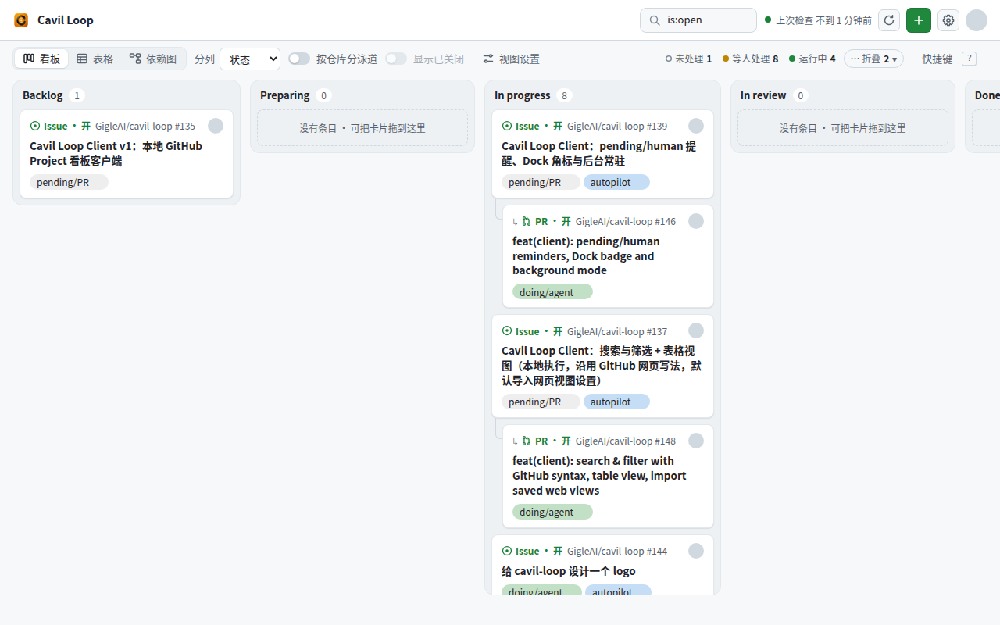
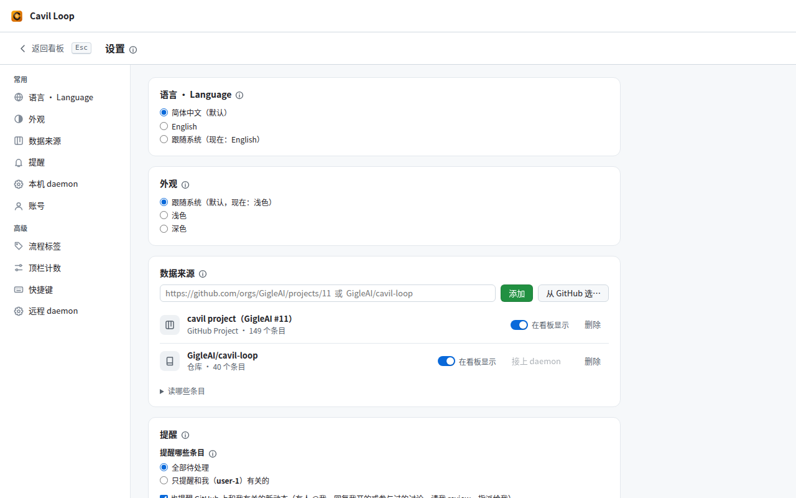
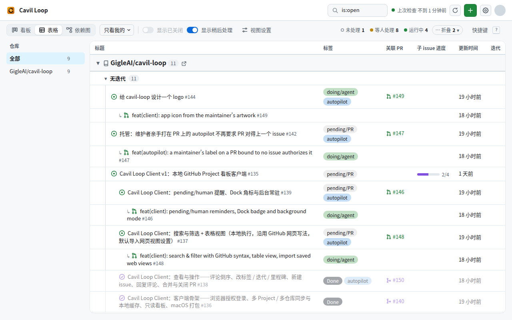
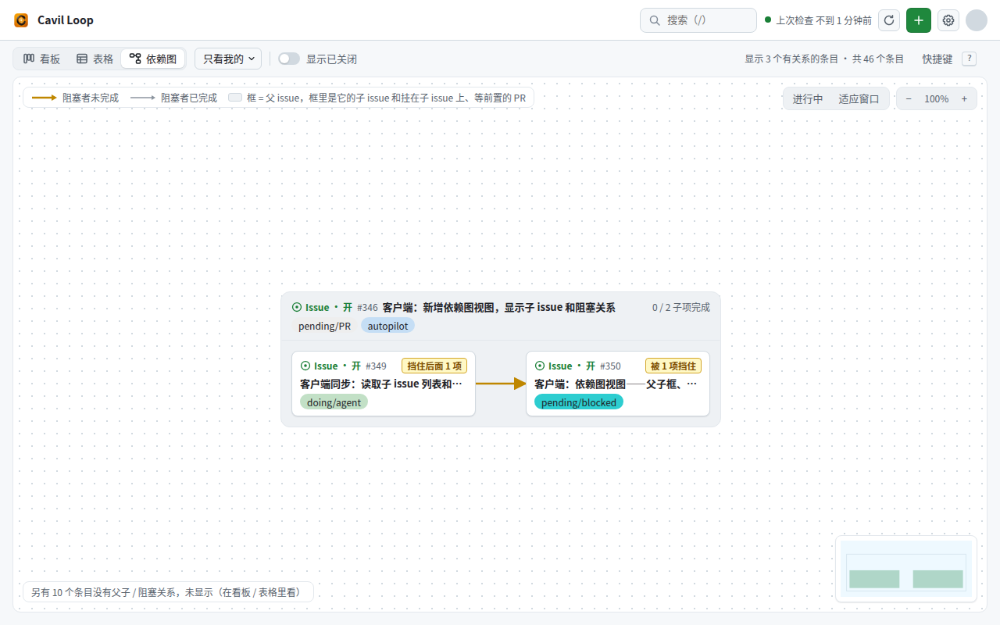
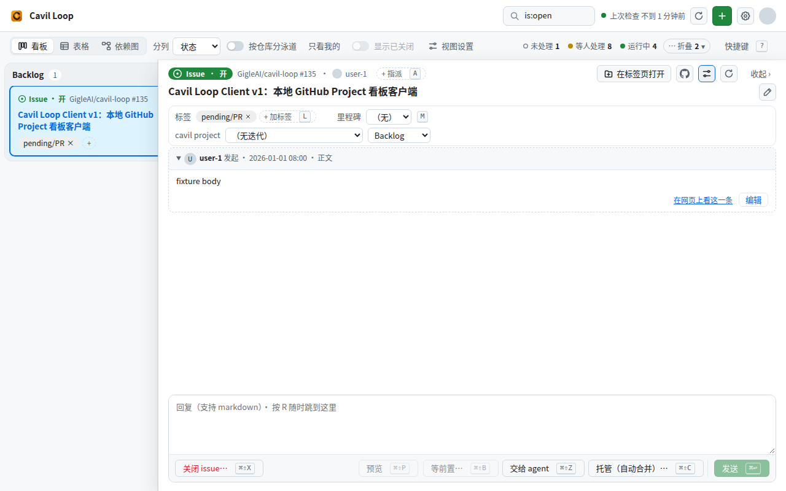

# Cavil Loop client guide

> **English** · [中文](client.zh.md)

The Cavil Loop client is a desktop app (macOS, Windows) for managing GitHub issues and pull requests. It puts several repositories and GitHub Project boards into one window: each issue sits together with its linked PRs, items are split into columns or groups by iteration / status / milestone, and the parent and blocking relations between issues are drawn as a dependency graph — across repositories too.

**It works on its own**: all it needs is a GitHub account. It does not need this repository's daemon, it does not need a GitHub Project, and it needs no command-line programs. When you want an AI to take on work, connect the repository to the daemon as described in [the last section](#optional-connect-the-daemon).

> This page covers what the app shows and does. The rules for changing its code, and how it is built, are in the developer notes [client/README.md](../client/README.md) (Chinese). **The interface is Chinese until you switch it**: Settings → "Language · 语言" turns it to English (see [Language](#language)). Button names below are given as the Chinese interface shows them, with their meaning in brackets; the English interface may word them a little differently.

## Contents

- [What you need](#what-you-need)
- [First run (the client on its own)](#first-run-the-client-on-its-own)
- [Sources](#sources)
- [Board](#board)
- [Table](#table)
- [Dependency graph](#dependency-graph)
- [Search, filters and view settings](#search-filters-and-view-settings)
- [Details, the floating panel and tabs](#details-the-floating-panel-and-tabs)
- [Making changes from the client](#making-changes-from-the-client)
- [Keyboard shortcuts](#keyboard-shortcuts)
- [Network, credentials and offline use](#network-credentials-and-offline-use)
- [Updates](#updates)
- [Language](#language)
- [Optional: connect the daemon](#optional-connect-the-daemon)
- [In progress](#in-progress)

## What you need

- A GitHub account that can see the repositories you want to manage.
- A Mac with macOS 14 or later, or a 64-bit (x64) Windows 10 / 11 PC. Stable releases come with an Apple-silicon and an Intel package (the current stable release has no Windows package yet); development builds are Apple silicon and Windows only (see [Updates](#updates)). On Windows the daemon itself cannot run (see [Optional: connect the daemon](#optional-connect-the-daemon)); everything else works the same.

## First run (the client on its own)

Download the client from this repository's [Releases](https://github.com/GigleAI/cavil-loop/releases) page, install it, sign in with GitHub and add one repository or Project as a source — that is all the client needs.

1. **Download**: the newest entry tagged `client/vX.Y.Z` that is **not** marked Pre-release; on a Mac the `.dmg` ending in `-arm64.dmg` (Apple silicon) or `-x64.dmg` (Intel), on Windows the file ending in `-windows-x64.exe` (when no stable entry has it yet, take it from the newest development build that does, marked Pre-release).
2. **Install**: on a Mac, open the dmg and drag the app into Applications, then allow the first launch; on Windows, run the `.exe`.
3. **Sign in**: open the app and click "用 GitHub 登录" (sign in with GitHub), then enter the short code it shows on the browser page that opens.
4. **Add a source**: the gear at the top right opens Settings → "数据来源" (sources); type `owner/repo` (or the repository's URL) or a GitHub Project's URL and click "添加" (add).
5. **Back to the board**: click "返回看板" (back to board). After a few seconds the repository's open issues and PRs are on the board.

Details: which file to download, allowing the first launch, sign-in, repositories without a Project

- **Which entry**: the newest entry tagged `client/vX.Y.Z` without the Pre-release mark is a stable client release. The entry marked Latest at the top of the page is the daemon's weekly release, not the client. **On Windows**, pick the newest entry whose files include `-windows-x64.exe`: when no stable entry has that file yet, take the newest development build that has it. To get the newest changes first, install a development build instead: the entries tagged `client/vX.Y.Z-dev.N` and marked Pre-release, with an Apple-silicon dmg and a Windows installer.
- **Apple silicon or Intel?** Apple menu → About This Mac: a "Chip" line reading Apple M… means Apple silicon, a "Processor" line reading Intel means Intel.
- **macOS blocks the first launch**: allow it in one of the two ways the dmg window describes: System Settings → Privacy & Security → "Open Anyway", or double-click "复制放行命令" (copy the allow command) in the dmg and run the copied command in Terminal.
- **Windows**: the installer is not code-signed, so Windows shows "Windows protected your PC" (Microsoft Defender SmartScreen) the first time: click "More info", check that the app is "Cavil Loop" from this repository's Releases page, then "Run anyway". It installs for the current user only (no administrator needed) and adds a Start menu entry; updates later install themselves without this prompt.
- **Sign-in**: this is the client's own sign-in; approve it on the browser page. The credential goes into the macOS keychain (on Windows: Windows Credential Manager).
- **Picking a source**: instead of typing, click "从 GitHub 选…" (pick from GitHub) to choose among the repositories and Projects you can see.
- **With repositories only, no Project**: iteration and status are stored in a Project, not in the repository, so with the default "columns by iteration" every card lands in one column. Switch to columns by milestone in "视图设置" (view settings), or use the table grouped by repository / milestone; once you create a Project, add it under sources too.

## Sources

A source is a GitHub Project or a repository; add as many as you like under Settings → "数据来源" (sources). While the app is open it syncs about once a minute, and the refresh button or ⌘R syncs now; a failed read keeps the previous copy, so items never "disappear".

Details: sources, merging, importing a saved web view, organization Projects

- **Two kinds**: a GitHub Project (`github.com/orgs/<org>/projects/<number>` or `github.com/users/<user>/projects/<number>`) and a repository (`owner/repo`). Settings → "数据来源" (sources) lists each one; switching its "在看板显示" (show on board) off hides its items from the board for the moment (the source keeps syncing; its row fades and says "看板上暂不显示" (hidden from the board)).
- **One item, one entry**: an issue that is in several sources is merged into one by `repo#number`. Iteration and status belong to each Project, so when two Projects disagree the item shows once in each column; the milestone belongs to the repository.
- **Importing a saved web view**: when you add a Project, the client reads one view saved on its GitHub page (the one in the URL if it ends in `/views/N`, else the first) and copies its layout, grouping, sort, columns and filter. This happens once; later changes on the web page are not followed. Whatever cannot be copied (grouping by a custom field, the roadmap layout, …) is listed at the top of the view.
- **An organization's Project cannot be read**: usually the organization restricts third-party apps and an owner has to approve. The developer notes explain it step by step in "[读不到组织的 Project 怎么办](../client/README.md#读不到组织的-project-怎么办401)" (when an organization's Project cannot be read).

Details: syncing, reading only what changed, GitHub's rate limit

- **Syncing**: the top bar shows when the client last checked. A source is either read in full and replaces the local copy, or the previous round's copy stays.
- **Reading only what changed**: each round first checks for changes: the board and repository checks are conditional REST requests — when nothing changed GitHub answers "not modified" (304), which does not count against the REST quota, a changed answer (200) costs 1 call; with a board, each round also counts the boards' items with one GraphQL query (about 1 point); once a check sees a change, only the changed items are read again — a large board is not read in full every minute. Full reads still happen regularly to catch what the checks cannot see: about every 10 minutes for a repository, about every 60 minutes for a board read by changes; a round with more than 100 changed items, an item taken off a board, or several failed reads of changes in a row reads in full right away. Hovering "last check" shows when each source was last read by changes and in full.
- **GitHub's rate limit**: the sync sends its requests one at a time (GitHub asks for that, to avoid its short-time limit) and keeps no quota of its own: GitHub's quota is shared by the whole account (per hour 5000 GraphQL points and 5000 REST calls), and the client reads as long as GitHub answers. Only when GitHub refuses with its rate limit does a yellow "GitHub rate limit (resumes HH:MM)" appear next to the refresh button; the board keeps what it showed, nothing more is sent until then, and reading resumes by itself. Its details say whether the hourly quota is used up or too many requests came in a short time, with GitHub's own words. While the quota is used up, other programs on the same account (command line, daemon) are refused too.

Details: the window's top row, light / dark, how Settings is laid out

- **The window's top row**: one row at the top of the window — logo, open tabs, search box, sync status, refresh, new (➕), settings, account; all of it stays while a detail tab is in front. The search box is small until used (it still shows the current search); click it or press `/` to widen it. On macOS this row is the window's title bar: the traffic lights sit at its left, drag an empty part to move the window, double-click it to zoom.
- **Light / dark**: Settings → "外观" (appearance) offers three choices: "跟随系统" (follow the system, the default — the window switches when the system does), "浅色" (light) and "深色" (dark). The choice takes effect at once for the board, table, graph, details and discussions and label colours, and on macOS for the title bar and menus too; it is kept on this computer and survives a restart.
- **How Settings is laid out**: the contents on the left come in two parts, "常用" (common) and "高级" (advanced). The common cards (language, appearance, sources, reminders, updates, local daemon, account) are shown at once; "流程标签" (flow labels), "顶栏计数" (view-bar counts), "快捷键" (shortcuts) and "远程 daemon" (remote daemon) sit in the "高级设置" (advanced settings) block at the bottom of the page, folded each time Settings opens — clicking one of them in the contents, or "在设置里改快捷键" in the shortcut list, opens the block first (on Windows the remote daemon counts as common). The less used options of a common card are under the card's own "高级": the reminder card's "切到 App 时收起全部系统通知", the local daemon's dependency checks (opened by itself while something is missing), the account card's sign-in method and Client ID (opened by itself while the Client ID is missing or does not fit). Each setting's explanation sits behind an ⓘ next to its name: it shows while the pointer is on it, while it has keyboard focus, or after a click; Esc or a second click hides it. Warnings, errors and "what pressing this does" stay in sight, and each card's longer explanation is still in the "▸" fold at its bottom.

## Board

The board puts items into columns by iteration (the default), status or milestone, with each PR under its linked issue. Dragging a card to another column changes that value.

Details: columns, swimlanes, PRs under issues, what a card shows

- **Columns**: by iteration, ended iterations are folded into the leftmost column (click to open it); items without an iteration go to "无迭代" (no iteration). Dragging a card to "no iteration" clears it.
- **Swimlanes per repository** ("按仓库分泳道"): one row per repository, each scrolling sideways and folding on its own; the button next to a repository's name opens it in the browser.
- **PRs under their linked issue** (a switch in view settings, on by default): "linked" means GitHub's linked pull requests in the issue sidebar, plus any issue a PR body names with `Closes` / `Fixes` / `Resolves` / `Refs #N`. The PR is indented with "↳" and sits in the issue's column.
- **On a card**: repository and number, title, labels, iteration, author and assignee avatars, and which board a Project value comes from.

## Table

The table lists items in groups (iteration, status, milestone, repository or none), with PRs under their issue and sub-issues indented under their parent. Labels, iteration, status and milestone can be changed right in a cell.

Details: groups, columns, editing, folding, new issues, empty repositories

- **Groups**: with "左侧按仓库切片" (repository list on the left) on, the left side lists repositories; with "全部" (all) picked, the table is split by repository first, then by the chosen grouping.
- **Columns**: title, labels, linked PR, sub-issue progress, updated, iteration, status, milestone, author, assignees … pick them in view settings; drag a header's right edge to resize.
- **Sub-issues**: the parent's row shows "N / M" done.
- **Editing in a cell**: click a labels, iteration, status or milestone cell to change it; when grouped by iteration / status / milestone, a whole row can be dragged to another group.
- **Folding**: every group folds; neighbouring folded groups merge into one row "已收起 N 组 · 共 M 条" (N groups folded · M items). What is folded is remembered on this machine.
- **New issue**: every group ends with "＋ 新建 issue" (new issue), which creates the issue with that group's iteration / status / milestone already set.
- **Repositories with nothing to show stay**: a repository in "数据来源" (sources) with "在看板显示" (show on board) on keeps its place in the table even when none of its issues / PRs is shown (a new empty repository, or everything filtered out by the search or by "显示已关闭"): 0 in the repository list, a section of its own under "全部", a group of its own when grouped by repository, and the same when it alone is picked (whatever the grouping) — each saying "no issues or PRs to show" with "＋ 新建 issue" (the dialog opens with that repository picked). A repository never read shows "—", says so and offers no "+". A repository known only from a GitHub Project is unknown to the client while it has no items, and is not shown.

## Dependency graph

The third view button draws the parent / sub-issue and blocking relations between issues, across repositories too: parents as boxes, blocking relations as arrows. Only items with a relation are drawn; the number left out is shown at the bottom left.

Details: what is drawn, boxes, arrows, where relations come from, moving around

- **What is drawn**: issues with a relation (those with a parent, with sub-issues, blocking or blocked) and pull requests tied to a prerequisite registration: a PR waiting with a registration of its own, and a PR some registration names as a prerequisite (the latter whether or not it has a registration or the label of its own, open or closed; see "Where relations come from" below).
- **Boxes**: a parent issue is a box with its sub-issues inside in GitHub's order, its header saying "N / M 子项完成" (N of M sub-issues done, counting sub-issues only); a pull request with a prerequisite registration also sits in the box its linked sub-issue sits in, without being a sub-issue; a sub-issue with sub-issues of its own is a box inside the box.
- **Arrows** point from the blocking item to the blocked one: thick amber while the blocker is open, thin grey once it is closed. Nodes say "被 N 项挡住" (blocked by N) or "挡住后面 N 项" (blocking N).
- **A PR to the issue it is linked to**: when a pull request and an issue it is linked to (the issue's "Linked pull requests" in its sidebar, or the PR's description naming it with Closes / Fixes / Resolves / Refs) are both drawn, a dashed line with an arrowhead runs from the PR to the issue: teal while both are open, thin grey once either is closed or merged. It is not a blocking relation and "被 N 项挡住" does not count it; but when an upstream item holds the PR through a chain of items that are all still open, its "挡住后面 N 项" counts across it, the issue and what the issue holds included. An issue nothing holds itself whose PR is held says "它的 PR 被挡住" (its PR is blocked), and its summary lists "它的 PR #N 被挡住（未完成）" under "被挡住".
- **Where relations come from**: the parent / sub-issue relations and "Blocked by" registered in GitHub's sidebar; in addition, for an open issue carrying the "waiting for prerequisites" label (default `pending/blocked`), the prerequisite registration for the daemon in its comments (only one written by the repository's owner, an organization member or a collaborator), drawn next to "Blocked by". The same goes for a pull request: an open PR carrying that label has the registration in its own comments read, and is drawn as a node with its prerequisites pointing at it, in the box its linked issue sits in (at the top level when that issue is not drawn or sits at the top level).
- **Across repositories**: when the other end of a relation is in another repository that is not among your sources, it is still drawn, dashed and marked "不在当前来源中" (not in the current sources), and can be opened on GitHub; an end hidden by the search is drawn faded.
- **Moving around**: drag to pan, scroll to zoom; "适应窗口" (fit, `F`) fits the whole graph, "进行中" (in progress) jumps to the first group that still has an open issue; the minimap at the bottom right can be clicked and dragged. Click a node for a summary, double-click to open its details.

## Search, filters and view settings

The search box uses GitHub's web syntax and filters the synced data locally as you type; the "显示已关闭" (show closed) switch decides whether closed and merged items are listed (off by default). The flow numbers in the top bar filter on one flow label with a click (the ones rarely needed sit behind the "⋯ 折叠 N" button at its end), and view settings choose columns, grouping and sort.

Details: search syntax

- Plain text matches title, number (`135` / `#135`) and label names, including the middle of a Chinese word.
- `label:` `status:` `milestone:` `assignee:` `author:` `repo:` `project:` `iteration:` `is:` `no:` `has:` (e.g. `is:open`, `is:pr`, `no:milestone`), a leading `-` excludes, `@me` is you, `@current` / `@next` / `@previous` are iterations.
- Anything not supported (iteration comparisons and ranges, for example) is listed in a yellow bar above the board and ignored — it never turns into "0 results".

Details: the "显示已关闭" (show closed) switch

- A new install starts with an empty search box. The switch left of "视图设置" (view settings) on the view bar lists only open issues / PRs while it is off; on, closed and merged ones are listed too. Each view keeps its own: the board, the table and the dependency graph one each (off by default); while a top-bar number is lit, that number's own (the switch says whose, e.g. "显示已关闭（等人处理）"), which starts the way the number counts — on for "等人处理" (waiting for a human), off for the others — and can be switched by itself afterwards. All of them are remembered across restarts.
- When the search box itself says `is:open` / `is:closed` / `is:merged`, the search box decides and the switch is greyed out.
- In the dependency graph with the switch off, closed parents, blockers and sub-issues that open items need are still drawn, faded; closed items unrelated to any open one are left out.
- The switch only covers items already read: a repository source reads every open item, those updated in the last 14 days and the closed ones carrying the "waiting for a human" label; a Project source reads every item on the board.
- Items are hidden by open / closed, not by the Project's Done column or the `Done` label: an item that is open but sits in the Done column shows up; to hide it, write `-status:done` in the search box. When a Project's saved web view is imported, words that only hide finished items (`-status:done`, `-label:done`, `is:open`) are left out of the search box, and a saved search made only of those words is emptied.

Details: flow numbers in the top bar, a PR's issue shown with it, view settings

- **Flow numbers**: by default, left to right, "未处理 / 等人处理 / 等 agent / 运行中 / 稍后处理" (untouched / waiting for a human / waiting for the agent / running / later). "未处理" counts open items with no label at all; the others count the items of the checked sources that carry their label ("稍后处理" counts the label set in the "暂缓" (parked) field of Settings, default `pending/later`): "等人处理" counts open and closed ones (an autopilot PR's merge closes the issue and leaves `pending/human` on it for a human to look at), the others open ones only. Click a number to filter on that label (`label:"…"`); the list follows that number's own "显示已关闭" switch, so by default it is exactly the items counted. Click it again to get your previous search back. Some numbers are kept behind the "⋯ 折叠 N" (folded) button at the end of the bar: by default "稍后处理" always is, "运行中" never is, and the others are while they count 0; a number with a condition of your own that picks just the parked label always is too, as long as every repository of the ticked sources uses that name for its parked label (with a Project ticked: as long as no repository renamed its parked label — otherwise it folds at 0, and you can set that row to "总是折叠" (always) in Settings); open the button to see and click them as usual, and it lights up while the number you are filtering on is folded. Which numbers are shown, what each counts and whether it folds (each row's "折叠" (fold): 不折叠 never / 为 0 时折叠 at 0 / 总是折叠 always) is set in Settings → "顶栏计数" (top-bar numbers); the preview strip above the table shows the result over the current data as you edit, folded numbers after a "折叠区" (folded) mark.
- **A PR's issue comes along when only the PR matches**: while the search box holds a condition (a lit top-bar number included) and "PRs under their issue" is on, a PR that matches whose linked issue does not brings that issue along on the board and in the table, the PR indented under it as usual. The issue is faded: a dashed card with the line "随 PR 显示 · 不在筛选结果里" (shown with its PR · not a search match) on the board, a "随 PR 显示" tag at the end of its table row; it does not drag, and opens as usual. Only issues already read come along, one per PR (the first in the current sort that may take the PR; none when the PR already sits under a matching issue), only from the picked repository when one is picked, and a carried issue brings none of its own sub-issues. In the table with sub-issues indented, an issue that already comes along as a sub-issue of a matching issue stays there (one row per group) and the PR goes under it. The top-bar numbers and "搜索命中 N 条" (N search matches) count matches only; column, group and repository-section counts count what is shown, faded items included; the numbers' tooltip adds "另有 N 个 issue 随命中的 PR 显示" (N more issues shown with matching PRs).
- **View settings**: column / grouping mode, sort (including "Project 里的顺序", the Project's own order), which columns to show, PRs under issues, sub-issues indented. The search text and view settings are remembered across restarts.

## Details, the floating panel and tabs

A click on a card or a table row opens its details in a panel floating on the right of the board; ⌘-click opens the item as a tab instead, details filling the window. Click outside, press Esc or click "收起 ›" (hide) to close the panel; ⌘W closes a tab.

Details: panel width, what the details show, tabs, unsent text

- **The floating panel** is by default as wide as leaves the list behind about 15 characters of title, following the window (drag the left edge to change the width, which is then remembered; double-click the edge to go back to the default). It shows body, discussion, labels, assignees, iteration, status, milestone; a PR also has its checks and the merge button.
- **In the dependency graph** a click on a node only shows its summary; a double-click, or "打开详情" (open details) in the summary, opens the panel; a node outside the current sources has only the summary and "open on GitHub", no details.
- **Tabs**: ⌘-click, right-click → "在新标签页打开" (open in new tab), or "在标签页打开" (open in tab) at the top right of the panel. The tabs sit in the window's top row (right of the logo), "首页" (home) being the board / table / graph, and scroll sideways when there are more than fit; ⌘1 … ⌘9 switch tabs. Open tabs come back after a restart.
- **Unsent text** in a reply box stays with its tab / panel when you switch away and back; closing a tab that holds unsent text asks first.

## Making changes from the client

Changes go straight to GitHub, and the item is read back afterwards: labels, milestone, iteration and status, replies and edits, new issues, closing and merging. Anything that did not go through is said in the notice at the top of the window; offline, every change is greyed out and nothing is queued.

Details: labels and milestone, replies, new issues, closing and merging

- Labels (`L`), milestone (`M`), a Project's iteration and status: the new value shows at once and is marked until GitHub confirms it; you can resend or drop it.
- When the label picker opens, the labels the item already carries are ticked at the top, followed by `autopilot`, `pending/human`, `pending/later`, `pending/agent` (the label names set under "流程标签" (flow labels) in Settings, the parked label included; ones the repository lacks are not listed), then the rest in the repository's order. While it is open a click only moves the tick, never the rows; closing and reopening sorts again. The milestone picker lists the current milestone first.
- Reply (⌘↩ sends, ⌘⇧P previews), edit your comments and the body, tick the task lists in a body.
- New issue (`C`): pick the repository, optionally set labels, milestone, iteration and which boards it joins.
  - When the chosen repository lacks the labels "交给 agent" (hand to agent) and "托管" (autopilot) need, the missing ones are listed under the buttons. If the account has write access, "在这个仓库建好这 N 个标签" creates them with cavil-loop's install-time colours and descriptions (existing labels are not changed), and the two buttons work right away. Without access (or if GitHub refuses), each label's name, colour and description are listed, with "open the repository's labels page" and "copy the label list" to hand to someone who can, then "read again" once they exist. Progress and result appear in the notices at the top of the window, naming the repository; switching to another repository meanwhile shows only that repository's own state. The "等前置" (wait for prerequisites) dialog does the same when the waiting or waiting-for-human label is missing. Creating the labels does not connect the repository to the daemon: without it, no agent picks up an item carrying the dispatch label.
- Close an issue (pick the reason, optionally add a comment), close or merge a PR: each needs one more click in a confirmation dialog. When it succeeds the tab / panel it was started from closes, and the result is shown at the top of the window.
- "交给 agent" (hand to the agent) and "托管" (autopilot) next to the send button close the tab / panel they were started from as soon as the client accepts them, without waiting for GitHub; the progress and the result — including a later refusal, with "Retry" — are shown at the top of the window. Something refused before anything was sent (for example the same words still on their way from the reply box) keeps the details and the reply text as they were. Words typed into the reply box right after pressing are a new draft: the details then stay open with a line saying why.

Details: when a change did not go through

Anything that did not go through (close, merge, autopilot, hand to the agent, waiting on a prerequisite, a reply, an edited body / title, a ticked task, a new issue) is said in the notice at the top of the window, with at most two buttons plus ×:

- **GitHub surely refused it**: "Retry" does it again right away with the same choices (no confirmation dialog; it is still checked before sending), and the other button is "Handle it on GitHub" (an attached comment is copied to the clipboard first) or "Put it back in the editor"; × puts an attached comment that did not go out back into the item's reply box. A refused new issue: "Retry" creates it again from the same draft, or "Reopen draft".
- **Sent, but GitHub's answer never came**: "Check again" only reads GitHub and never sends a second time (only the one label step that can safely be sent again offers "Resend…", after saying what the late request may still cause); a new issue that may or may not exist is only looked for among recent issues with the same title, never created again. The other button, "Check on GitHub", has two steps: the first press opens the item's page and copies the text, then the same place becomes "Checked on GitHub, release the lock", and only that press unlocks. Until then there is no ×, and the text stays in the notice (also over a restart); if the original request lands later, the client finds it and unlocks by itself.

## Keyboard shortcuts

Keys follow GitHub's web pages where they can. Press `?` for the full list (also in the "快捷键" (shortcuts) section of the developer notes); Settings → "快捷键" (shortcuts) changes them. The common ones:

| Keys | Does |
|---|---|
| `/` | jump to the search box |
| `C` | new issue |
| ⌘R | sync now (in a detail tab: re-read that item) |
| ⌘, | open settings |
| ⌃⌘1 / ⌃⌘2 / ⌃⌘3 (Control and Command together; ⌥⌘1/2/3 and ⌘⇧1/2 work too) | board / table / dependency graph |
| ⌘1 … ⌘9 | go to that tab (⌘1 is home) |
| ⌘W | close the current tab |
| ⌘F | find text on the page (the detail's discussion included; the search box is not touched); ↩ / ⇧↩ or ⌘G / ⌘⇧G next / previous, Esc closes |
| `L` / `M` / `R` in details | labels / milestone / jump to the reply box |
| ⌘↩ | send a reply, confirm a dialog |
| ⌘= / ⌘- / ⌘0 | zoom in / out / actual size |

Details: changing keys

Settings → "快捷键" (shortcuts), click "改" (change) on a row and press the new key; Esc cancels. One action gets one key, and its old keys stop working (for example "new issue" has `C` and ⌘N by default; after a change neither creates an issue any more). Changed rows are marked "已改" (changed); "恢复默认" (restore default) puts the old keys back, and "全部恢复默认" (restore all) at the top of the section does it for every row. The shortcut list (`?`) marks changed keys the same way, and its "在设置里改快捷键 →" (change shortcuts in Settings) link goes straight to the section. Changes stay on this computer.

- **A clash is not saved**: when the new key is the key of another action that works at the same time, nothing is saved and the clash is named. Restoring one action whose default key another action now has is refused the same way: change or restore that other action first.
- **Fixed keys**: Esc, ↩, the arrows, ⌘1 … ⌘9, ⌘W and the zoom keys. Keys the system or text editing uses are not taken either (⌘Q / ⌘H / ⌘M, ⌘C / ⌘V / ⌘X / ⌘A / ⌘Z, and ⌘⇧3 / ⌘⇧4 / ⌘⇧5 on macOS). "Preview" in the reply box and the two buttons of the new-issue window need a key with ⌘.
- **A single key without ⌘** works only while the cursor is not in a text field; a detail action changed to such a key does nothing in the reply box or the discussion.
- A saved key that cannot be used when the app starts (say a newer version gives another action the same default key) is set back to its default, and the settings page names it and says why.

## Network, credentials and offline use

By default the client talks to GitHub only, and the sign-in credential stays in the system's credential store, used only by the app's back end. Tailscale machines are contacted only when you use "远程 daemon" (remote daemon): opening its add window asks every online device whether its remote entry is open, pairing talks to the one machine picked, and afterwards only paired machines are contacted — none of these requests carries a GitHub credential.

Details: GitHub addresses, Tailscale connections, links, credentials, offline

- **GitHub addresses**: syncing and changes go to `api.github.com` / `github.com`. A few other addresses are GitHub's own too: avatars (`avatars.githubusercontent.com`), images in discussions (GitHub's attachment addresses and image proxy), repository files (`raw.githubusercontent.com`), Release attachments quoted in a discussion, and — when the app updates itself — `release-assets.githubusercontent.com` / `objects.githubusercontent.com`, where GitHub redirects the package download.
- **Tailscale machines** (see [Optional: connect the daemon](#optional-connect-the-daemon)): ① opening the "添加远程 daemon" (add remote daemon) window under Settings → "远程 daemon" reads this computer's Tailscale device list once and sends every online device one HTTPS request without content, asking whether its remote entry is open — before any machine is picked or any pairing code entered; ② submitting a pairing code sends the pairing request to the one machine picked; ③ after pairing, reading its state, stopping / starting projects, reading its log and reading / saving a project's settings go to paired machines only. These connections accept only a full `*.ts.net` machine name, its addresses must all be Tailscale addresses, it must present a valid HTTPS certificate for that name, and none of them carries a GitHub credential. With the add window never opened and no paired machine, no such request is sent.
- **Links in a discussion go to the system browser**: clicking an `http` / `https` link in the detail view (on GitHub or not) opens it in the system browser, as github.com does, with no confirmation; so do ⌘ / Ctrl + click and a middle click, and links in the reply box's "Preview". The client itself does not visit the address and no credential goes with it. A link to a place on the page (a footnote) scrolls there in the discussion instead of opening the browser; other kinds of address (`javascript:`, `file:`, `mailto:` …) are not opened.
- **Credentials**: the sign-in credential is kept in the macOS keychain (on Windows: Windows Credential Manager, under the name `dev.luosky.cavil-loop.client/github-oauth`; keys of paired remote machines next to it) and used only by the app's back end; the pages in the window cannot read it. Signing out removes the credential and the local cache.
- **Offline**: the last synced data stays readable, the top bar says how old it is, and changes are greyed out.

## Updates

The app checks for, downloads and installs updates itself; Settings lists what changed in each version. "更新渠道" (update channel) in Settings is stable (the default) or development.

Details: the two channels, switching back to stable

- **正式版** (stable, the default): only the stable releases tagged `client/vX.Y.Z`, which pass the full tests. A new one comes out with the weekly release whenever the client changed that week. The one for everyday use.
- **开发版** (development): stable releases too, and on top at most one new build a night (tag `client/vX.Y.Z-dev.N`, around 06:00 Beijing time; none on a night the client did not change) — new features first, but only the quick tests and the packaging checks have run, it may be unstable, and development builds carry Apple-silicon and Windows packages only (an Intel Mac stays on stable).
- **Which platforms a release covers** is a separate question from the channel: an update reaches a computer only if that release carries a package for its platform (the files on the Releases page). The current stable release has Apple-silicon and Intel packages and no Windows package, so a Windows client on the stable channel is offered nothing until a stable release with a Windows package comes out; use the development channel meanwhile.
- Switching from development back to stable never downgrades; it waits for the next stable version above the current one. A development version sorts before the stable one with the same number (`0.5.3-dev.N` is below `0.5.3` and above `0.5.2`), so someone on a 0.5.3 development build who switches back to stable gets the next update at 0.5.3 or later.

## Language

Settings → "语言 · Language", the first section, switches the interface between Simplified Chinese (the default), English and following the system. The switch takes effect at once, with no restart, and is remembered on this computer.

Details: the three choices, what is not translated

| Choice | Shows |
|---|---|
| **简体中文** (Simplified Chinese) — the default | the Chinese interface; a setting this version does not recognise also reads as Chinese |
| **English** | the English interface |
| **跟随系统** (follow the system) | Chinese when the system's preferred language is any Chinese (`zh-…`), English for every other language; the choice shows which one it is now |

- The switch covers the window, the macOS menu and the notifications that follow.
- **Not translated**: what comes from outside the client is shown as written — on GitHub, titles, descriptions, comments, label / milestone / iteration / Project names, account and repository names, GitHub's own error messages and the release notes; the output of the daemon's scripts, of a remote daemon and its log; the error text of git, the system and other programs; and what you typed or named yourself (a search, a draft, a label name set in Settings). Only the words around them change language.
- The section's own name and the choice "简体中文" stay in Chinese in the English interface (and "Language" / "English" in the Chinese one), so someone who cannot read the current language can still find the way back.

## Optional: connect the daemon

The other thing in this repository is the daemon: label an issue `pending/agent` and an AI on your machine (Claude Code, Codex, …) picks it up, does the work and reports back on the issue / PR. The client can install the daemon for you and connect a repository to it; after that you can hand items to the AI from the client. **Without the daemon, everything above works the same.**

1. **Install the programs the daemon needs first** (the client only checks what is missing, it does not install them): `git`, `gh`, `tmux`, `jq`, `flock`, `bash` 4 or later (macOS ships 3.2), and the agent program you will use (such as `claude`). With Homebrew: `brew install gh tmux jq flock bash`. Then run `gh auth login` once in Terminal — the daemon uses `gh`'s sign-in, not the client's.
2. **Install the daemon**: Settings → "本机 daemon" (local daemon) → "安装" (install). It clones this repository from github.com into `~/.agents/skills/cavil-loop`; the checklist below it says which programs are still missing — install them and click "重新检查" (check again). Later, "更新 daemon" (update daemon) updates it.
3. **Connect the repository**: back in sources, click "接上 daemon" (connect) on the repository's row: pick an existing local copy of the repository or let it clone one, pick the agent; once the pre-check passes, click "开始" (start). It runs the daemon's own setup script (project config, the `pending/agent` and other labels in the repository, the background poller), showing the output as it runs.
4. **Hand over the first item**: create an issue and click "交给 agent" (hand to the agent) in its details (or add the `pending/agent` label). The daemon picks it up within about a minute and the label becomes `doing/agent`; when it is done the label becomes `pending/human` and the client sends a system notification.

Once the daemon is connected, the details get buttons to hand an item to the agent, put it on autopilot or wait for prerequisites; the client notifies you of items waiting for a human, and a project's everyday settings can be changed from Settings. How the daemon itself works: the repository's [README](../README.md).

Details: hand to the agent / autopilot / wait for prerequisites, notifications, flow labels

- **Hand to the agent / autopilot / wait for prerequisites**: three buttons in the details (⌘⇧Z / ⌘⇧C / ⌘⇧B). "交给 agent" adds the dispatch label; "托管" (autopilot) also adds the autopilot label, and the agent takes the item from proposal through development, review and merge; "等前置" (wait for prerequisites) records which issues / PRs this one waits for. If the reply box holds text, it is posted as a comment first, then the labels change.
- **Notifications**: an open item newly labeled with the "waiting for a human" label (default `pending/human`) triggers a system notification, and the Dock badge counts the ones not yet seen (on Windows: a number over the app's taskbar icon). Closing the window keeps the app running and reminding: on a Mac in the Dock, on Windows as an icon in the notification area at the bottom right of the taskbar — click it to bring the window back, right-click → "退出" (quit) to quit. "开机自动启动" (launch at login) starts it there without a window. Opening an item in the window (clicking its card or its notification) removes the notifications about that item; other items' notifications stay. The item the floating panel shows is scrolled into view on the board / in the table and outlined in blue. In Settings → "提醒" (notifications) you can switch to "只提醒和我有关的" (only those that concern me: assigned to you, review requested from you, or — with nobody assigned — ones you are subscribed to on GitHub), useful when several people share a repository.
- **Flow labels**: Settings → the "流程标签" (flow labels) section sets which label means running / hand to the agent / waiting for a human / parked / autopilot / waiting for prerequisites (keep them the same as the daemon's config); buttons, top-bar numbers, notifications, tab icons and the order of the label picker follow. The parked label (default `pending/later`) moves it up in the label picker, right after the waiting-for-a-human label, and is what the top bar's "稍后处理" (later) number counts; empty = neither.

Details: project settings

Settings → "本机 daemon" → the project's "配置…" (configure) opens a form for the everyday settings: which agent, which model, how many workers at once, and so on. It opens with the common settings only; each group's less used ones are under "高级" at the group's end, and whole groups such as dispatch picking, flow labels, previews and polling are in the "高级设置" block at the bottom of the window. A fold holding a changed or wrongly typed value does not close. Each setting's explanation is behind the ⓘ next to its name; why a setting is not changed here, and "配置文件里没写这一项" (not in the config file), stay in sight. Where each setting goes is the daemon's registry's call; a daemon that does not send that information shows everything at once.

Details: renaming a flow label

In that form, a flow label (such as `pending/human` or `Done`) has "改名…" (rename). Type the new name; the daemon's own checks run as you type and each shows ✓ / ✗ / ?. The dialog lists every other daemon the client knows of that polls the same repository (other projects on this computer, paired remote machines) with "停掉它的轮询" (stop its polling); one that cannot be read counts as not stopped. Tick that nothing else polls the repository, then "改名（三处一起改）" (rename all three places): the label is renamed on GitHub (items carrying it keep it), then the project's config line, then the client's own name for that repository only — other repositories keep the shared names, and Settings → "流程标签" lists such names under "按仓库单独的标签名" (per-repository names) with "改回共用" (back to shared).

- **Counting under per-repository names**: the view bar counts each item under its own repository's name. A click puts all the names in the search box (`label:"A","B"`), and while that clicked number is lit the list keeps only items carrying their own repository's name (the same text typed or pasted by hand is an ordinary search: every item with either name, no number lit), so an ordinary label that happens to carry another repository's name is not listed; the names in that search come from the label settings, not from the items loaded, so a sync, a source ticked off or a repository's last item leaving changes neither it nor the list's match with the number, and a second click still gives back the search from before (changing the names in Settings changes the search, just as changing the shared label does).
- **Until all three are done** the daemon pauses that project, the item buttons that write flow labels in that repository are greyed, and the notice at the top of the window says where each place stands, with only the next safe step: "重试" (retry), "再查一次（只读）" (check again, read only) and "重发改名" (send again) when GitHub did not answer — never undo then, since the request may still land — "退回" (undo) only while GitHub is surely unchanged. A rename left unfinished (the app was closed half way) shows up again at the next start.
- **Other machines**: the done notice offers a one-line rename credential to copy; on each machine that was stopped, open that project's settings, choose "跟进另一台的改名…" (follow a rename done elsewhere), paste it, and start its polling again afterwards. Remote projects are renamed from the client on that machine.

Details: remote daemon, Windows

- **Remote daemon**: when the daemon runs on another computer, pair with it over Tailscale and see its state, stop / start it, read its log and change a project's everyday settings ("配置…", the same form as on this computer, saved on that machine) under Settings → "远程 daemon" (remote daemon). If that computer has the client too, turn on "允许其他电脑远程连接" (allow other computers to connect) under its "本机 daemon" to get a pairing code. The network boundary is described in [Network, credentials and offline use](#network-credentials-and-offline-use).
- **On Windows** the daemon cannot run on the same computer (it needs bash, tmux and a scheduler from macOS or Linux): Settings → "本机 daemon" (local daemon) only says so, and the repositories in sources have no "接上 daemon" (connect the daemon). Run the daemon on a Mac or Linux machine and connect the Windows client to it under "远程 daemon" (remote daemon) through Tailscale; Tailscale for Windows must be installed and signed in on the Windows PC.

## In progress

Client issues still open; the issue pages have the current state:

- A nightly development build for Windows and Mac, updated through the development channel: [#628](https://github.com/GigleAI/cavil-loop/issues/628)
