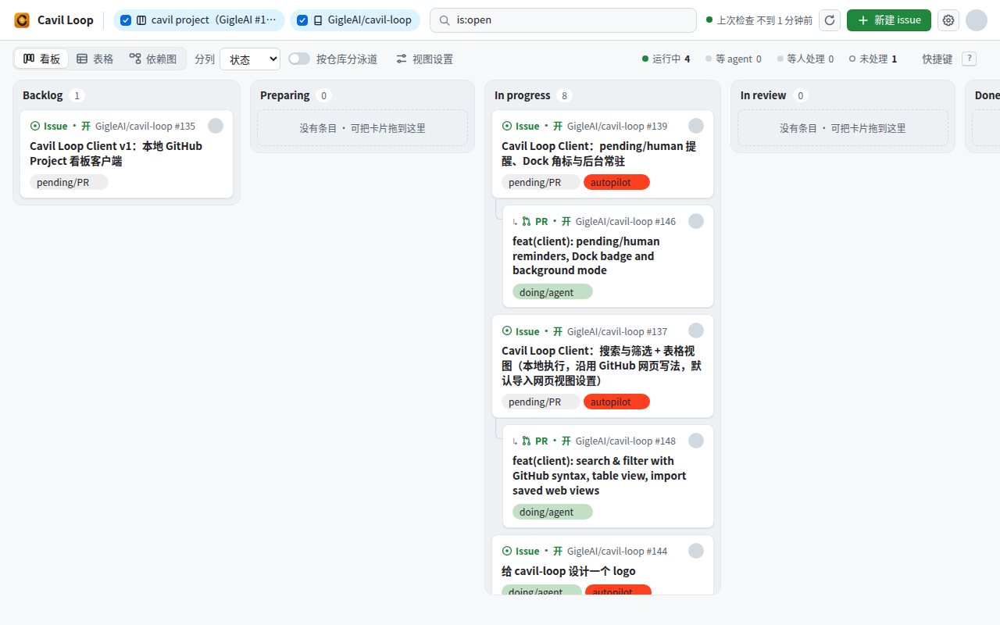
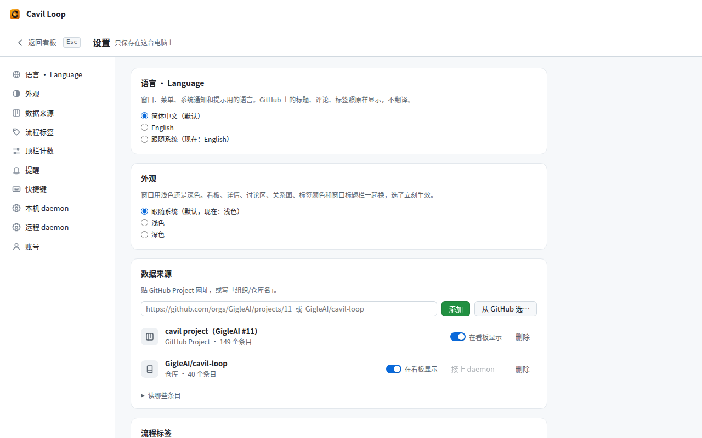
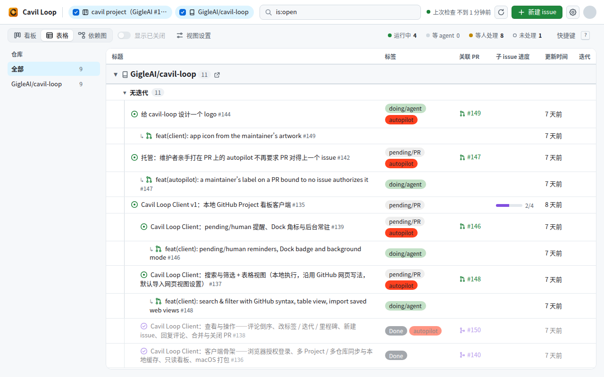
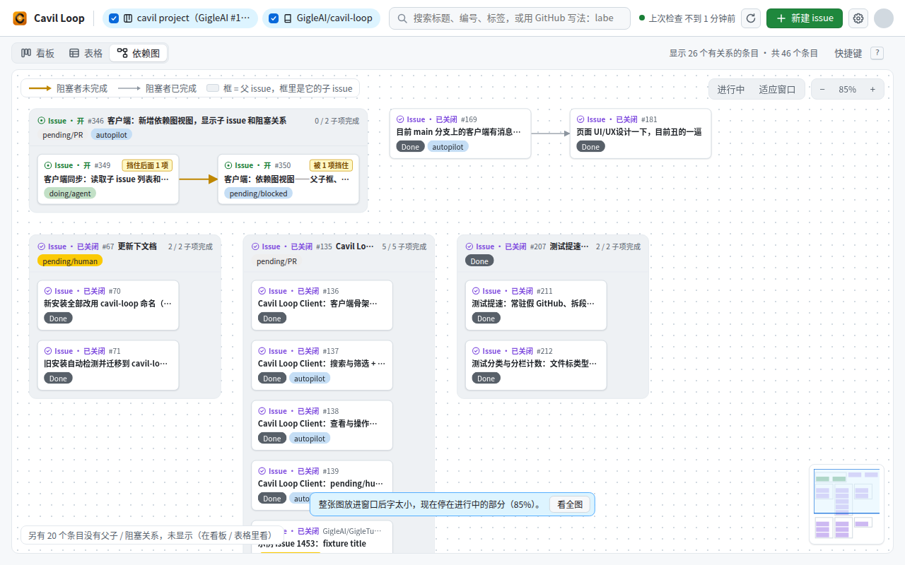
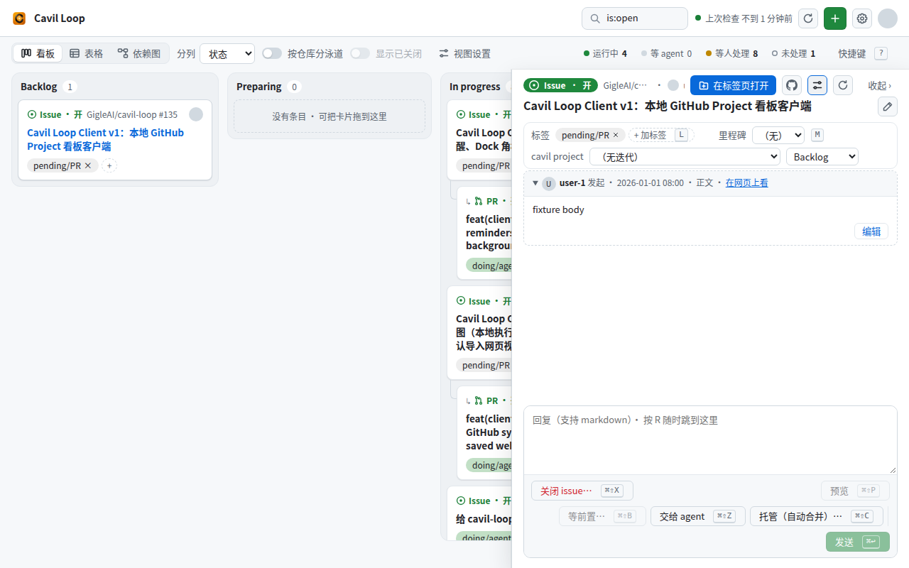

# Cavil Loop client guide

> **English** · [中文](client.zh.md)

The Cavil Loop client is a desktop app (macOS) for managing GitHub issues and pull requests. It puts several repositories and GitHub Project boards into one window: each issue sits together with its linked PRs, items are split into columns or groups by iteration / status / milestone, and the parent and blocking relations between issues are drawn as a dependency graph — across repositories too.

**It works on its own**: all it needs is a GitHub account. It does not need this repository's daemon, it does not need a GitHub Project, and it needs no command-line programs. When you want an AI to take on work, connect the repository to the daemon as described in [the last section](#optional-connect-the-daemon).

> This page covers what the app shows and does. The rules for changing its code, and how it is built, are in the developer notes [client/README.md](../client/README.md) (Chinese). **The interface is Chinese only for now** (switching between Chinese and English is in progress in [#466](https://github.com/GigleAI/cavil-loop/issues/466)), so button names below are given in Chinese with their meaning in brackets.

## Contents

- [What you need](#what-you-need)
- [First run (the client on its own)](#first-run-the-client-on-its-own)
- [Sources](#sources)
- [Board](#board)
- [Table](#table)
- [Dependency graph](#dependency-graph)
- [Search, filters and view settings](#search-filters-and-view-settings)
- [Details, the floating panel and tabs](#details-the-floating-panel-and-tabs)
- [Making changes from the client](#making-changes-from-the-client)
- [Keyboard shortcuts](#keyboard-shortcuts)
- [Network, credentials and offline use](#network-credentials-and-offline-use)
- [Updates](#updates)
- [Optional: connect the daemon](#optional-connect-the-daemon)
- [In progress](#in-progress)

## What you need

- A GitHub account that can see the repositories you want to manage.
- A Mac with macOS 14 or later. For now there is only an Apple-silicon package, and only development builds (see [Updates](#updates)); on an Intel Mac you have to build it yourself (the "开发" (development) section of the developer notes).

## First run (the client on its own)

1. **Download**: open this repository's [Releases](https://github.com/GigleAI/cavil-loop/releases) page, find the newest entry whose tag starts with `client/v` (for now `client/vX.Y.Z-dev.N`, marked Pre-release) and download its `.dmg`.
2. **Install**: open the dmg and drag the app into Applications. macOS blocks the first launch; allow it in one of the two ways the dmg window describes: System Settings → Privacy & Security → "Open Anyway", or double-click "复制放行命令" (copy the allow command) in the dmg and run the copied command in Terminal.
3. **Sign in**: open the app and click "用 GitHub 登录" (sign in with GitHub). The app shows a short code; enter it on the browser page that opens and approve. This is the client's own sign-in; the credential goes into the macOS keychain.
4. **Add a source**: the gear at the top right opens Settings → "数据来源" (sources). Type `owner/repo` (or the repository's URL), or a GitHub Project's URL, and click "添加" (add); or click "从 GitHub 选…" (pick from GitHub) to choose among the repositories and Projects you can see.
5. **Back to the board**: click "返回看板" (back to board). After a few seconds the repository's open issues and PRs are on the board.

That is all the client needs. **With repositories only, no Project**: iteration and status are stored in a Project, not in the repository, so with the default "columns by iteration" every card lands in one column. Switch to columns by milestone in "视图设置" (view settings), or use the table grouped by repository / milestone; once you create a Project, add it under sources too.

## Sources

- **Two kinds**: a GitHub Project (`github.com/orgs/<org>/projects/<number>` or `github.com/users/<user>/projects/<number>`) and a repository (`owner/repo`). Add as many as you like. Settings → "数据来源" (sources) lists each one; switching its "在看板显示" (show on board) off hides its items from the board for the moment (the source keeps syncing; its row fades and says "看板上暂不显示" (hidden from the board)).
- **One item, one entry**: an issue that is in several sources is merged into one by `repo#number`. Iteration and status belong to each Project, so when two Projects disagree the item shows once in each column; the milestone belongs to the repository.
- **Importing a saved web view**: when you add a Project, the client reads one view saved on its GitHub page (the one in the URL if it ends in `/views/N`, else the first) and copies its layout, grouping, sort, columns and filter. This happens once; later changes on the web page are not followed. Whatever cannot be copied (grouping by a custom field, the roadmap layout, …) is listed at the top of the view.
- **An organization's Project cannot be read**: usually the organization restricts third-party apps and an owner has to approve. The developer notes explain it step by step in "[读不到组织的 Project 怎么办](../client/README.md#读不到组织的-project-怎么办401)" (when an organization's Project cannot be read).
- **Syncing**: while the app is open it syncs about once a minute; the top bar shows when it last checked. The refresh button or ⌘R syncs now. A source is either read in full and replaces the local copy, or the previous round's copy stays — a failed read never makes items "disappear".
- **The window's top row**: one row at the top of the window — logo, open tabs, search box, sync status, refresh, new (➕), settings, account; all of it stays while a detail tab is in front. The search box is small until used (it still shows the current search); click it or press `/` to widen it. On macOS this row is the window's title bar: the traffic lights sit at its left, drag an empty part to move the window, double-click it to zoom.

## Board

- **Columns**: by iteration (default), status or milestone. By iteration, ended iterations are folded into the leftmost column (click to open it); items without an iteration go to "无迭代" (no iteration).
- **Swimlanes per repository** ("按仓库分泳道"): one row per repository, each scrolling sideways and folding on its own; the button next to a repository's name opens it in the browser.
- **PRs under their linked issue** (a switch in view settings, on by default): "linked" means GitHub's linked pull requests in the issue sidebar, plus any issue a PR body names with `Closes` / `Fixes` / `Resolves` / `Refs #N`. The PR is indented with "↳" and sits in the issue's column.
- **Dragging a card** to another column changes its iteration / status / milestone; dragging it to "no iteration" clears it.
- **On a card**: repository and number, title, labels, iteration, author and assignee avatars, and which board a Project value comes from.

## Table

- **Groups**: iteration / status / milestone / repository / none. With "左侧按仓库切片" (repository list on the left) on, the left side lists repositories; with "全部" (all) picked, the table is split by repository first, then by the grouping above.
- **Columns**: title, labels, linked PR, sub-issue progress, updated, iteration, status, milestone, author, assignees … pick them in view settings; drag a header's right edge to resize.
- **Sub-issues are indented under their parent**, and the parent's row shows "N / M" done.
- **Editing in a cell**: click a labels, iteration, status or milestone cell to change it; when grouped by iteration / status / milestone, a whole row can be dragged to another group.
- **Folding**: every group folds; neighbouring folded groups merge into one row "已收起 N 组 · 共 M 条" (N groups folded · M items). What is folded is remembered on this machine.
- **New issue**: every group ends with "＋ 新建 issue" (new issue), which creates the issue with that group's iteration / status / milestone already set.

## Dependency graph

The third view button. Only issues with a relation are drawn (those with a parent, with sub-issues, blocking or blocked); the number left out is shown at the bottom left.

- **Boxes**: a parent issue is a box with its sub-issues inside in GitHub's order, its header saying "N / M 子项完成" (N of M sub-issues done); a sub-issue with sub-issues of its own is a box inside the box.
- **Arrows** point from the blocking item to the blocked one: thick amber while the blocker is open, thin grey once it is closed. Nodes say "被 N 项挡住" (blocked by N) or "挡住后面 N 项" (blocking N).
- **Where relations come from**: the parent / sub-issue relations and "Blocked by" registered in GitHub's sidebar; in addition, for an open issue carrying the "waiting for prerequisites" label (default `pending/blocked`), the prerequisite registration for the daemon in its comments (only one written by the repository's owner, an organization member or a collaborator), drawn next to "Blocked by".
- **Across repositories**: when the other end of a relation is in another repository that is not among your sources, it is still drawn, dashed and marked "不在当前来源中" (not in the current sources), and can be opened on GitHub; an end hidden by the search is drawn faded.
- **Moving around**: drag to pan, scroll to zoom; "适应窗口" (fit, `F`) fits the whole graph, "进行中" (in progress) jumps to the first group that still has an open issue; the minimap at the bottom right can be clicked and dragged. Click a node for a summary, double-click to open its details.

## Search, filters and view settings

- **The search box** uses GitHub's web syntax and filters the synced data locally as you type:
  - plain text matches title, number (`135` / `#135`) and label names, including the middle of a Chinese word;
  - `label:` `status:` `milestone:` `assignee:` `author:` `repo:` `project:` `iteration:` `is:` `no:` `has:` (e.g. `is:open`, `is:pr`, `no:milestone`), a leading `-` excludes, `@me` is you, `@current` / `@next` / `@previous` are iterations;
  - anything not supported (iteration comparisons and ranges, for example) is listed in a yellow bar above the board and ignored — it never turns into "0 results".
- **The "显示已关闭" (show closed) switch**: a new install starts with an empty search box. The switch left of "视图设置" (view settings) on the view bar lists only open issues / PRs while it is off; on, closed and merged ones are listed too. Each view keeps its own: the board, the table and the dependency graph one each (off by default); while a top-bar number is lit, that number's own (the switch says whose, e.g. "显示已关闭（等人处理）"), which starts the way the number counts — on for "等人处理" (waiting for a human), off for the others — and can be switched by itself afterwards. All of them are remembered across restarts.
  - When the search box itself says `is:open` / `is:closed` / `is:merged`, the search box decides and the switch is greyed out.
  - In the dependency graph with the switch off, closed parents, blockers and sub-issues that open items need are still drawn, faded; closed items unrelated to any open one are left out.
  - The switch only covers items already read: a repository source reads every open item, those updated in the last 14 days and the closed ones carrying the "waiting for a human" label; a Project source reads every item on the board.
  - Items used to be hidden by the Project's Done column / the `Done` label; now they are hidden by open / closed. An item that is open but sits in the Done column shows up; to keep hiding it, write `-status:done` in the search box. When a Project's saved web view is imported, words that only hid finished items (`-status:done`, `-label:done`, `is:open`) are left out of the search box; a search saved by an older version made only of those words is emptied on upgrade.
- **Flow numbers in the top bar**: by default "运行中 / 等 agent / 等人处理 / 未处理" (running / waiting for the agent / waiting for a human / untouched), each counting the items of the checked sources that carry its label: "等人处理" counts open and closed ones (an autopilot PR's merge closes the issue and leaves `pending/human` on it for a human to look at), the others open ones only. Click a number to filter on that label (`label:"…"`); the list follows that number's own "显示已关闭" switch, so by default it is exactly the items counted. Click it again to get your previous search back. Which numbers are shown and what each counts is set in Settings → "顶栏计数" (top-bar numbers).
- **View settings**: column / grouping mode, sort (including "Project 里的顺序", the Project's own order), which columns to show, PRs under issues, sub-issues indented. The search text and view settings are remembered across restarts.

## Details, the floating panel and tabs

- **Click** a card or a table row's title and its details float on the right of the board (drag the left edge to widen): body, discussion, labels, assignees, iteration, status, milestone; a PR also has its checks and the merge button. Click outside, press Esc or click "收起 ›" (hide) to close it. The dependency graph differs: a click on a node only shows its summary; a double-click, or "打开详情" (open details) in the summary, opens this panel; a node outside the current sources has only the summary and "open on GitHub", no details.
- **⌘-click** (or right-click → "在新标签页打开" (open in new tab), or "在标签页打开" (open in tab) at the top right of the panel) opens the item as a tab, details filling the window. The tabs sit in the window's top row (right of the logo), "首页" (home) being the board / table / graph, and scroll sideways when there are more than fit; ⌘1 … ⌘9 switch tabs, ⌘W closes the current one. Open tabs come back after a restart.
- Unsent text in a reply box stays with its tab / panel when you switch away and back; closing a tab that holds unsent text asks first.

## Making changes from the client

Changes go straight to GitHub, and the item is read back afterwards:

- Labels (`L`), milestone (`M`), a Project's iteration and status: the new value shows at once and is marked until GitHub confirms it; you can resend or drop it.
- When the label picker opens, the labels the item already carries are ticked at the top, followed by `autopilot`, `pending/human`, `pending/agent` (the label names set for "hand to the agent" in Settings; ones the repository lacks are not listed), then the rest in the repository's order. While it is open a click only moves the tick, never the rows; closing and reopening sorts again. The milestone picker lists the current milestone first.
- Reply (⌘↩ sends, ⌘⇧P previews), edit your comments and the body, tick the task lists in a body.
- New issue (`C`): pick the repository, optionally set labels, milestone, iteration and which boards it joins.
- Close an issue (pick the reason, optionally add a comment), close or merge a PR: each needs one more click in a confirmation dialog. When it succeeds the tab / panel it was started from closes, and the result is shown at the top of the window.
- Anything that did not go through (close, merge, autopilot, hand to the agent, waiting on a prerequisite, a reply, an edited body / title, a ticked task, a new issue) is said in the notice at the top of the window, with at most two buttons plus ×:
  - **GitHub surely refused it**: "Retry" does it again right away with the same choices (no confirmation dialog; it is still checked before sending), and the other button is "Handle it on GitHub" (an attached comment is copied to the clipboard first) or "Put it back in the editor"; × puts an attached comment that did not go out back into the item's reply box. A refused new issue: "Retry" creates it again from the same draft, or "Reopen the draft".
  - **Sent, but GitHub's answer never came**: "Check again" only reads GitHub and never sends a second time (only the one label step that can safely be sent again offers "Resend…", after saying what the late request may still cause); a new issue that may or may not exist is only looked for among recent issues with the same title, never created again. The other button, "Check on GitHub", has two steps: the first press opens the item's page and copies the text, then the same place becomes "Checked on GitHub, release the lock", and only that press unlocks. Until then there is no ×, and the text stays in the notice (also over a restart); if the original request lands later, the client finds it and unlocks by itself.
- Offline, every change is greyed out; nothing is queued or retried.

## Keyboard shortcuts

Keys follow GitHub's web pages where they can. Press `?` for the full list (also in the "快捷键" (shortcuts) section of the developer notes). The common ones:

| Keys | Does |
|---|---|
| `/` | jump to the search box |
| `C` | new issue |
| ⌘R | sync now (in a detail tab: re-read that item) |
| ⌘, | open settings |
| ⌃⌘1 / ⌃⌘2 / ⌃⌘3 (Control and Command together; the earlier ⌥⌘1/2/3 and ⌘⇧1/2 still work) | board / table / dependency graph |
| ⌘1 … ⌘9 | go to that tab (⌘1 is home) |
| ⌘W | close the current tab |
| ⌘F | find text on the page (the detail's discussion included; the search box is not touched); ↩ / ⇧↩ or ⌘G / ⌘⇧G next / previous, Esc closes |
| `L` / `M` / `R` in details | labels / milestone / jump to the reply box |
| ⌘↩ | send a reply, confirm a dialog |
| ⌘= / ⌘- / ⌘0 | zoom in / out / actual size |

**Your own keys** ([#487](https://github.com/GigleAI/cavil-loop/issues/487)): Settings → "快捷键" (shortcuts), click "改" (change) on a row and press the new key; Esc cancels. One action gets one key, and its old keys stop working (for example "new issue" has `C` and ⌘N by default; after a change neither creates an issue any more). Changed rows are marked "已改" (changed); "恢复默认" (restore default) puts the old keys back, and "全部恢复默认" (restore all) at the top of the section does it for every row. The shortcut list (`?`) marks changed keys the same way, and its "在设置里改快捷键 →" (change shortcuts in Settings) link goes straight to the section. Changes stay on this computer.

- **A clash is not saved**: when the new key is the key of another action that works at the same time, nothing is saved and the clash is named. Restoring one action whose default key another action now has is refused the same way: change or restore that other action first.
- **Fixed keys**: Esc, ↩, the arrows, ⌘1 … ⌘9, ⌘W and the zoom keys. Keys the system or text editing uses are not taken either (⌘Q / ⌘H / ⌘M, ⌘C / ⌘V / ⌘X / ⌘A / ⌘Z, and ⌘⇧3 / ⌘⇧4 / ⌘⇧5 on macOS). "Preview" in the reply box and the two buttons of the new-issue window need a key with ⌘.
- **A single key without ⌘** works only while the cursor is not in a text field; a detail action changed to such a key does nothing in the reply box or the discussion.
- A saved key that cannot be used when the app starts (say a newer version gives another action the same default key) is set back to its default, and the settings page names it and says why.

## Network, credentials and offline use

- **By default the client talks to GitHub only**: syncing and changes go to `api.github.com` / `github.com`. A few other addresses are GitHub's own too: avatars (`avatars.githubusercontent.com`), images in discussions (GitHub's attachment addresses and image proxy), repository files (`raw.githubusercontent.com`), Release attachments quoted in a discussion, and — when the app updates itself — `release-assets.githubusercontent.com` / `objects.githubusercontent.com`, where GitHub redirects the package download.
- **Tailscale machines are contacted only when you use "远程 daemon" (remote daemon)** (see [Optional: connect the daemon](#optional-connect-the-daemon)): ① opening the "添加远程 daemon" (add remote daemon) window under Settings → "远程 daemon" reads this computer's Tailscale device list once and sends every online device one HTTPS request without content, asking whether its remote entry is open — before any machine is picked or any pairing code entered; ② submitting a pairing code sends the pairing request to the one machine picked; ③ after pairing, reading its state, stopping / starting projects and reading its log go to paired machines only. These connections accept only a full `*.ts.net` machine name, its addresses must all be Tailscale addresses, it must present a valid HTTPS certificate for that name, and none of them carries a GitHub credential. With the add window never opened and no paired machine, no such request is sent.
- **Credentials**: the sign-in credential is kept in the macOS keychain and used only by the app's back end; the pages in the window cannot read it. Signing out removes the credential and the local cache.
- **Offline**: the last synced data stays readable, the top bar says how old it is, and changes are greyed out.

## Updates

- The app checks for, downloads and installs updates itself; Settings lists what changed in each version.
- "更新渠道" (update channel) is one of: **正式版** (stable — none released yet) or **开发版** (development — a new one can appear with every client change merged into main, and may be unstable). Switching from development back to stable never downgrades; it waits for the next stable version above the current one.

## Optional: connect the daemon

The other thing in this repository is the daemon: label an issue `pending/agent` and an AI on your machine (Claude Code, Codex, …) picks it up, does the work and reports back on the issue / PR. The client can install the daemon for you and connect a repository to it; after that you can hand items to the AI from the client. **Without the daemon, everything above works the same.**

1. **Install the programs the daemon needs first** (the client only checks what is missing, it does not install them): `git`, `gh`, `tmux`, `jq`, `flock`, `bash` 4 or later (macOS ships 3.2), and the agent program you will use (such as `claude`). With Homebrew: `brew install gh tmux jq flock bash`. Then run `gh auth login` once in Terminal — the daemon uses `gh`'s sign-in, not the client's.
2. **Install the daemon**: Settings → "本机 daemon" (local daemon) → "安装" (install). It clones this repository from github.com into `~/.agents/skills/cavil-loop`; the checklist below it says which programs are still missing — install them and click "重新检查" (check again). Later, "更新 daemon" (update daemon) updates it.
3. **Connect the repository**: back in sources, click "接上 daemon" (connect) on the repository's row: pick an existing local copy of the repository or let it clone one, pick the agent; once the pre-check passes, click "开始" (start). It runs the daemon's own setup script (project config, the `pending/agent` and other labels in the repository, the background poller), showing the output as it runs.
4. **Hand over the first item**: create an issue and click "交给 agent" (hand to the agent) in its details (or add the `pending/agent` label). The daemon picks it up within about a minute and the label becomes `doing/agent`; when it is done the label becomes `pending/human` and the client sends a system notification.

What the client adds once the daemon is connected:

- **Hand to the agent / autopilot / wait for prerequisites**: three buttons in the details (⌘⇧Z / ⌘⇧C / ⌘⇧B). "交给 agent" adds the dispatch label; "托管" (autopilot) also adds the autopilot label, and the agent takes the item from proposal through development, review and merge; "等前置" (wait for prerequisites) records which issues / PRs this one waits for. If the reply box holds text, it is posted as a comment first, then the labels change.
- **Notifications**: an open item newly labeled with the "waiting for a human" label (default `pending/human`) triggers a system notification, and the Dock badge counts the ones not yet seen. In Settings → "提醒" (notifications) you can switch to "只提醒和我有关的" (only those that concern me: assigned to you, review requested from you, or — with nobody assigned — ones you are subscribed to on GitHub), useful when several people share a repository.
- **Flow labels**: Settings → the "交给 agent" section sets which label means running / hand to the agent / waiting for a human / autopilot / waiting for prerequisites (keep them the same as the daemon's config); buttons, top-bar numbers, notifications and tab icons follow.
- **Project settings**: Settings → "本机 daemon" → the project's "配置…" (configure) opens a form for the everyday settings: which agent, which model, how many workers at once, and so on.
- **Remote daemon**: when the daemon runs on another computer, pair with it over Tailscale and see its state, stop / start it and read its log under Settings → "远程 daemon" (remote daemon). If that computer has the client too, turn on "允许其他电脑远程连接" (allow other computers to connect) under its "本机 daemon" to get a pairing code. The network boundary is described in [Network, credentials and offline use](#network-credentials-and-offline-use).

How the daemon itself works: the repository's [README](../README.md).

## In progress

Client issues still open when this guide was written (2026-11-13); the issue pages have the current state:

- Chinese / English switching: [#466](https://github.com/GigleAI/cavil-loop/issues/466), in four steps — [#471](https://github.com/GigleAI/cavil-loop/issues/471) (language setting, top bar, settings, sign-in, menu, notifications), [#472](https://github.com/GigleAI/cavil-loop/issues/472) (board, table, graph, details, tabs, new issue), [#473](https://github.com/GigleAI/cavil-loop/issues/473) (local and remote daemon, updates, project settings), [#474](https://github.com/GigleAI/cavil-loop/issues/474) (finishing touches and this guide)
- "Hand to the agent" and "autopilot" right in the new-issue window, with shortcuts: [#450](https://github.com/GigleAI/cavil-loop/issues/450)
- A spinner and a result message after "重新读取" / "重新同步" (re-read / re-sync): [#455](https://github.com/GigleAI/cavil-loop/issues/455)
- Client tests leaving temporary directories behind: [#469](https://github.com/GigleAI/cavil-loop/issues/469) (affects development only, not use)
