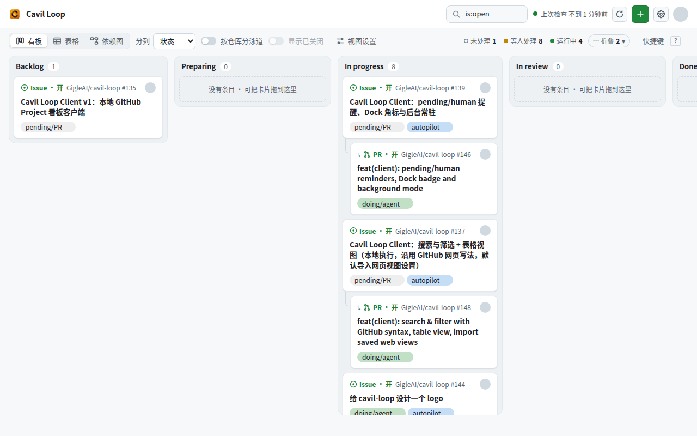
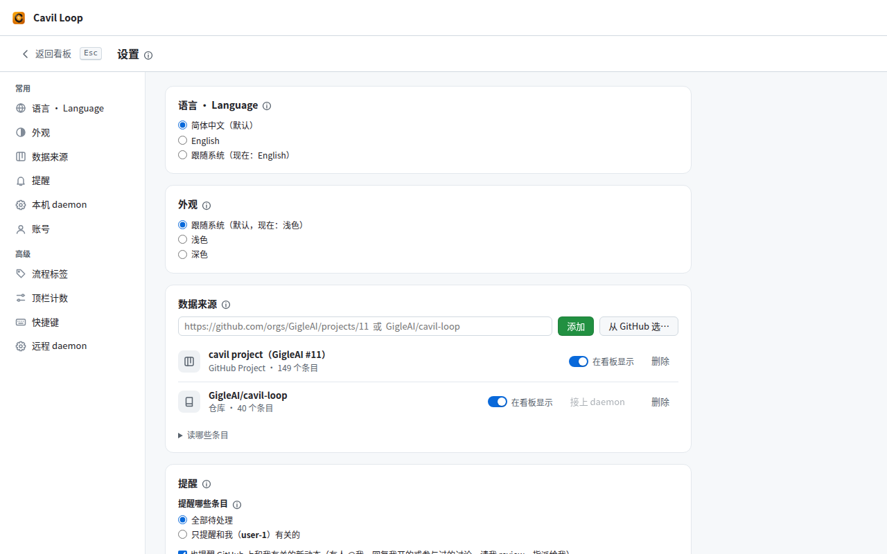
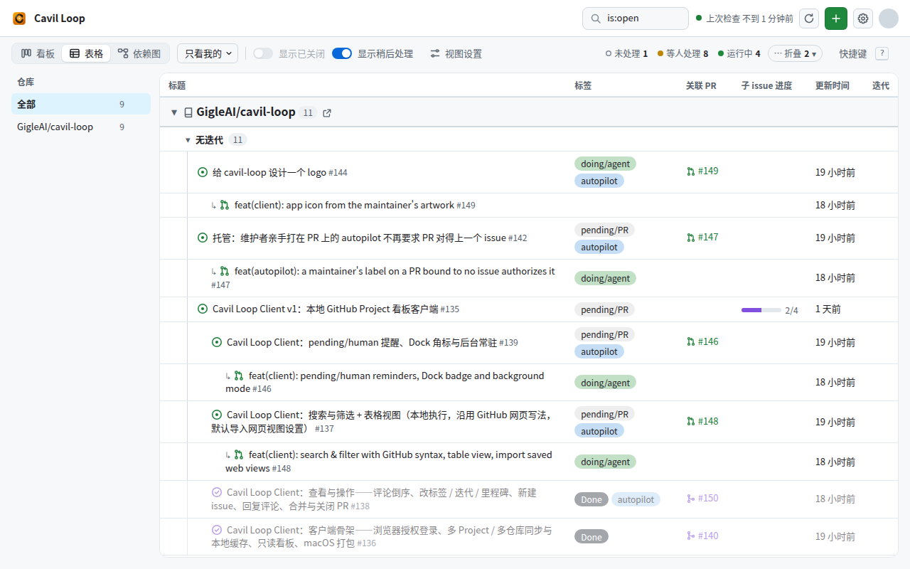
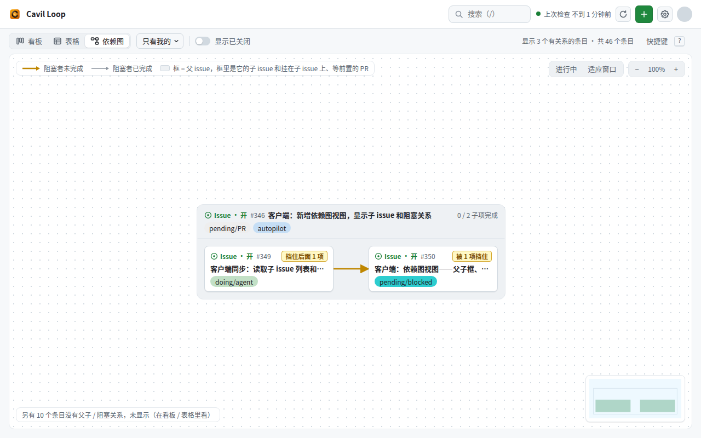
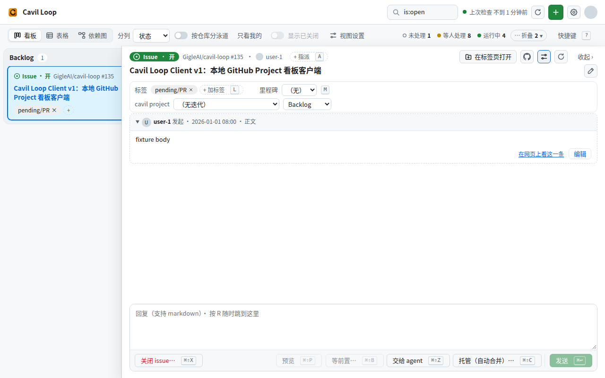

# Cavil Loop 客户端使用说明

> [English](client.md) · **中文**

Cavil Loop 客户端是一个管理 GitHub issue / PR 的桌面 App（macOS、Windows）。它把多个仓库和 GitHub Project 看板合进一个窗口：issue 和关联的 PR 放在一起，按迭代 / 状态 / 里程碑分列分组，并把 issue 之间的父子和阻塞关系画成依赖图（可以跨仓库）。

**它可以单独使用**：只要一个 GitHub 账号。不需要装本仓库的 daemon，不需要建 GitHub Project，也不需要装任何命令行程序。想让 AI 接活时，再按[最后一节](#可选接上-daemon)把仓库接上 daemon。

> 本文写的是界面和行为，改代码的规则与实现细节在开发文档 [client/README.md](../client/README.md)。界面默认是中文，在设置的「语言 · Language」里可以换成英文（见[语言](#语言)）。

## 目录

- [需要什么](#需要什么)
- [第一次用（只用客户端）](#第一次用只用客户端)
- [数据来源](#数据来源)
- [看板](#看板)
- [表格](#表格)
- [依赖图](#依赖图)
- [搜索、筛选和视图设置](#搜索筛选和视图设置)
- [详情、浮窗和标签页](#详情浮窗和标签页)
- [在客户端里修改](#在客户端里修改)
- [快捷键](#快捷键)
- [网络、凭据和离线](#网络凭据和离线)
- [更新](#更新)
- [语言](#语言)
- [可选：接上 daemon](#可选接上-daemon)
- [正在开发中](#正在开发中)

## 需要什么

- 一个 GitHub 账号，能看到想管理的仓库。
- 一台 Mac（macOS 14 或更新），或一台 64 位（x64）的 Windows 10 / 11 电脑。正式版有 Apple 芯片和 Intel 两种安装包（现有的正式版还没有 Windows 安装包）；开发版只有 Apple 芯片和 Windows 的（见[更新](#更新)）。Windows 上不能运行 daemon 本身（见[可选：接上 daemon](#可选接上-daemon)），其余都一样。

## 第一次用（只用客户端）

从本仓库的 [Releases](https://github.com/GigleAI/cavil-loop/releases) 页下载客户端，装好、用 GitHub 登录、加一个仓库或 Project 作为来源——客户端要的就这些。

1. **下载**：标签形如 `client/vX.Y.Z`、**没有** Pre-release 标记的最新一条；Mac 选以 `-arm64.dmg`（Apple 芯片）或 `-x64.dmg`（Intel）结尾的 `.dmg`，Windows 选以 `-windows-x64.exe` 结尾的文件（还没有正式版带它时，从带它的最新开发版里取，那一条标着 Pre-release）。
2. **安装**：Mac 上打开 dmg，把 App 拖进「应用程序」，再放行第一次打开；Windows 上运行 `.exe`。
3. **登录**：打开 App，点「用 GitHub 登录」，在弹出的浏览器页面里输入 App 显示的短码。
4. **添加来源**：右上角齿轮进设置 →「数据来源」，填 `owner/repo`（或仓库网址），或者一个 GitHub Project 的网址，点「添加」。
5. **回到看板**：点「返回看板」，几秒后看板上出现这个仓库开着的 issue / PR。

细节：下载哪个文件、放行第一次打开、登录、只加仓库不加 Project

- **下哪一条**：标签形如 `client/vX.Y.Z`、没有 Pre-release 标记的最新一条是客户端正式版。页面顶上标着 Latest 的是后台工具（daemon）的每周发版，不是客户端。**Windows** 上选附件里有 `-windows-x64.exe` 的最新一条：还没有哪个正式版带这个文件时，用带这个文件的最新开发版。想先用上最新改动，可以改装开发版：标签形如 `client/vX.Y.Z-dev.N`、标着 Pre-release 的那些，有 Apple 芯片的 dmg 和 Windows 安装包。
- **Apple 芯片还是 Intel？** 点屏幕左上角苹果菜单 →「关于本机」，「芯片」一行写 Apple M… 就是 Apple 芯片，「处理器」一行写 Intel 就是 Intel。
- **macOS 拦下第一次打开**：照 dmg 窗口里写的两种办法之一放行：「系统设置 → 隐私与安全性 → 仍要打开」，或双击 dmg 里的「复制放行命令」，复制一条命令到终端里运行。
- **Windows**：安装包没有代码签名，第一次运行时 Windows 会弹「Windows 已保护你的电脑」（Microsoft Defender SmartScreen）：点「更多信息」，核对应用名是「Cavil Loop」、文件来自本仓库的 Releases 页，再点「仍要运行」。只装给当前用户（不用管理员权限），开始菜单里会有它；之后的更新自己装，不再弹这个提示。
- **登录**：这是客户端自己的登录，在浏览器页面里同意授权。凭据存进 macOS 钥匙串（Windows 上存进 Windows 凭据管理器）。
- **挑来源**：不想手填时，点「从 GitHub 选…」从自己能看到的仓库和 Project 里挑。
- **只加仓库、不加 Project 时**：迭代和状态这两个值存在 Project 里，仓库本身没有，默认「按迭代分列」下所有卡片都在一列。可以在「视图设置」里改成按里程碑分列，或者切到表格按仓库 / 里程碑分组；以后建了 Project，再加进「数据来源」即可。

## 数据来源

来源是 GitHub Project 或仓库，在设置 →「数据来源」里加，可以加任意多个。App 开着时大约每分钟同步一轮，点刷新按钮或按 ⌘R 立即同步；读失败时沿用上一轮的内容，条目不会「消失」。

细节：两种来源、合并、导入网页视图、组织的 Project

- **两种来源**：GitHub Project（网址形如 `github.com/orgs/<组织>/projects/<编号>` 或 `github.com/users/<账号>/projects/<编号>`）和仓库（`owner/repo`）。设置 →「数据来源」每个来源一行，行里的「在看板显示」关掉后，看板暂时不显示它的条目（来源照常同步，行变淡并写着「看板上暂不显示」）。
- **同一条只出现一次**：一个 issue 同时在几个来源里，按 `仓库#编号` 合并成一条。迭代、状态属于各个 Project，两个 Project 的值不同时，这一条在两列里各出现一次；里程碑属于仓库。
- **导入网页视图**：添加 Project 时，客户端读一次它在 GitHub 网页上存的视图（网址带 `/views/N` 就用那一个，没带就用第一个），照着设好布局、分组、排序、列和筛选。只导入这一次，之后网页上的改动不会跟过来。做不到的部分（自定义字段分组、路线图布局等）会在视图顶部列出来。
- **组织的 Project 读不到**：多半是组织限制了第三方应用的访问，需要组织管理员批准。开发文档的「[读不到组织的 Project 怎么办](../client/README.md#读不到组织的-project-怎么办401)」一节有逐步说明。

细节：同步、只读变了的条目、GitHub 限流

- **同步**：顶栏写着「上次检查」的时间。一个来源要么整份读成功、整份替换本地，要么沿用上一轮的内容。
- **只读变了的条目**：每轮先检查有没有变化：看板和仓库的检查是带条件的 REST 请求，没变时 GitHub 回「没改过」（304），不扣 REST 次数，变了回 200 扣 1 次；有看板时每轮还用一个 GraphQL 查询数各看板的条目数（约 1 点）；看出变化后，只把变了的那几条重新读回来，大看板不会每分钟整份重读。整份读取仍会定期做，用来补检查看不到的变化：仓库约每 10 分钟一次，按变化读取的看板约每 60 分钟一次；一轮里变了 100 条以上、有条目被移出看板、或连续几轮读取变化失败时，当轮就整份读。鼠标停在「上次检查」上能看到每个来源上次「读取变化」和「整份读取」的时间。
- **GitHub 限流**：同步的请求一个接一个地发（GitHub 要求这样做，以免触发短时间请求过密的限制），客户端不给自己设额度上限：GitHub 的额度是整个账号共用的（每小时 GraphQL 5000 点、REST 5000 次），只要 GitHub 还在回应就照常读。只有 GitHub 拒绝请求、说超限了，刷新按钮旁才出现黄色「GitHub 限流（HH:MM 恢复）」：看板保持上次的内容，在那之前不再发请求，到时自动恢复。点开的说明会分开写「每小时额度用完」还是「短时间请求过密」，并附上 GitHub 的原话。额度用完的这段时间里，同一账号下的其他程序（命令行、daemon）也会被拒绝。

细节：窗口顶行、浅色 / 深色、设置页的排法

- **窗口顶行**：窗口最上面只有一行——Logo、打开的标签页、搜索框、同步状态、刷新、新建（➕）、设置、头像；打开详情标签页时这些也都在。搜索框平时收小，仍显示当前的搜索词，点它或按 `/` 展开。macOS 上这一行就是窗口标题栏：红黄绿按钮在行内左侧，按住空白处拖动窗口，双击放大 / 还原。
- **浅色 / 深色**：设置 →「外观」三选一：「跟随系统」（默认，系统切换深浅时窗口跟着变）、「浅色」、「深色」。选了立刻生效，看板、表格、依赖图、详情和讨论区、标签颜色一起换，macOS 上窗口标题栏和菜单也跟着变；只存在这台电脑上，重开 App 还在。
- **设置页的排法**：左侧目录分「常用」「高级」两段。常用的几张卡片（语言、外观、数据来源、提醒、更新、本机 daemon、账号）直接显示；「流程标签」「顶栏计数」「快捷键」「远程 daemon」收在页面最底下的「高级设置」里，每次进设置都收着，点目录里的这几项、或快捷键一览里的「在设置里改快捷键」会先展开再跳过去（Windows 上「远程 daemon」算常用）。常用卡片里不常用的选项再收进卡片内的「高级」：提醒卡片的「切到 App 时收起全部系统通知」、本机 daemon 的依赖检查（有缺的东西时自动展开）、账号卡片的登录方式和 Client ID（Client ID 没填或填错时自动展开）。每一项的说明文字收在名字旁的 ⓘ 里：鼠标移上去、用 Tab 键移到它上面，或点一下就显示，Esc 或再点一下收起；警告、出错和「按下去会怎样」的提示照旧直接显示，卡片底部的长说明照旧在「▸」折叠里。

## 看板

看板按迭代（默认）、状态或里程碑分列，PR 跟在关联的 issue 下面。把卡片拖到另一列，就改了它的这个值。

细节：分列、按仓库分泳道、PR 跟在 issue 下、卡片上有什么

- **分列**：按迭代时，已结束的迭代收在最左边的一列，点开展开；没有迭代的条目在「无迭代」列。拖到「无迭代」等于清空。
- **按仓库分泳道**：勾上后每个仓库一行，各自左右滚动、各自收起；仓库标题旁的按钮在浏览器里打开这个仓库。
- **PR 跟在关联的 issue 下面**（视图设置里的开关，默认开）：「关联」包括 GitHub 侧栏的关联 PR，以及 PR 正文里用 `Closes` / `Fixes` / `Resolves` / `Refs #N` 点名的 issue。PR 缩进一格、带「↳」，跟 issue 在同一列。
- **卡片上有什么**：仓库和编号、标题、标签、迭代、作者和负责人头像；Project 里的值来自哪个看板也写在卡片底部。

## 表格

表格把条目分组列出（迭代、状态、里程碑、仓库或不分组），PR 跟在 issue 下面，子 issue 缩进在父 issue 下面。标签、迭代、状态、里程碑在格子里就能改。

细节：分组、列、在格子里改、收起、新建、没有条目的仓库

- **分组**：开着「左侧按仓库切片」时，左边是仓库栏，选「全部」时先按仓库分大组，再按选定的方式分小组。
- **列**：标题、标签、关联 PR、子 issue 进度、更新时间、迭代、状态、里程碑、作者、负责人……在「视图设置」里选显示哪些；拖表头右边缘改宽度。
- **子 issue**：父 issue 那一行显示「N / M」的完成进度。
- **在格子里改**：标签、迭代、状态、里程碑四列点一下就能改；按迭代 / 状态 / 里程碑分组时，整行可以拖到另一组。
- **收起**：每组可以收起，相邻的几个收起的组合成一行「已收起 N 组 · 共 M 条」。收起状态记在本机。
- **新建**：每组底部有「＋ 新建 issue」，新 issue 直接带上这一组的迭代 / 状态 / 里程碑。
- **没有条目的仓库也在**：「数据来源」里开着「在看板显示」的仓库，即使现在没有要显示的 issue / PR（新建的空仓库，或者被搜索、「显示已关闭」滤空了），表格里也照样有它：仓库栏写 0，「全部」下有它的一节，按仓库分组时有它的一组，单选它时也一样（不管怎么分组），都写着「没有要显示的 issue / PR」并带「＋ 新建 issue」（打开时已选好这个仓库）。从来没读到过的仓库数字写「—」，写明还没读到，不给「＋」。只在 GitHub Project 里出现的仓库没有条目时客户端不知道它，不显示。

## 依赖图

视图切换的第三个按钮，把 issue 之间的父子和阻塞关系画出来（可以跨仓库）：父 issue 画成框，阻塞关系画成箭头。只画有关系的条目，其余的个数写在左下角。

细节：画哪些、框、箭头、关系从哪来、操作

- **画哪些**：有关系的 issue（有父 issue、有子 issue、挡住别人或被别人挡住的），以及和前置登记有关的 PR：自己登记了前置、正在等待的 PR，和被某条登记点名为前置的 PR（后者不管自己有没有登记、挂没挂标签、开着还是已关闭都画；见下方「关系从哪来」）。
- **框**：父 issue 画成一个框，子 issue 按 GitHub 里的顺序放在框里，框头写「N / M 子项完成」（只数子 issue）；登记了前置的 PR 也放进它关联的子 issue 所在的框里，但它不是子 issue；子 issue 自己还有子 issue 时框里套框。
- **箭头**：从挡住别人的条目指向被挡住的条目。挡人的还没关闭 → 琥珀色粗线；已关闭 → 灰色细线。节点上标「被 N 项挡住」或「挡住后面 N 项」。
- **PR 到它关联的 issue**：PR 和它关联的 issue（issue 侧栏的 Linked pull requests，或 PR 正文用 Closes / Fixes / Resolves / Refs 点名）都在图上时，从 PR 向 issue 画一条带箭头的虚线：两头都开着是青色，有一头已关闭或已合并是灰色细线。它不算阻塞，「被 N 项挡住」不数它；但一个上游沿一路都没完成的条目挡到这个 PR 时，「挡住后面 N 项」会越过它，把 issue 和 issue 挡住的条目也数进去。issue 自己没被挡、它的 PR 被挡时，节点标「它的 PR 被挡住」，摘要的「被挡住」一栏写「它的 PR #N 被挡住（未完成）」。
- **关系从哪来**：GitHub 侧栏里登记的父子关系（sub-issue）和「Blocked by」；另外，开着且挂着「等前置的标签」（默认 `pending/blocked`）的 issue，还读它评论里给 daemon 的前置登记（只认仓库所有者、组织成员和协作者写的），和「Blocked by」一起画线。PR 也一样：开着且挂着这个标签的 PR，读它自己评论里的前置登记，PR 画成一个节点、前置画线指向它，放在它关联的 issue 所在的框里（那个 issue 不在图上或在最外层时，PR 也在最外层）。
- **跨仓库**：关系另一头在别的仓库、不在当前来源里时，照样画出来，用虚线标「不在当前来源中」，可以在 GitHub 打开；被搜索藏掉的另一头变淡显示。
- **操作**：拖动平移，滚轮缩放；「适应窗口」（F）把整张图放进窗口，「进行中」跳到第一组还有未关闭 issue 的地方；右下角小地图可点可拖。单击节点看摘要，双击打开详情。

## 搜索、筛选和视图设置

搜索框的写法沿用 GitHub 网页，在本地对已同步的数据筛，打字即出结果；「显示已关闭」开关决定列不列已关闭、已合并的条目（默认关）。顶栏的流程数字点一下就按那个流程标签筛（不常看的收在末尾「⋯ 折叠 N」里），视图设置管分列、分组和排序。

细节：搜索写法

- 文字匹配标题、编号（`135` / `#135`）、标签名，中文词中间也能搜到。
- `label:` `status:` `milestone:` `assignee:` `author:` `repo:` `project:` `iteration:` `is:` `no:` `has:`（如 `is:open`、`is:pr`、`no:milestone`），前面加 `-` 表示排除，`@me` 指自己，`@current` / `@next` / `@previous` 指当前 / 下一个 / 上一个迭代。
- 不支持的写法（比如迭代的比较和区间）会在看板上方用黄条列出来并忽略，不会变成「0 条结果」。

细节：「显示已关闭」开关

- 新装的客户端搜索框是空的。视图栏「视图设置」左边的「显示已关闭」开关关着时只列开着的 issue / PR，打开后已关闭、已合并的也列出来。开关每个视图各记一份：看板、表格、依赖图各一份（默认关）；顶栏的数点亮时用这个数自己的那份（开关文字后面写着是哪个数，比如「显示已关闭（等人处理）」），一开始跟着这个数怎么数——「等人处理」开，其他关——之后可以单独拨。都会记住，重开 App 还在。
- 搜索框里自己写了 `is:open` / `is:closed` / `is:merged` 时以搜索框为准，开关变灰。
- 依赖图关着开关时，开着的条目要用到的已关闭父项、前置、子项仍淡显画出来，只是和开着的条目都无关的已关闭条目不出现。
- 开关只管已经读到的条目：仓库来源读全部开着的、近 14 天更新过的和挂着「等人处理的标签」的已关闭条目，Project 来源读看板上的全部条目。
- 挡条目按开 / 关，不按 Project 的 Done 列或 `Done` 标签：开着却已拖进 Done 列的条目会显示出来，想挡掉就在搜索框写 `-status:done`。导入 Project 网页视图时，只用来挡已完成条目的写法（`-status:done`、`-label:done`、`is:open`）不放进搜索框，存着的、整句只由这几个写法组成的搜索词会被清空。

细节：顶栏的流程数字、随 PR 显示的 issue、视图设置

- **流程数字**：默认从左到右是「未处理 / 等人处理 / 等 agent / 运行中 / 稍后处理」：「未处理」数开着、一个标签都没有的，其余各自数勾选的来源里有几条带对应标签（「稍后处理」数设置里「暂缓」那一格的标签，默认 `pending/later`）：「等人处理」开着的和已关闭的都数（托管 PR 合并时 issue 会关掉、留着 `pending/human` 提醒人看），其余只数开着的。点一个数，搜索框换成那个标签的筛选（`label:"…"`），列表按这个数自己的「显示已关闭」开关显示，所以默认正好是数到的那些；再点一次回到原来的搜索。有些数收在顶栏末尾的「⋯ 折叠 N」按钮里：默认「稍后处理」总是收着，「运行中」一直摊开，其余数到 0 个时收起；自己写条件、只筛一个暂缓标签的数也总是收着，前提是勾选的来源里每个仓库都用这个名字当暂缓标签（勾了 Project 时，要求没有仓库给暂缓标签改过名，否则照「为 0 时折叠」，可以在设置里把这一行的「折叠」选成「总是折叠」）；设置里「暂缓」那一格留空时这条规则不起作用，哪怕某个仓库有自己的暂缓标签名；点开按钮照样能看、能点，正在筛选的数被收起时这个按钮会高亮。显示哪几个数、各自数什么、要不要收起（每行的「折叠」：不折叠 / 为 0 时折叠 / 总是折叠），在设置 →「顶栏计数」里改，表格上方的预览条按当前数据实时显示改完的样子，收起的数排在「折叠区」后面。
- **只命中 PR 时带出所属 issue**：搜索框里有条件（点亮顶栏的数也算）、并且开着「PR 跟在 issue 下」时，一个 PR 命中了、它关联的 issue 没命中，看板和表格会把这个 issue 也显示出来，PR 照常缩进在它下面。带出来的 issue 变淡：看板上是虚线框加一行小字「随 PR 显示 · 不在筛选结果里」，表格行尾标「随 PR 显示」；不能拖动，点开照常。只带已经读到的 issue，一个 PR 只带一个（按当前排序取第一个能接 PR 的；PR 已经挂在一个命中的 issue 下就不再带），选了单个仓库时只带这个仓库的；带出来的 issue 不再往下带它的子 issue。表格开着「子 issue 缩进」时，如果这个 issue 本来就会作为命中 issue 的子 issue 带出来，它就留在那个位置（同一组只画一行），PR 跟到它下面。顶栏的数和「搜索命中 N 条」只数命中的；列头、组头、仓库分段的数数的是显示出来的条目，含淡色的；数字的悬停提示末尾另写「另有 N 个 issue 随命中的 PR 显示」。
- **视图设置**：分列 / 分组方式、排序（含「Project 里的顺序」）、显示哪些列、PR 是否跟在 issue 下、子 issue 是否缩进。搜索文字和视图设置都会记住，重开 App 还在。

## 详情、浮窗和标签页

单击卡片或表格行，详情浮在看板右侧；按住 ⌘ 点则开成标签页，详情占满窗口。点浮窗外面、按 Esc 或点「收起 ›」收起浮窗，⌘W 关掉标签页。

细节：浮窗宽度、详情里有什么、标签页、没发出去的文字

- **浮窗**默认铺到只给后面的列表留出约 15 个字的标题，跟着窗口变宽变窄（拖左边缘改宽度，拖过的宽度会记住；双击左边缘回到默认）。里面有正文、讨论、标签、负责人、迭代、状态、里程碑；PR 还有检查结果和合并按钮。
- **依赖图上**单击节点只显示摘要，双击或点摘要里的「打开详情」才打开浮窗；不在当前来源里的节点只有摘要和「在 GitHub 打开」，没有详情。
- **标签页**：按住 ⌘ 点、右键菜单 →「在新标签页打开」，或浮窗右上角的「在标签页打开」。标签页排在窗口最上面那一行（Logo 右边），「首页」就是看板 / 表格 / 依赖图，标签页多了可以左右滚动；⌘1 … ⌘9 切标签页。打开的标签页重开 App 还在。
- **没发出去的文字**跟着各自的标签页 / 浮窗，切走再回来还在；关掉有字的标签页前会先问。

## 在客户端里修改

修改直接发给 GitHub，发完重新读回这一条：标签、里程碑、迭代和状态，回复和编辑，新建 issue，关闭和合并。没成功的操作在窗口上方的通知里说；离线时所有修改入口变灰，不排队。

细节：标签和里程碑、回复、新建 issue、关闭和合并

- 改标签（`L`）、里程碑（`M`）、Project 的迭代和状态：点下去立刻显示新值，结果没确认前会标出来，可以重发或放弃。
- 标签选择框打开时，这一条已挂的标签打着勾排在最上面，接着固定是 `autopilot`、`pending/human`、`pending/later`、`pending/agent`（跟着设置里「流程标签」的标签名走，暂缓标签也算，仓库里没有的不列），其余照仓库原顺序；开着的时候点一下只变勾、行不挪位置，关掉再打开才按新状态重排。里程碑选择框同样把当前里程碑排第一。
- 回复评论（⌘↩ 发送，⌘⇧P 预览）、编辑自己的评论和正文、勾选正文里的任务列表。
- 引用回复：每条评论、正文和评审底部的「引用回复」把整条原文以 `> ` 引用放进回复框，接着往下写；在讨论里选中一段文字再点这条的「引用回复」或按 `R`，只引用选中的那段。整条引用保留原文格式，网页上看不见的隐藏标记清空成空注释 `<!-- -->`（发出去后同样看不见；agent 评论末尾那行可展开的用量统计会一起引进来，不需要就删掉）；选中一段引用时只带文字，不带链接和代码格式。选中的文字跨了两条评论时，`R` 只跳到回复框。回复框不能输入时（离线、有操作在途）按钮变灰。
- 新建 issue（`C`）：选仓库，可以顺便设标签、里程碑、迭代，以及加进哪些看板。
  - 选的仓库还没有「交给 agent」「托管」要用的标签时，按钮下面列出缺哪几个：当前账号有写权限就点「在这个仓库建好这 N 个标签」，按 cavil-loop 安装时的默认颜色和说明新建（不改仓库已有的标签），建好后两个按钮就能按；没有权限（或 GitHub 拒绝）就列出每个标签的名字、颜色、说明，可以「打开仓库的标签页」或「复制标签清单」交给有权限的人，建好后点「重新读取」。建标签的进度和结果在窗口上方的通知里，写明是哪个仓库；建的过程中换到别的仓库，对话框只显示那个仓库自己的情况。「等前置」对话框缺等前置标签或等人处理的标签时同样处理。建好标签不等于仓库已经接入 daemon，没接入时挂上派工标签也没有 agent 来接。
- 关闭 issue（选原因，可附一句评论）、关闭 / 合并 PR：都要在确认框里再点一次。成功后发起操作的标签页 / 浮窗自动收起，结果显示在窗口上方。
- 发送按钮旁的「交给 agent」「托管」：客户端一受理，发起操作的标签页 / 浮窗就自动收起，不等 GitHub 的回答；进度和结果（包括之后被拒、可「重试」）显示在窗口上方。受理前就被拒的（例如同样一段话还在从回复框发出的路上），详情和回复框里的字都原样留着。按下之后紧接着又在回复框里打的字算新草稿，这时详情不收起，顶部一行说明原因。

细节：操作没成功时

没成功的操作（关闭、合并、托管、交给 agent、等前置、回复、改正文 / 标题、勾任务、新建 issue）都在窗口上方的通知里说，每条最多两个按钮加 ×：

- **GitHub 明确拒绝了**：「重试」按原来的选择直接再做一次（不再弹确认框，发之前照样先核对），另一个按钮是「到 GitHub 上处理」（附的评论先复制到剪贴板）或「放回编辑框」；点 × 时，没发出去的附带评论回到这一条的回复框。新建 issue 被拒：「重试」用同一份草稿再建，或「重新打开草稿」。
- **发出去了但没收到 GitHub 的回答**：「再查一次」只读一遍 GitHub，不会再发一次（只有能安全重发的那一步标签是「重发…」，先说清迟到的那次可能造成什么）；新建 issue 不确定时只查最近建的同标题 issue，永远不会再建一个。另一个按钮「到 GitHub 上核对」分两步：第一次点打开这一条的网页并复制原文，同一个位置随后变成「已在 GitHub 上核对过，解除锁定」，点它才解锁。解锁前没有 ×，原文一直留在通知里（重启后也在）；原来那次请求后来生效了，客户端查到会自己解锁。

## 快捷键

键位尽量照搬 GitHub 网页，按 `?` 看完整一览（完整表也在开发文档的「快捷键」一节）；在设置 →「快捷键」里可以改。常用的：

| 按键 | 效果 |
|---|---|
| `/` | 跳到搜索框 |
| `C` | 新建 issue |
| ⌘R | 立即同步（详情标签页里：重新读这一条） |
| ⌘, | 打开设置 |
| ⌃⌘1 / ⌃⌘2 / ⌃⌘3（同时按住 Control 和 Command；⌥⌘1/2/3、⌘⇧1/2 也能用） | 看板 / 表格 / 依赖图 |
| ⌘1 … ⌘9 | 切到第几个标签页（⌘1 是首页） |
| ⌘W | 关掉当前标签页 |
| ⌘F | 在页面上查找文字（包括详情的讨论区；不动搜索框）；↩ / ⇧↩ 或 ⌘G / ⌘⇧G 下一处 / 上一处，Esc 关掉 |
| 详情里 `L` / `M` / `R` | 标签 / 里程碑 / 跳到回复框（在讨论里选中了文字时：引用进回复框） |
| ⌘↩ | 发送回复、确认对话框 |
| ⌘= / ⌘- / ⌘0 | 放大 / 缩小 / 实际大小 |

细节：改成自己的键

设置 →「快捷键」，在要改的那一行点「改」，再按下新的键；Esc 取消。一个操作改成一个键，原来的键随之不再起作用（例如「新建 issue」默认有 `C` 和 ⌘N，改成别的键后这两个都不再新建）。改过的行标「已改」，「恢复默认」改回原来的键，本节顶上的「全部恢复默认」把全部改回去；快捷键一览（`?`）里改过的键同样标「已改」，底部「在设置里改快捷键 →」直接跳到这一节。改动只存在这台电脑上。

- **撞车就不保存**：新键和另一个同时会起作用的操作的键相同，就不保存，并写明撞了哪一个；单独「恢复默认」时，原来的默认键已经被别的操作占了，同样不恢复，先把占着它的那一个改掉或恢复默认。
- **固定、不能改的键**：Esc、↩、方向键、⌘1 … ⌘9、⌘W 和缩放键。系统和编辑占着的键（⌘Q / ⌘H / ⌘M、⌘C / ⌘V / ⌘X / ⌘A / ⌘Z，macOS 上的 ⌘⇧3 / ⌘⇧4 / ⌘⇧5）也不收。回复框里的「预览」和新建 issue 窗口里的两个按钮，新键必须带 ⌘。
- **不带 ⌘ 的单个键**只在光标不在输入框里时起作用；详情里的操作改成这样的键后，在回复框和讨论区里按它不起作用。
- 下次打开时读到不能用的已保存键（例如 App 新版本给别的操作加了同一个默认键），那一项按默认处理，设置页顶上写明是哪几项、为什么。

## 网络、凭据和离线

默认只连 GitHub，登录凭据存在系统的凭据存储里，只在 App 的后台使用。只有人用到「远程 daemon」时才会连 Tailscale 上的机器：打开添加窗口时问每台在线设备远程入口开没开，配对时只连人选定的那一台，之后只连已配对的机器——这些请求都不带 GitHub 凭据。

细节：GitHub 的地址、Tailscale 连接、链接、凭据、离线

- **GitHub 的地址**：同步和修改只发给 `api.github.com` / `github.com`。另外几处也是 GitHub 自己的地址：头像（`avatars.githubusercontent.com`）、讨论里的图片（GitHub 的附件地址和图片代理）、仓库文件（`raw.githubusercontent.com`）、讨论里引用的 Release 附件图，以及自动更新下载更新包时跳转到的 `release-assets.githubusercontent.com` / `objects.githubusercontent.com`。
- **Tailscale 上的机器**（见[可选：接上 daemon](#可选接上-daemon)）：① 在设置 →「远程 daemon」里打开「添加远程 daemon」窗口时，客户端读一次本机 Tailscale 的设备列表，并向每台在线设备发一个不带内容的 HTTPS 请求，问它的远程入口开没开——这时还没选机器、也没输配对码；② 提交配对码时，只向人选定的那一台发配对请求；③ 配对之后，读状态、停启项目、看日志、读改项目配置也只连已配对的机器。这些连接只接受 `*.ts.net` 的完整机器名，地址必须全是 Tailscale 地址，对方必须出示这个名字的有效 HTTPS 证书，都不带 GitHub 凭据。没打开过添加窗口、也没有已配对的机器时，不发这类请求。
- **讨论里的链接交给系统浏览器**：在详情里点 `http` / `https` 链接（不论是不是 GitHub 的），由系统浏览器打开，和网页版 GitHub 一样，打开前不再确认；⌘ / Ctrl + 点击、中键点击一样，回复框下方「预览」里的链接也一样。客户端自己不访问这个地址，也不带凭据。指向本页某处的链接（如脚注）在讨论里跳过去，不开浏览器；`javascript:`、`file:`、`mailto:` 这类别的地址不打开。
- **凭据**：登录凭据存在 macOS 钥匙串（Windows 上存在 Windows 凭据管理器，名字是 `dev.luosky.cavil-loop.client/github-oauth`，配对远程机器的钥匙也在旁边），只在 App 的后台使用，窗口里的页面拿不到。退出登录会清掉凭据和本机缓存。
- **离线**：断网时照样能看上次同步下来的内容，顶栏写明数据是什么时候的；修改入口变灰。

## 更新

App 会自己检查、下载、安装更新，设置里能看到每个版本改了什么。设置里的「更新渠道」是正式版（默认）或开发版。

细节：两个渠道、切回正式版

- **正式版**（默认）：只收标签形如 `client/vX.Y.Z` 的正式发版，过完整测试。客户端这一周有改动，每周发版时就会出一个新的。适合日常用。
- **开发版**：正式版照收，另外每次改到客户端的合入后出一个（标签 `client/vX.Y.Z-dev.N`；没发出来的由每晚那一轮补发），最快拿到新功能，但只过快速测试和打包检查、可能不稳定，而且开发版只带 Apple 芯片和 Windows 的安装包（Intel 的 Mac 只能用正式版）。
- **一次发版覆盖哪些平台**和渠道是两回事：只有那次发版带了这台电脑所在平台的安装包（发版页上的附件），这台电脑才收得到更新。现有的正式版有 Apple 芯片和 Intel 的安装包、没有 Windows 的，所以 Windows 上选正式版渠道暂时收不到任何更新，要等带 Windows 安装包的正式版发出；在那之前用开发版渠道。
- 从开发版切回正式版不会降级，会等下一个比当前版本更高的正式版。开发版的版本号排在同号正式版之前（`0.5.3-dev.N` 比 `0.5.3` 低、比 `0.5.2` 高），所以装着 0.5.3 开发版的人切回正式版后，要等到 0.5.3 或更新的正式版才会更新。

## 语言

设置的第一节「语言 · Language」把界面切成简体中文（默认）、英文或跟随系统。切换当场生效，不用重启，记在这台电脑上。

细节：三个选项、不翻译的内容

| 选项 | 显示 |
|---|---|
| **简体中文**（默认） | 中文界面；存着本版本认不出的设置值时也按中文 |
| **English** | 英文界面 |
| **跟随系统** | 系统首选语言是任何一种中文（`zh-…`）时显示中文，其他语言一律显示英文；选项上写着现在是哪一种 |

- 切换时窗口、macOS 菜单和之后的系统通知一起换。
- **不翻译的内容**：客户端以外来的文字一律原样显示——GitHub 上的标题、正文、评论、标签 / 里程碑 / 迭代 / Project 的名字、账号名和仓库名、GitHub 自己的报错原文和更新说明；daemon 脚本的输出、远程 daemon 返回的内容和它的日志；git、系统和其他程序的报错原文；人自己输入或起的名字（搜索、草稿、设置里填的标签名）。换语言的只是它们周围的文字。
- 这一节的名字和「简体中文」这个选项在英文界面里仍是中文（中文界面里的「Language」「English」同理），看不懂当前语言的人也找得到回去的路。

## 可选：接上 daemon

本仓库的另一样东西是 daemon：给 issue 打上 `pending/agent` 标签，本机的 AI（Claude Code、Codex 等）就会接走去做，做完把结果写回 issue / PR。客户端可以替人安装 daemon、把仓库接上去，之后在客户端里就能把条目交给 AI。**不接 daemon，上面的一切照样能用。**

1. **先装 daemon 要用的程序**（客户端只检查缺什么，不替人装）：`git`、`gh`、`tmux`、`jq`、`flock`、4 以上的 `bash`（macOS 自带的是 3.2），以及要用的 agent 程序（如 `claude`）。用 Homebrew：`brew install gh tmux jq flock bash`。然后在终端里跑一次 `gh auth login`——daemon 用 `gh` 的登录，不用客户端的。
2. **安装 daemon**：设置 →「本机 daemon」→「安装」。它从 github.com 克隆本仓库到 `~/.agents/skills/cavil-loop`；下面的检查清单列出还缺哪些程序，装好后点「重新检查」。以后要更新时点「更新 daemon」。
3. **把仓库接上 daemon**：回到「数据来源」，在仓库那一行点「接上 daemon」：选本机已有的同仓库目录或让它克隆一份、选 agent；预检通过后点「开始」，它代跑 daemon 自带的安装脚本（建项目配置、在仓库里建 `pending/agent` 等标签、启动后台轮询），输出边跑边显示。
4. **派第一个活**：新建一个 issue，在详情里点「交给 agent」（或给它加 `pending/agent` 标签）。daemon 约一分钟内接走，标签变成 `doing/agent`；做完翻成 `pending/human`，客户端发系统通知。

接上之后，详情里多出「交给 agent」「托管」「等前置」三个按钮，等人处理的条目会发系统通知，项目的常用设置可以在设置里改。daemon 本身的工作方式见仓库首页 [README](../README.zh.md)。

细节：交给 agent / 托管 / 等前置、提醒、流程标签

- **交给 agent / 托管 / 等前置**：详情里的三个按钮（⌘⇧Z / ⌘⇧C / ⌘⇧B）。「交给 agent」挂上派工标签；「托管」再加上托管标签，agent 方案、开发、复审、合并一路做完；「等前置」登记这一条要等哪些 issue / PR 先完成。回复框里有字时，先把这段字作为评论发出去，再改标签。
- **提醒**：开着的条目新挂上「等人处理的标签」（默认 `pending/human`）时发系统通知，Dock 角标是还没看的条数（Windows 上是任务栏图标上的数字）。关掉窗口后 App 仍在后台同步和提醒：Mac 上留在 Dock，Windows 上是任务栏右下角通知区域里的图标——点它把窗口叫回来，右键选「退出」才完全退出。「开机自动启动」让它开机后就在那里，不弹窗口。在窗口里打开某一条（点卡片、点通知都算）就收起关于它的通知，别的条目的通知留着；浮窗打开的那一条在看板 / 表格上会被滚到眼前并描上蓝边。设置「提醒」里可以改成「只提醒和我有关的」（指派给自己、请自己 review 的，以及谁都没指派时自己在 GitHub 上关注着的），几个人共用一个仓库时有用。
- **流程标签**：设置 →「流程标签」一节能改「运行中 / 交给 agent / 等人处理 / 暂缓 / 托管 / 等前置」各用哪个标签（要和 daemon 配置里的一致），按钮、顶栏数字、提醒、标签页图标、标签选择框的顺序都跟着变。暂缓标签（默认 `pending/later`）在标签选择框里排到等人处理的标签后面，顶栏「稍后处理」也数它；留空 = 两样都不做。

细节：项目配置

设置 →「本机 daemon」→ 项目的「配置…」，用表单改用哪个 agent、哪个模型、同时最多几个 worker 等常用设置。打开时只显示常用的几项；每组不常用的收在组末的「高级」里，派工挑选、流程标签、预览、轮询等整组收在窗口底部的「高级设置」里。改过或填错的值所在的那块不会收起。每项的说明在名字旁的 ⓘ 里；「这里不改它」的原因、「配置文件里没写这一项」照旧直接显示。哪项放在哪由 daemon 的登记表定，接的 daemon 不给这个信息时，全部直接显示。

细节：给流程标签改名

在这张表单里，流程标签（如 `pending/human`、`Done`）一行有「改名…」。填新名字，daemon 自己的检查边输边跑，每项标 ✓ / ✗ / ?。窗口里列出客户端知道的、同样在轮询这个仓库的其他 daemon（本机的其他项目、配对过的远程机器），各带「停掉它的轮询」；读不到状态的算作没停。勾上「已确认：除了上面列出的，没有别的机器在轮询本仓库」，再点「改名（三处一起改）」：先在 GitHub 上给标签改名（挂着它的条目照样挂着），再改项目配置里那一行，最后只改客户端里这个仓库的标签名——别的仓库照用共用的名字，设置 →「流程标签」下的「按仓库单独的标签名」列出这些名字，可以「改回共用」。

- **按仓库单独的名字怎么计数**：视图栏的数字按每个条目所在仓库的名字计数。点开后搜索框里是全部名字（`label:"A","B"`），点开的这个数字亮着时列表只留挂着自己仓库那个名字的条目（手工输入或粘贴同样的文字是普通搜索：挂任一名字的都列出，不点亮数字），某个仓库里恰好叫别的仓库名字的普通标签不会被列出；搜索里的名字取自标签设置、不取自当前读到的条目，所以同步、取消勾选某个来源、某个仓库最后一条条目消失，都不会改变这段搜索和数字与列表的对应，再点一下照样回到点开前的搜索（在设置里改名字会改变搜索，和改共用标签一样）。
- **三处都改完之前**，daemon 暂停这个项目，这个仓库条目上写流程标签的按钮置灰，窗口顶上的提示写明每一处现在是什么，只给下一步安全的做法：GitHub 没回音时只有「再查一次（只读）」和「重发改名」——这时不能退回，请求以后仍可能生效；只有 GitHub 确定没改时才有「退回」。没做完就关了客户端，下次打开会再提示。
- **其他机器**：改完的提示里有一行改名凭据可以复制；在每台停掉的机器上打开那个项目的配置，点「跟进另一台的改名…」贴上它，做完再把轮询启动。远程机器上的项目，要在那台机器的客户端里改名。

细节：远程 daemon、Windows

- **远程 daemon**：daemon 跑在另一台电脑上时，可以通过 Tailscale 配对后在设置 →「远程 daemon」里看它的状态、停启、看日志，并用「配置…」改某个项目的常用设置（和本机同一张表单，保存在那台机器上）。被连接的那台也装了客户端时，在它的「本机 daemon」里打开「允许其他电脑远程连接」，拿到配对码。网络上的边界见[网络、凭据和离线](#网络凭据和离线)。
- **Windows 上**不能在同一台电脑上运行 daemon（它要 macOS 或 Linux 上的 bash、tmux 和定时服务）：设置 →「本机 daemon」只写明这一点，数据来源里的仓库后面也没有「接上 daemon」。把 daemon 装在一台 Mac 或 Linux 机器上，再在 Windows 客户端的「远程 daemon」里通过 Tailscale 接上它；Windows 电脑上要先装好并登录 Windows 版 Tailscale。

## 正在开发中

以下是还开着的客户端 issue，状态以 issue 页面为准：

- 每晚打一个 Windows 和 Mac 的开发版，经开发版渠道更新：[#628](https://github.com/GigleAI/cavil-loop/issues/628)
