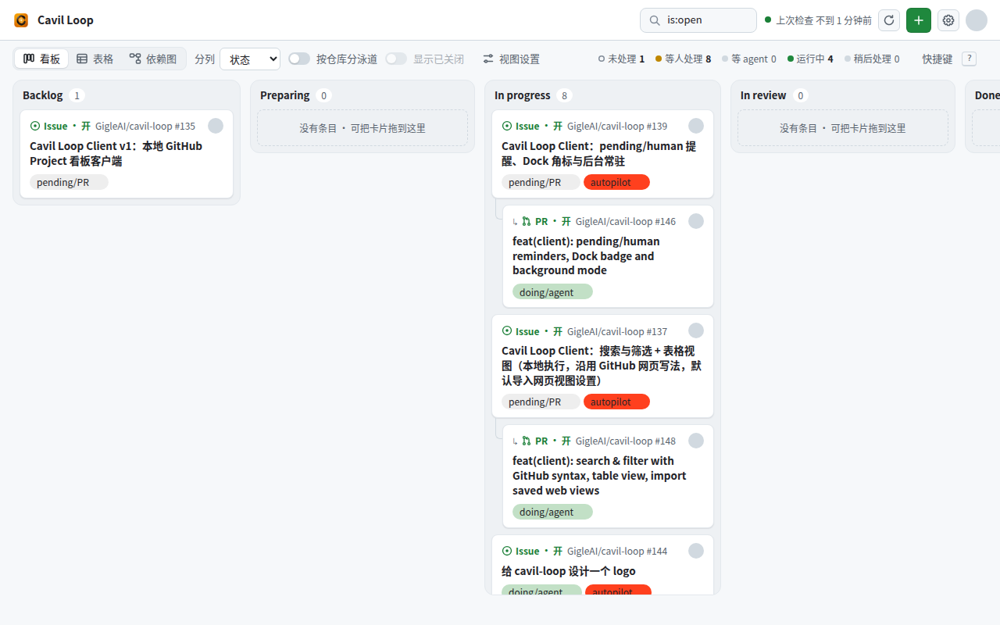
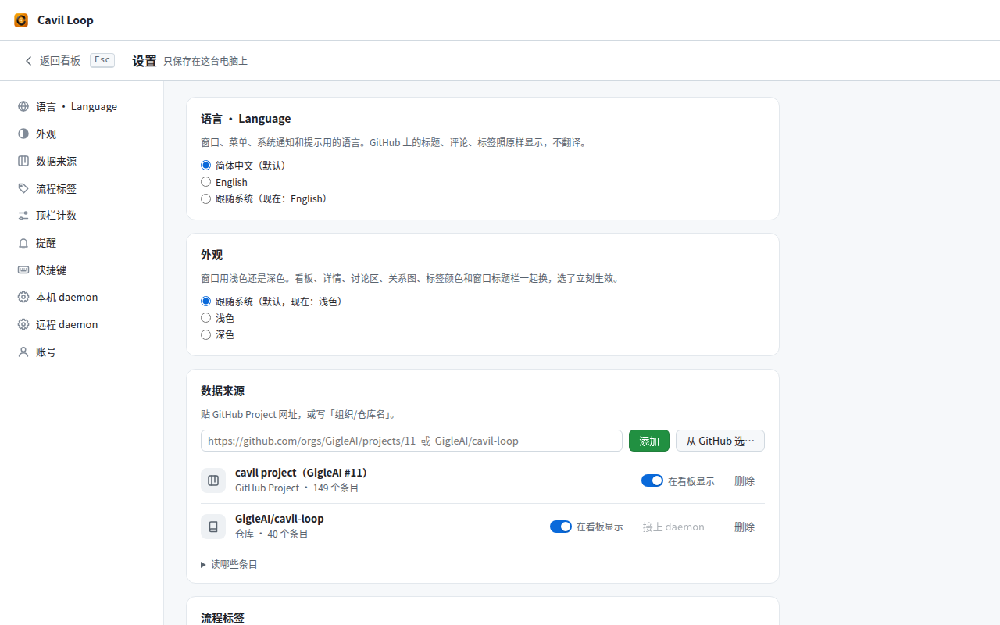
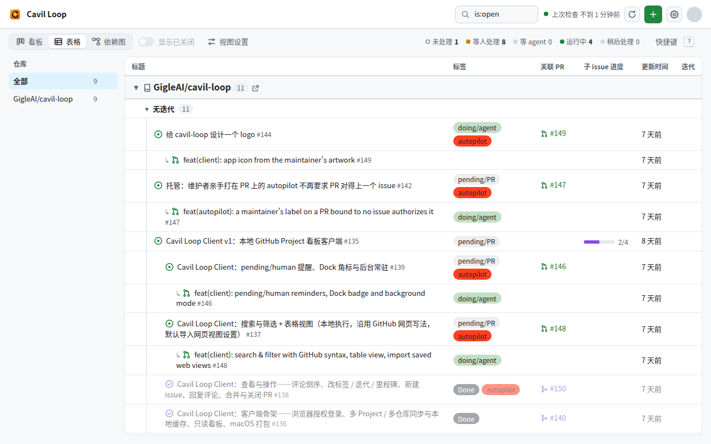
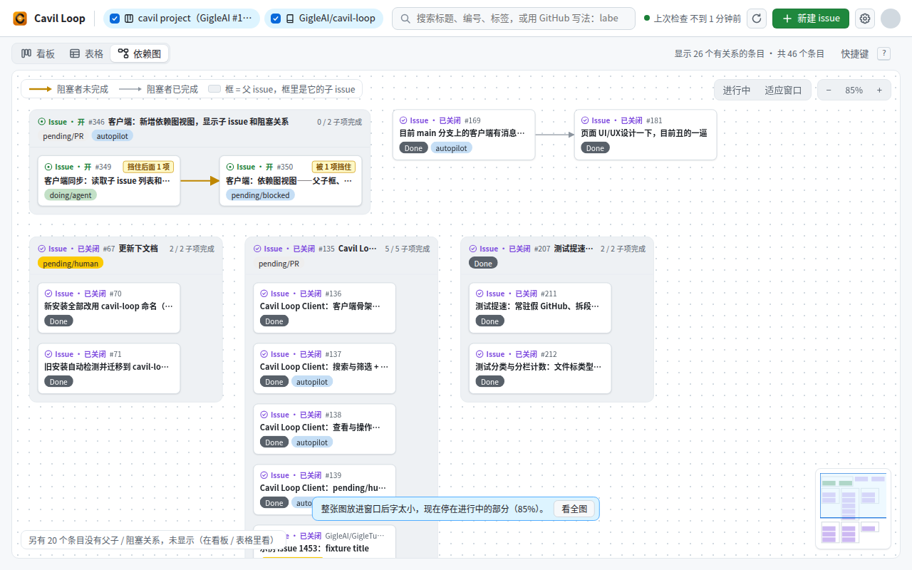
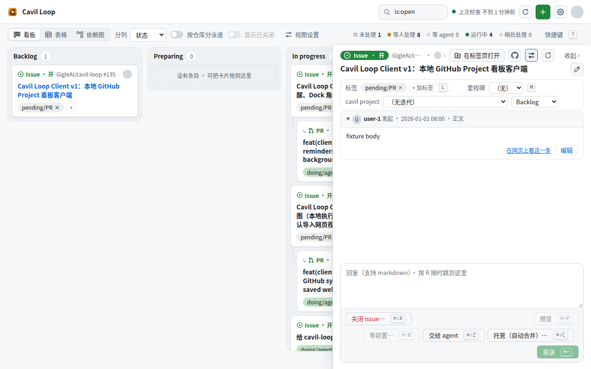

# Cavil Loop 客户端使用说明

> [English](client.md) · **中文**

Cavil Loop 客户端是一个管理 GitHub issue / PR 的桌面 App（macOS）。它把多个仓库和 GitHub Project 看板合进一个窗口：issue 和关联的 PR 放在一起，按迭代 / 状态 / 里程碑分列分组，并把 issue 之间的父子和阻塞关系画成依赖图（可以跨仓库）。

**它可以单独使用**：只要一个 GitHub 账号。不需要装本仓库的 daemon，不需要建 GitHub Project，也不需要装任何命令行程序。想让 AI 接活时，再按[最后一节](#可选接上-daemon)把仓库接上 daemon。

> 本文写的是界面和行为，改代码的规则与实现细节在开发文档 [client/README.md](../client/README.md)。界面目前只有中文（中英文切换在 [#466](https://github.com/GigleAI/cavil-loop/issues/466) 进行中）。

## 目录

- [需要什么](#需要什么)
- [第一次用（只用客户端）](#第一次用只用客户端)
- [数据来源](#数据来源)
- [看板](#看板)
- [表格](#表格)
- [依赖图](#依赖图)
- [搜索、筛选和视图设置](#搜索筛选和视图设置)
- [详情、浮窗和标签页](#详情浮窗和标签页)
- [在客户端里修改](#在客户端里修改)
- [快捷键](#快捷键)
- [网络、凭据和离线](#网络凭据和离线)
- [更新](#更新)
- [可选：接上 daemon](#可选接上-daemon)
- [正在开发中](#正在开发中)

## 需要什么

- 一个 GitHub 账号，能看到想管理的仓库。
- 一台 Mac，macOS 14 或更新。目前只有 Apple 芯片的安装包，而且只有开发版（见[更新](#更新)）；Intel 的 Mac 暂时只能照开发文档的「开发」一节自己构建。

## 第一次用（只用客户端）

1. **下载**：打开本仓库的 [Releases](https://github.com/GigleAI/cavil-loop/releases) 页，找标签以 `client/v` 开头的最新一条（目前是 `client/vX.Y.Z-dev.N`，标着 Pre-release），下载里面的 `.dmg`。
2. **安装**：打开 dmg，把 App 拖进「应用程序」。第一次打开会被 macOS 拦下，照 dmg 窗口里写的两种办法之一放行：「系统设置 → 隐私与安全性 → 仍要打开」，或双击 dmg 里的「复制放行命令」，复制一条命令到终端里运行。
3. **登录**：打开 App，点「用 GitHub 登录」。App 显示一个短码，在弹出的浏览器页面里输入并同意授权。这是客户端自己的登录，凭据存进 macOS 钥匙串。
4. **添加来源**：右上角齿轮进设置 →「数据来源」，填 `owner/repo`（或仓库网址），或者一个 GitHub Project 的网址，点「添加」；也可以点「从 GitHub 选…」从自己能看到的仓库和 Project 里挑。
5. **回到看板**：点「返回看板」，几秒后看板上出现这个仓库开着的 issue / PR。

到这里客户端已经能用了。**只加仓库、不加 Project 时**：迭代和状态这两个值存在 Project 里，仓库本身没有，默认「按迭代分列」下所有卡片都在一列。可以在「视图设置」里改成按里程碑分列，或者切到表格按仓库 / 里程碑分组；以后建了 Project，再加进「数据来源」即可。

## 数据来源

- **两种来源**：GitHub Project（网址形如 `github.com/orgs/<组织>/projects/<编号>` 或 `github.com/users/<账号>/projects/<编号>`）和仓库（`owner/repo`）。可以加任意多个。设置 →「数据来源」每个来源一行，行里的「在看板显示」关掉后，看板暂时不显示它的条目（来源照常同步，行变淡并写着「看板上暂不显示」）。
- **同一条只出现一次**：一个 issue 同时在几个来源里，按 `仓库#编号` 合并成一条。迭代、状态属于各个 Project，两个 Project 的值不同时，这一条在两列里各出现一次；里程碑属于仓库。
- **导入网页视图**：添加 Project 时，客户端读一次它在 GitHub 网页上存的视图（网址带 `/views/N` 就用那一个，没带就用第一个），照着设好布局、分组、排序、列和筛选。只导入这一次，之后网页上的改动不会跟过来。做不到的部分（自定义字段分组、路线图布局等）会在视图顶部列出来。
- **组织的 Project 读不到**：多半是组织限制了第三方应用的访问，需要组织管理员批准。开发文档的「[读不到组织的 Project 怎么办](../client/README.md#读不到组织的-project-怎么办401)」一节有逐步说明。
- **同步**：App 开着时大约每分钟同步一轮，顶栏写着「上次检查」的时间；点刷新按钮或按 ⌘R 立即同步。一个来源要么整份读成功、整份替换本地，要么沿用上一轮的内容——读失败不会让条目「消失」。
- **窗口顶行**：窗口最上面只有一行——Logo、打开的标签页、搜索框、同步状态、刷新、新建（➕）、设置、头像；打开详情标签页时这些也都在。搜索框平时收小，仍显示当前的搜索词，点它或按 `/` 展开。macOS 上这一行就是窗口标题栏：红黄绿按钮在行内左侧，按住空白处拖动窗口，双击放大 / 还原。
- **浅色 / 深色**（[#516](https://github.com/GigleAI/cavil-loop/issues/516)）：设置 →「外观」三选一：「跟随系统」（默认，系统切换深浅时窗口跟着变）、「浅色」、「深色」。选了立刻生效，看板、表格、依赖图、详情和讨论区、标签颜色一起换，macOS 上窗口标题栏和菜单也跟着变；只存在这台电脑上，重开 App 还在。

## 看板

- **分列**：按迭代（默认）、状态或里程碑分列。按迭代时，已结束的迭代收在最左边的一列，点开展开；没有迭代的条目在「无迭代」列。
- **按仓库分泳道**：勾上后每个仓库一行，各自左右滚动、各自收起；仓库标题旁的按钮在浏览器里打开这个仓库。
- **PR 跟在关联的 issue 下面**（视图设置里的开关，默认开）：「关联」包括 GitHub 侧栏的关联 PR，以及 PR 正文里用 `Closes` / `Fixes` / `Resolves` / `Refs #N` 点名的 issue。PR 缩进一格、带「↳」，跟 issue 在同一列。
- **拖卡片**：把卡片拖到另一列，就改了它的迭代 / 状态 / 里程碑；拖到「无迭代」等于清空。
- **卡片上有什么**：仓库和编号、标题、标签、迭代、作者和负责人头像；Project 里的值来自哪个看板也写在卡片底部。

## 表格

- **分组**：迭代 / 状态 / 里程碑 / 仓库 / 不分组。开着「左侧按仓库切片」时，左边是仓库栏，选「全部」时先按仓库分大组，再按上面的方式分小组。
- **列**：标题、标签、关联 PR、子 issue 进度、更新时间、迭代、状态、里程碑、作者、负责人……在「视图设置」里选显示哪些；拖表头右边缘改宽度。
- **子 issue 缩进在父 issue 下面**，父 issue 那一行显示「N / M」的完成进度。
- **在格子里改**：标签、迭代、状态、里程碑四列点一下就能改；按迭代 / 状态 / 里程碑分组时，整行可以拖到另一组。
- **收起**：每组可以收起，相邻的几个收起的组合成一行「已收起 N 组 · 共 M 条」。收起状态记在本机。
- **新建**：每组底部有「＋ 新建 issue」，新 issue 直接带上这一组的迭代 / 状态 / 里程碑。

## 依赖图

视图切换的第三个按钮。只画有关系的 issue（有父 issue、有子 issue、挡住别人或被别人挡住的），以及和前置登记有关的 PR：自己登记了前置、正在等待的 PR，和被某条登记点名为前置的 PR（后者不管自己有没有登记、挂没挂标签、开着还是已关闭都画；见下方「关系从哪来」）；其余的个数写在左下角。

- **框**：父 issue 画成一个框，子 issue 按 GitHub 里的顺序放在框里，框头写「N / M 子项完成」（只数子 issue）；登记了前置的 PR 也放进它关联的子 issue 所在的框里，但它不是子 issue；子 issue 自己还有子 issue 时框里套框。
- **箭头**：从挡住别人的条目指向被挡住的条目。挡人的还没关闭 → 琥珀色粗线；已关闭 → 灰色细线。节点上标「被 N 项挡住」或「挡住后面 N 项」。
- **关系从哪来**：GitHub 侧栏里登记的父子关系（sub-issue）和「Blocked by」；另外，开着且挂着「等前置的标签」（默认 `pending/blocked`）的 issue，还读它评论里给 daemon 的前置登记（只认仓库所有者、组织成员和协作者写的），和「Blocked by」一起画线。PR 也一样：开着且挂着这个标签的 PR，读它自己评论里的前置登记，PR 画成一个节点、前置画线指向它，放在它关联的 issue 所在的框里（那个 issue 不在图上或在最外层时，PR 也在最外层）。
- **跨仓库**：关系另一头在别的仓库、不在当前来源里时，照样画出来，用虚线标「不在当前来源中」，可以在 GitHub 打开；被搜索藏掉的另一头变淡显示。
- **操作**：拖动平移，滚轮缩放；「适应窗口」（F）把整张图放进窗口，「进行中」跳到第一组还有未关闭 issue 的地方；右下角小地图可点可拖。单击节点看摘要，双击打开详情。

## 搜索、筛选和视图设置

- **搜索框**的写法沿用 GitHub 网页，在本地对已同步的数据筛，打字即出结果：
  - 文字匹配标题、编号（`135` / `#135`）、标签名，中文词中间也能搜到；
  - `label:` `status:` `milestone:` `assignee:` `author:` `repo:` `project:` `iteration:` `is:` `no:` `has:`（如 `is:open`、`is:pr`、`no:milestone`），前面加 `-` 表示排除，`@me` 指自己，`@current` / `@next` / `@previous` 指当前 / 下一个 / 上一个迭代；
  - 不支持的写法（比如迭代的比较和区间）会在看板上方用黄条列出来并忽略，不会变成「0 条结果」。
- **「显示已关闭」开关**：新装的客户端搜索框是空的。视图栏「视图设置」左边的「显示已关闭」开关关着时只列开着的 issue / PR，打开后已关闭、已合并的也列出来。开关每个视图各记一份：看板、表格、依赖图各一份（默认关）；顶栏的数点亮时用这个数自己的那份（开关文字后面写着是哪个数，比如「显示已关闭（等人处理）」），一开始跟着这个数怎么数——「等人处理」开，其他关——之后可以单独拨。都会记住，重开 App 还在。
  - 搜索框里自己写了 `is:open` / `is:closed` / `is:merged` 时以搜索框为准，开关变灰。
  - 依赖图关着开关时，开着的条目要用到的已关闭父项、前置、子项仍淡显画出来，只是和开着的条目都无关的已关闭条目不出现。
  - 开关只管已经读到的条目：仓库来源读全部开着的、近 14 天更新过的和挂着「等人处理的标签」的已关闭条目，Project 来源读看板上的全部条目。
  - 原来按 Project 的 Done 列 / `Done` 标签挡、现在按开 / 关挡：开着却已拖进 Done 列的条目会显示出来，想继续挡就在搜索框写 `-status:done`。导入 Project 网页视图时，只用来挡已完成条目的写法（`-status:done`、`-label:done`、`is:open`）不放进搜索框；旧版存下的、整句只由这几个写法组成的搜索词，升级后清空。
- **顶栏的流程数字**：默认从左到右是「未处理 / 等人处理 / 等 agent / 运行中 / 稍后处理」：「未处理」数开着、一个标签都没有的，其余各自数勾选的来源里有几条带对应标签（「稍后处理」数设置里「暂缓」那一格的标签，默认 `pending/later`）：「等人处理」开着的和已关闭的都数（托管 PR 合并时 issue 会关掉、留着 `pending/human` 提醒人看），其余只数开着的。点一个数，搜索框换成那个标签的筛选（`label:"…"`），列表按这个数自己的「显示已关闭」开关显示，所以默认正好是数到的那些；再点一次回到原来的搜索。显示哪几个数、各自数什么，在设置 →「顶栏计数」里改，表格上方的预览条按当前数据实时显示改完的样子。
- **视图设置**：分列 / 分组方式、排序（含「Project 里的顺序」）、显示哪些列、PR 是否跟在 issue 下、子 issue 是否缩进。搜索文字和视图设置都会记住，重开 App 还在。

## 详情、浮窗和标签页

- **单击**卡片或表格行的标题，详情浮在看板右侧（左边缘可拖宽）：正文、讨论、标签、负责人、迭代、状态、里程碑；PR 还有检查结果和合并按钮。点浮窗外面、按 Esc 或点「收起 ›」收起。依赖图上不一样：单击节点只显示摘要，双击或点摘要里的「打开详情」才打开这个浮窗；不在当前来源里的节点只有摘要和「在 GitHub 打开」，没有详情。
- **按住 ⌘ 点**（或右键菜单 →「在新标签页打开」、浮窗右上角的「在标签页打开」）：开成标签页，详情占满窗口。标签页排在窗口最上面那一行（Logo 右边），「首页」就是看板 / 表格 / 依赖图，标签页多了可以左右滚动；⌘1 … ⌘9 切标签页，⌘W 关掉当前标签页。打开的标签页重开 App 还在。
- 回复框里没发出去的文字跟着各自的标签页 / 浮窗，切走再回来还在；关掉有字的标签页前会先问。

## 在客户端里修改

修改直接发给 GitHub，发完重新读回这一条：

- 改标签（`L`）、里程碑（`M`）、Project 的迭代和状态：点下去立刻显示新值，结果没确认前会标出来，可以重发或放弃。
- 标签选择框打开时，这一条已挂的标签打着勾排在最上面，接着固定是 `autopilot`、`pending/human`、`pending/later`、`pending/agent`（跟着设置里「流程标签」的标签名走，暂缓标签也算，仓库里没有的不列），其余照仓库原顺序；开着的时候点一下只变勾、行不挪位置，关掉再打开才按新状态重排。里程碑选择框同样把当前里程碑排第一。
- 回复评论（⌘↩ 发送，⌘⇧P 预览）、编辑自己的评论和正文、勾选正文里的任务列表。
- 新建 issue（`C`）：选仓库，可以顺便设标签、里程碑、迭代，以及加进哪些看板。
- 关闭 issue（选原因，可附一句评论）、关闭 / 合并 PR：都要在确认框里再点一次。成功后发起操作的标签页 / 浮窗自动收起，结果显示在窗口上方。
- 没成功的操作（关闭、合并、托管、交给 agent、等前置、回复、改正文 / 标题、勾任务、新建 issue）都在窗口上方的通知里说，每条最多两个按钮加 ×：
  - **GitHub 明确拒绝了**：「重试」按原来的选择直接再做一次（不再弹确认框，发之前照样先核对），另一个按钮是「到 GitHub 上处理」（附的评论先复制到剪贴板）或「放回编辑框」；点 × 时，没发出去的附带评论回到这一条的回复框。新建 issue 被拒：「重试」用同一份草稿再建，或「重新打开草稿」。
  - **发出去了但没收到 GitHub 的回答**：「再查一次」只读一遍 GitHub，不会再发一次（只有能安全重发的那一步标签是「重发…」，先说清迟到的那次可能造成什么）；新建 issue 不确定时只查最近建的同标题 issue，永远不会再建一个。另一个按钮「到 GitHub 上核对」分两步：第一次点打开这一条的网页并复制原文，同一个位置随后变成「已在 GitHub 上核对过，解除锁定」，点它才解锁。解锁前没有 ×，原文一直留在通知里（重启后也在）；原来那次请求后来生效了，客户端查到会自己解锁。
- 离线时所有修改入口变灰，不排队、不重试。

## 快捷键

键位尽量照搬 GitHub 网页，按 `?` 看完整一览（完整表也在开发文档的「快捷键」一节）。常用的：

| 按键 | 效果 |
|---|---|
| `/` | 跳到搜索框 |
| `C` | 新建 issue |
| ⌘R | 立即同步（详情标签页里：重新读这一条） |
| ⌘, | 打开设置 |
| ⌃⌘1 / ⌃⌘2 / ⌃⌘3（同时按住 Control 和 Command；以前的 ⌥⌘1/2/3、⌘⇧1/2 也还能用） | 看板 / 表格 / 依赖图 |
| ⌘1 … ⌘9 | 切到第几个标签页（⌘1 是首页） |
| ⌘W | 关掉当前标签页 |
| ⌘F | 在页面上查找文字（包括详情的讨论区；不动搜索框）；↩ / ⇧↩ 或 ⌘G / ⌘⇧G 下一处 / 上一处，Esc 关掉 |
| 详情里 `L` / `M` / `R` | 标签 / 里程碑 / 跳到回复框 |
| ⌘↩ | 发送回复、确认对话框 |
| ⌘= / ⌘- / ⌘0 | 放大 / 缩小 / 实际大小 |

**改成自己的键**（[#487](https://github.com/GigleAI/cavil-loop/issues/487)）：设置 →「快捷键」，在要改的那一行点「改」，再按下新的键；Esc 取消。一个操作改成一个键，原来的键随之不再起作用（例如「新建 issue」默认有 `C` 和 ⌘N，改成别的键后这两个都不再新建）。改过的行标「已改」，「恢复默认」改回原来的键，本节顶上的「全部恢复默认」把全部改回去；快捷键一览（`?`）里改过的键同样标「已改」，底部「在设置里改快捷键 →」直接跳到这一节。改动只存在这台电脑上。

- **撞车就不保存**：新键和另一个同时会起作用的操作的键相同，就不保存，并写明撞了哪一个；单独「恢复默认」时，原来的默认键已经被别的操作占了，同样不恢复，先把占着它的那一个改掉或恢复默认。
- **固定、不能改的键**：Esc、↩、方向键、⌘1 … ⌘9、⌘W 和缩放键。系统和编辑占着的键（⌘Q / ⌘H / ⌘M、⌘C / ⌘V / ⌘X / ⌘A / ⌘Z，macOS 上的 ⌘⇧3 / ⌘⇧4 / ⌘⇧5）也不收。回复框里的「预览」和新建 issue 窗口里的两个按钮，新键必须带 ⌘。
- **不带 ⌘ 的单个键**只在光标不在输入框里时起作用；详情里的操作改成这样的键后，在回复框和讨论区里按它不起作用。
- 下次打开时读到不能用的已保存键（例如 App 新版本给别的操作加了同一个默认键），那一项按默认处理，设置页顶上写明是哪几项、为什么。

## 网络、凭据和离线

- **默认只连 GitHub**：同步和修改只发给 `api.github.com` / `github.com`。另外几处也是 GitHub 自己的地址：头像（`avatars.githubusercontent.com`）、讨论里的图片（GitHub 的附件地址和图片代理）、仓库文件（`raw.githubusercontent.com`）、讨论里引用的 Release 附件图，以及自动更新下载更新包时跳转到的 `release-assets.githubusercontent.com` / `objects.githubusercontent.com`。
- **只有人用到「远程 daemon」时，才会连 Tailscale 上的机器**（见[可选：接上 daemon](#可选接上-daemon)）：① 在设置 →「远程 daemon」里打开「添加远程 daemon」窗口时，客户端读一次本机 Tailscale 的设备列表，并向每台在线设备发一个不带内容的 HTTPS 请求，问它的远程入口开没开——这时还没选机器、也没输配对码；② 提交配对码时，只向人选定的那一台发配对请求；③ 配对之后，读状态、停启项目、看日志、读改项目配置也只连已配对的机器。这些连接只接受 `*.ts.net` 的完整机器名，地址必须全是 Tailscale 地址，对方必须出示这个名字的有效 HTTPS 证书，都不带 GitHub 凭据。没打开过添加窗口、也没有已配对的机器时，不发这类请求。
- **凭据**：登录凭据存在 macOS 钥匙串，只在 App 的后台使用，窗口里的页面拿不到。退出登录会清掉凭据和本机缓存。
- **离线**：断网时照样能看上次同步下来的内容，顶栏写明数据是什么时候的；修改入口变灰。

## 更新

- App 会自己检查、下载、安装更新，设置里能看到每个版本改了什么。
- 「更新渠道」二选一：**正式版**（还没有发布过）和**开发版**（每次客户端改动合进 main 都可能出一个，可能不稳定）。从开发版切回正式版不会降级，会等下一个更高的正式版。

## 可选：接上 daemon

本仓库的另一样东西是 daemon：给 issue 打上 `pending/agent` 标签，本机的 AI（Claude Code、Codex 等）就会接走去做，做完把结果写回 issue / PR。客户端可以替人安装 daemon、把仓库接上去，之后在客户端里就能把条目交给 AI。**不接 daemon，上面的一切照样能用。**

1. **先装 daemon 要用的程序**（客户端只检查缺什么，不替人装）：`git`、`gh`、`tmux`、`jq`、`flock`、4 以上的 `bash`（macOS 自带的是 3.2），以及要用的 agent 程序（如 `claude`）。用 Homebrew：`brew install gh tmux jq flock bash`。然后在终端里跑一次 `gh auth login`——daemon 用 `gh` 的登录，不用客户端的。
2. **安装 daemon**：设置 →「本机 daemon」→「安装」。它从 github.com 克隆本仓库到 `~/.agents/skills/cavil-loop`；下面的检查清单列出还缺哪些程序，装好后点「重新检查」。以后要更新时点「更新 daemon」。
3. **把仓库接上 daemon**：回到「数据来源」，在仓库那一行点「接上 daemon」：选本机已有的同仓库目录或让它克隆一份、选 agent；预检通过后点「开始」，它代跑 daemon 自带的安装脚本（建项目配置、在仓库里建 `pending/agent` 等标签、启动后台轮询），输出边跑边显示。
4. **派第一个活**：新建一个 issue，在详情里点「交给 agent」（或给它加 `pending/agent` 标签）。daemon 约一分钟内接走，标签变成 `doing/agent`；做完翻成 `pending/human`，客户端发系统通知。

接上之后客户端里多出来的：

- **交给 agent / 托管 / 等前置**：详情里的三个按钮（⌘⇧Z / ⌘⇧C / ⌘⇧B）。「交给 agent」挂上派工标签；「托管」再加上托管标签，agent 方案、开发、复审、合并一路做完；「等前置」登记这一条要等哪些 issue / PR 先完成。回复框里有字时，先把这段字作为评论发出去，再改标签。
- **提醒**：开着的条目新挂上「等人处理的标签」（默认 `pending/human`）时发系统通知，Dock 角标是还没看的条数。在窗口里打开某一条（点卡片、点通知都算）就收起关于它的通知，别的条目的通知留着；浮窗打开的那一条在看板 / 表格上会被滚到眼前并描上蓝边。设置「提醒」里可以改成「只提醒和我有关的」（指派给自己、请自己 review 的，以及谁都没指派时自己在 GitHub 上关注着的），几个人共用一个仓库时有用。
- **流程标签**：设置 →「流程标签」一节能改「运行中 / 交给 agent / 等人处理 / 暂缓 / 托管 / 等前置」各用哪个标签（要和 daemon 配置里的一致），按钮、顶栏数字、提醒、标签页图标、标签选择框的顺序都跟着变。暂缓标签（默认 `pending/later`）在标签选择框里排到等人处理的标签后面，顶栏「稍后处理」也数它；留空 = 两样都不做。
- **项目配置**：设置 →「本机 daemon」→ 项目的「配置…」，用表单改用哪个 agent、哪个模型、同时最多几个 worker 等常用设置。
- **远程 daemon**：daemon 跑在另一台电脑上时，可以通过 Tailscale 配对后在设置 →「远程 daemon」里看它的状态、停启、看日志，并用「配置…」改某个项目的常用设置（和本机同一张表单，保存在那台机器上）。被连接的那台也装了客户端时，在它的「本机 daemon」里打开「允许其他电脑远程连接」，拿到配对码。网络上的边界见[网络、凭据和离线](#网络凭据和离线)。

daemon 本身的工作方式见仓库首页 [README](../README.zh.md)。

## 正在开发中

以下是写这份说明时（2026-11-13）还开着的客户端 issue，状态以 issue 页面为准：

- 中英文切换：[#466](https://github.com/GigleAI/cavil-loop/issues/466)，分成四步 [#471](https://github.com/GigleAI/cavil-loop/issues/471)（语言设置、顶栏、设置目录、登录、菜单、通知）、[#472](https://github.com/GigleAI/cavil-loop/issues/472)（看板、表格、依赖图、详情、标签页、新建 issue）、[#473](https://github.com/GigleAI/cavil-loop/issues/473)（本机与远程 daemon、更新、项目配置）、[#474](https://github.com/GigleAI/cavil-loop/issues/474)（收尾与说明文档）
- 新建 issue 的窗口里直接「交给 agent」「托管」，并配快捷键：[#450](https://github.com/GigleAI/cavil-loop/issues/450)
- 点「重新读取」「重新同步」后有转圈和结果提示：[#455](https://github.com/GigleAI/cavil-loop/issues/455)
- 客户端测试不清理临时目录：[#469](https://github.com/GigleAI/cavil-loop/issues/469)（只影响开发，不影响使用）
