# Orchestration: tailor the workflow per project

> **English** · [中文](orchestration.zh.md)

The cavil-loop flow itself is fixed: dispatch, design, build, review, merge, clean up. At a few of those steps each project can plug in its own commands and prompts — install dependencies, add its own review criteria, deploy a preview build, refresh a site after a merge. This page shows where those hooks sit, who runs each one, and how to use them to tailor review, testing, previews and deployment.

Every setting lives in the project's `cavil-loop.config` (all fields: `cavil-loop.config.example` at the repo root); prompt additions live under `.agents/skills/cavil-loop/prompts/` in the project's repository.



<sub>No animation? [Static version](images/orchestration.en.static.svg).</sub>

## The hooks at a glance

| Step | Hook | Run by | When | Default |
|---|---|---|---|---|
| 1 Worktree ready | `WORKTREE_SETUP_CMD` | daemon | after every new worktree for an item | `npm ci \|\| npm install` in the config template |
| 2 Compose prompt | `<name>.extra.md` | daemon | every dispatch | no file = the tool's template alone |
| 3 PR opened | `PR_CREATED_HOOK` | worker | after the worker opened the PR and flipped labels | empty = not run |
| 4 Review | `review.extra.md` | review agent | with `LABEL_PENDING_REVIEW` set, when the worker hands over code or a design | off |
| 5 Cleanup on merge | `CLEANUP_HOOK` | daemon | when an item is cleaned up, before its session ends and its worktree goes | empty = not run |
| 6 Refresh latest site | `LATEST_SITE_REFRESH` | daemon | after the post-merge cleanup scan, in the background | off |
| 7 Retrospective | `POST_RETROSPECTIVE_PROJECT_CMD` | daemon | after the retrospective is written, before it is committed | empty = not run |

<details><summary>Details: three things that are easy to get wrong</summary>

- **The PR-opened script is run by the worker, not called by the daemon.** It is part of the worker's prompt; the worker runs it right after opening the PR, and the daemon never looks at its exit code.
- **The latest-site refresh lives inside cleanup on merge.** With cleanup on merge off (`AUTO_CLEANUP_ON_MERGE=false`) nothing is refreshed even with `LATEST_SITE_REFRESH=true`; but it does not care whether the cleanup succeeded — a failing cleanup still triggers the refresh.
- **Retrospectives and cleanup do not depend on each other.** The retrospective is its own background queue, advanced every poll: a failed cleanup does not hold it up, and a failed retrospective does not hold up cleanup.

</details>

## Worktree ready: `WORKTREE_SETUP_CMD`

Once the daemon has built an item's worktree and copied in the local files listed in `COPY_TO_WORKTREE` (such as `.env`), it runs this one-line command inside the worktree to install dependencies. A failure is only logged and dispatch goes on; leave it empty or set it to `:` to skip it.

<details><summary>Details: when it runs and how to write it</summary>

- It runs when a new issue's worktree is created, and when a PR-comment dispatch finds the worktree missing and rebuilds it. An existing worktree does not run it again.
- It runs as the daemon's user, at the worktree root, through `eval`: chain several commands with `&&`, but keep it to one line.
- A failure (non-zero exit) is one line in `poll.log`; the worker starts anyway and will see the missing dependencies when it runs the tests.
- Typical values:

  ```bash
  WORKTREE_SETUP_CMD="npm ci || npm install"   # Node
  WORKTREE_SETUP_CMD="uv sync"                 # Python (uv)
  WORKTREE_SETUP_CMD="cargo fetch"             # Rust
  WORKTREE_SETUP_CMD=":"                       # install nothing
  ```

</details>

## Compose prompt: templates and additions

The daemon builds the worker's prompt fresh for every dispatch: the tool's template → the public lessons → the project's own lessons → the project's addition file `<name>.extra.md`, then a few rule sections appended by switch. A project writes only what is specific to it (test chain, acceptance criteria, layout rules), and its layer wins on conflict; there is no need to fork a whole template.



<sub>No animation? [Static version](images/prompt-assembly.en.static.svg).</sub>

<details><summary>Details: which templates exist and where the additions go</summary>

| Template | Used when | Project addition |
|---|---|---|
| `new-issue` | a new issue's first dispatch: read the code, write a design | `new-issue.extra.md` |
| `issue-comment` | a new comment on an issue: revise the design, answer, or — once the design is confirmed — build and open the PR | `issue-comment.extra.md` |
| `pr-comment` | a new comment on a PR: rework | `pr-comment.extra.md` |
| `review` | the review gate: another agent reviews a design or code | `review.extra.md` |

- Additions go under `.agents/skills/cavil-loop/prompts/` in the project's repository. The daemon reads the copy on `origin/<base branch>`: merge a change to an addition file and the next dispatch uses it, nothing to restart.
- Order: template → the tool's public lessons → the project's lessons (`lessons.md`, only the hard rules and the rules awaiting confirmation) → the project's addition → sections appended by switch (heavy-test queue, other work in progress, waiting on another item, autopilot, external requester bot …; each is left out while its switch is off).
- The addition is appended after the template with a line saying it wins on conflict: to overturn one rule of the template, write "this project does X instead" in the addition.
- Every dispatch logs how it composed, e.g. `prompt: base=new-issue.template.md + 增量=new-issue.extra.md（合成 214 行）`.

</details>

<details><summary>Details: when to replace a whole template</summary>

A file named `<name>.template.md` in the same directory replaces the tool's template of that name entirely. The price: it never receives another update of the tool's template, and nothing tells you it fell behind. Do it only when the project's workflow differs *structurally* (different stages, different label meanings); the addition and the switch sections are still appended after a replaced template.

The placeholders a template can use (`${ISSUE}`, `${WORKTREE}`, `${PREVIEW_URL_HOST}` …) are listed in [Prompt templates](operations.md#prompt-templates) in the operations guide.

</details>

## PR opened: `PR_CREATED_HOOK`

After opening the PR and flipping the PR's and the issue's labels, the worker runs this script as its prompt says. Typical uses: deploy a preview build, post the preview URL or a QR code on the PR, notify the team. Leave it empty to skip it.

<details><summary>Details: what it gets and what a failure does</summary>

- **Who runs it, where**: the worker, inside its own session, with `bash`, from the worktree. A relative path is resolved against the worktree, so the copy on the PR's branch runs — a PR that changes this script uses the changed version itself.
- **Environment**: `PR` (PR number), `ISSUE`, `WORKTREE`, `BRANCH`, `REPO`, and `PROJECT_ROOT` (here: the worktree directory).
- **When**: at the step where the confirmed design is built and the PR is first opened. New commits pushed during rework do not run it again.
- **Failure**: the daemon does not look at the exit code and no label changes because of it; the error only shows up in the worker's session.
- Recommended path: `PR_CREATED_HOOK=".agents/skills/cavil-loop/pr-created-hook.sh"`.

Minimal example — post the preview URL on the PR (replace the URL with the project's own):

<!-- orchestration-example:pr-created-hook:begin -->
```bash
#!/usr/bin/env bash
# .agents/skills/cavil-loop/pr-created-hook.sh: tell reviewers where this PR's preview lives
set -euo pipefail
gh pr comment "$PR" --repo "$REPO" --body "Preview of $BRANCH: https://preview.example.com/pr-$PR/"
```
<!-- orchestration-example:pr-created-hook:end -->

</details>

## Review: `review.extra.md`

With `LABEL_PENDING_REVIEW` set, the worker flips its code (and, with design review on, its design) to that label first, and the daemon dispatches a *different* agent that reviews it with the tool's review template plus the project's `review.extra.md`: a pass goes to the human, a fail bounces back to the worker with concrete feedback. The project's own rejection criteria go in `review.extra.md`.

<details><summary>Details: settings</summary>

| Setting | What it does | Default |
|---|---|---|
| `LABEL_PENDING_REVIEW` | the review label; empty = no review step | empty |
| `REVIEW_WORKER_AGENT` | which agent reviews | `codex` |
| `REVIEW_MODEL` | which model reviews; empty = the agent's default | empty |
| `REVIEW_MAX_ROUNDS` | how many bounces at most; once used up without a pass, the item carries both the review label and `pending/human` and waits for a person | `6` |
| `REVIEW_DESIGN_PROPOSALS` | designs also go through review before they reach the human | `false` |

- The reviewer starts from a fresh conversation; it never continues the coding conversation.
- When the two agents cannot agree, the item carries both the review label and `pending/human`: the daemon stops dispatching it until a person has read the summary comment and decided.

</details>

## Cleanup on merge: `CLEANUP_HOOK`

When the daemon sees a newly merged PR it cleans up the item (`AUTO_CLEANUP_ON_MERGE`, on by default): this script first, then it ends the worker's tmux session and removes the worktree. Typical uses: stop services this item started, deregister its preview, remove tunnel routes. A non-zero exit is only logged and the cleanup carries on; leave it empty to skip it.

<details><summary>Details: what it gets and when it runs</summary>

- **When**: on the automatic cleanup after a merge, and first thing when a person runs `bash scripts/cleanup-issue.sh <number>` by hand.
- **Environment**: `ISSUE`, `WORKTREE`, `BRANCH`, `REPO`, `PROJECT_ROOT` (the project's main checkout).
- **Path**: a relative path is resolved against `PROJECT_ROOT`, so the copy in the main checkout runs; a missing file is one log line and is skipped. Recommended path: `CLEANUP_HOOK=".agents/skills/cavil-loop/cleanup-hook.sh"`.
- **Output**: every line goes to `poll.log` with a `[hook]` prefix.
- **Find what to clean by worktree**: the session names and ports a worker used do not always follow the convention. Processes whose cwd is under `$WORKTREE`, and the ports they actually listen on, are more reliable than names and formulas; before killing by cwd, check the shape of `$WORKTREE` and leave out the script itself and its ancestors. The full approach is in [Cleanup hook](operations.md#cleanup-hook-cleanup_hook) in the operations guide.

Minimal example — stop the extra tmux sessions this item started (use the project's own session prefix; the worker session without a suffix is left to the cleanup script itself):

<!-- orchestration-example:cleanup-hook:begin -->
```bash
#!/usr/bin/env bash
# .agents/skills/cavil-loop/cleanup-hook.sh: stop the extra tmux sessions this item started
set -euo pipefail
prefix="myproj-issue${ISSUE}-"   # keep the trailing "-": issue 69 must not match issue 695
{ tmux list-sessions -F '#{session_name}' 2>/dev/null || true; } | while read -r s; do
    case "$s" in "$prefix"*) tmux kill-session -t "=$s" ;; esac
done
```
<!-- orchestration-example:cleanup-hook:end -->

</details>

## Refresh latest site: `LATEST_SITE_REFRESH`

When on, every poll that sees a newly merged PR fast-forwards the main checkout to the latest base branch after the post-merge cleanup scan, then rebuilds and restarts a resident production site in the background, so one fixed URL always serves the latest base. Off by default.

<details><summary>Details: when it refreshes and when it does not</summary>

It refreshes only when all three hold: cleanup on merge is on (`AUTO_CLEANUP_ON_MERGE`, on by default), `LATEST_SITE_REFRESH=true`, and this poll saw at least one merge not yet cleaned up.

| Situation | Refresh? |
|---|---|
| Cleanup on merge off (`AUTO_CLEANUP_ON_MERGE=false`), refresh on | No: the refresh is started from inside the automatic cleanup |
| The cleanup script fails (e.g. the worktree cannot be removed) | Yes: the refresh does not look at the cleanup result. That PR is not marked cleaned, so the next poll sees it again and starts the refresh once more |
| The base branch did not move and the resident session is alive | The refresh script skips itself, no rebuild |
| The build fails | The old resident session stays |

So a refresh having run does not mean the worktree is gone.

The refresh runs in the background and never blocks polling; its log is `latest-site.log` in the state directory. Settings (given as comments in the config template):

| Setting | What it does | Default |
|---|---|---|
| `LATEST_SITE_PORT` | the resident site listens on `127.0.0.1:<port>` | `3000` |
| `LATEST_SITE_SESSION` | the resident tmux session's name | `<TMUX_PREFIX>-latest` |
| `LATEST_SITE_BUILD_CMD` | build command | `npm run build` |
| `LATEST_SITE_SERVER_CMD` | command that starts the production site | `node server/index.mjs` |

First bring-up or a forced rebuild: run `FORCE=1 bash scripts/refresh-latest-site.sh` in the tool's directory.

</details>

## Retrospective: `POST_RETROSPECTIVE_PROJECT_CMD`

After every merged PR the daemon queues a retrospective in the background (`POST_MERGE_RETROSPECTIVE`, on by default), which commits a report and the project's lessons file back to the project repository. This command runs after the retrospective is written and before it is committed; whatever it changes goes into the same commit — for example, re-sorting the lessons file by the project's own rules. Leave it empty to skip it.

<details><summary>Details: where it runs and what counts as a failure</summary>

- **Where**: at the root of the retrospective's temporary checkout, as the daemon's user, for at most 10 minutes.
- **Environment**: `RETROSPECTIVE_PR` (PR number), `RETROSPECTIVE_LESSONS_FILE` (the lessons file), `RETROSPECTIVE_REPORT_FILE` (this retrospective's report). The GitHub tokens are not passed on (logins stored on the machine still work), so only put trusted commands here.
- **Failure**: a non-zero exit, a timeout, changing the report or the lessons file, or committing on its own — this retrospective fails and nothing is pushed.
- **Relation to cleanup**: the retrospective queue is independent of cleanup; a failed cleanup does not hold it up.
- Example: `POST_RETROSPECTIVE_PROJECT_CMD="node scripts/rank-lessons.mjs --write"`

</details>

## Recipes

Four common needs, and which of the hooks above each one uses.

### Your own review

Turn on the review gate, then write the project's rejection criteria into `review.extra.md`.

<details><summary>Details: steps</summary>

1. Set `LABEL_PENDING_REVIEW="pending/review"` in the config; to have designs reviewed too, add `REVIEW_DESIGN_PROPOSALS=true`. Run `setup.sh` once more — it creates the label in the repository.
2. Pick the reviewing agent and model with `REVIEW_WORKER_AGENT` and `REVIEW_MODEL`, and the bounce limit with `REVIEW_MAX_ROUNDS`.
3. Write `.agents/skills/cavil-loop/prompts/review.extra.md` in the project's repository: what must be bounced in this project, which checks the reviewer runs itself, how review comments are written. This repository's own [review.extra.md](../.agents/skills/cavil-loop/prompts/review.extra.md) is a complete example.
4. Once it is on the base branch, the next review dispatch uses it.

</details>

### Testing

The test chain goes into the prompt additions; when the full suite is heavy enough that several workers running it at once bog the machine down, turn on the heavy-test queue; for accurate test time in the comment footer, configure a timing command.

<details><summary>Details: three places</summary>

- **Test chain**: in `new-issue.extra.md`, `issue-comment.extra.md` and `pr-comment.extra.md`, write what must have run before anything is handed over in this project: type check, unit tests, end-to-end tests, lint, and when running only the related part is enough.
- **Heavy-test queue**: `HEAVY_TEST_COMMANDS` takes one command per line that counts as "heavy" (e.g. the full suite). With it set, the worker's prompt gains a section telling it to run those commands through the queue wrapper: one run at a time per system account, the rest wait; cleaning up an item stops its queued or running one. See [Heavy tests](operations.md#heavy-tests-one-at-a-time-optional-off-by-default-github343) in the operations guide.
- **Test time in the footer**: `COMMENT_FOOTER_EXTRA_CMD` is a command run in the worktree (30 s limit) whose first output line is `test_secs=<seconds>` or `test_secs=unknown`; the footer's summary line then shows test time separately. It deliberately lives in the local config rather than the repository: a script in the repository could be changed by any PR. The format is in that setting's comment in the config template.

</details>

### Previews

To give whoever looks at a PR a clickable preview: use on-demand previews — the URL always works, and nothing sits in memory while nobody is looking.

<details><summary>Details: wiring it up</summary>

- With `PREVIEW_EXEC` set (the command that starts the project's server), systemd starts previews on demand: the public port always listens, the server starts on the first visit and exits after `PREVIEW_IDLE` of idling. Public port = `PREVIEW_PORT_BASE` + the item's number.
- The server must read its listen address from `$PORT` / `$HOST`: it gets the backend port, since the public port is held by the listener — a hard-coded port cannot be wired in.
- In the prompt additions, tell the worker when to register a preview and how to post the URL. Use the `${PREVIEW_URL_HOST}` placeholder for the host name instead of writing it out — the same template runs on every machine that polls the repo, and a written-out host sends people to a machine that does not have the files.
- Deregister the item's preview in `CLEANUP_HOOK`.
- Register / deregister commands and troubleshooting: [On-demand preview](operations.md#on-demand-preview-socket-activation) in the operations guide.

</details>

### Deployment

The daemon stops at the merge: deploy a preview build after the PR opens with `PR_CREATED_HOOK`, keep one fixed URL on the latest base after a merge with `LATEST_SITE_REFRESH`; production deployment belongs in the project's own CI, and the daemon does not do it.

<details><summary>Details: what each hook covers</summary>

- **Preview build**: `PR_CREATED_HOOK` runs after the worker opened the PR — the place to build a preview and post its URL or QR code on the PR (example under "PR opened" above). It runs once, when the PR is first opened; rework commits do not redeploy by themselves — if that is needed, say in `pr-comment.extra.md` what to do after every push.
- **Resident latest site**: `LATEST_SITE_REFRESH` rebuilds a site resident on this machine to the latest base after a merge. It needs cleanup on merge on as well, and does not wait for the cleanup to succeed (see "Refresh latest site" above).
- **Production**: releasing to production, tagging, pushing images belong in the project's own CI, triggered by "merged to the base branch" or "tag pushed". The daemon holds no deployment credentials, and should not.

</details>
