# 编排：按项目定制工作流

> [English](orchestration.md) · **中文**

cavil-loop 的流程本身是固定的：派工、写方案、开发、复审、合并、清理。每个项目能在其中几步插进自己的命令和提示词——装依赖、加本项目的复审标准、发体验版、合并后刷新站点。这一篇讲这些挂点在哪一步、由谁执行、怎么用它们定制复审 / 测试 / 预览 / 部署。

所有设置都写在项目的 `cavil-loop.config` 里（全部字段见仓库根目录的 `cavil-loop.config.example`）；提示词增量放在项目仓库的 `.agents/skills/cavil-loop/prompts/` 下。



<sub>看不到动画？看[静态版](images/orchestration.zh.static.svg)。</sub>

## 挂点一览

| 步骤 | 挂点 | 谁执行 | 什么时候跑 | 默认 |
|---|---|---|---|---|
| ① 建 worktree 后 | `WORKTREE_SETUP_CMD` | daemon | 每次给条目新建 worktree 之后 | 配置模板里是 `npm ci \|\| npm install` |
| ② 拼提示词 | `<模板名>.extra.md` | daemon | 每次派工 | 没有文件 = 只用工具自带的模板 |
| ③ 开 PR 后 | `PR_CREATED_HOOK` | worker | worker 开完 PR、翻完标签之后 | 空 = 不跑 |
| ④ 复审 | `review.extra.md` | 复审 agent | 设了 `LABEL_PENDING_REVIEW`，worker 交出代码或方案时；通过后普通条目交人，托管条目不交人 | 关 |
| ⑤ 合并后清理 | `CLEANUP_HOOK` | daemon | 清理一个条目时，在关会话、删 worktree 之前 | 空 = 不跑 |
| ⑥ 刷新常驻站 | `LATEST_SITE_REFRESH` | daemon | 合并后清理扫描结束之后，后台 | 关 |
| ⑦ 合并后复盘 | `POST_RETROSPECTIVE_PROJECT_CMD` | daemon | 复盘写完、提交之前 | 空 = 不跑 |

<details><summary>细节：三件容易误会的事</summary>

- **开 PR 后的脚本是 worker 跑的，不是 daemon 调用的。** 它写在 worker 的提示词里，worker 开完 PR 照着执行；daemon 不看它的退出码。
- **常驻站刷新挂在合并后清理里面。** 关掉合并后清理（`AUTO_CLEANUP_ON_MERGE=false`），即使 `LATEST_SITE_REFRESH=true` 也不会刷新；但它不看清理成没成功，清理脚本报错时照样刷新。
- **复盘和清理互不依赖。** 复盘是每轮在后台推进的独立队列，清理失败不挡它，它失败也不挡清理。

</details>

## 建 worktree 后：`WORKTREE_SETUP_CMD`

daemon 给条目建好 worktree、把 `COPY_TO_WORKTREE` 列的本地文件（例如 `.env`）复制进去之后，在 worktree 目录里跑这一行命令，用来装依赖。失败只记日志，照常派工；留空或写成 `:` 就不跑。

<details><summary>细节：什么时候跑、怎么写</summary>

- 新 issue 派工建 worktree 时跑；PR 评论派工发现 worktree 不在、重建时也跑。worktree 已经在的话不再跑。
- 以 daemon 的系统账号、在 worktree 根目录用 `eval` 执行：可以用 `&&` 串多条，但只能写一行。
- 失败（非零退出）只在 `poll.log` 里记一行，worker 照常启动——依赖没装好，worker 跑测试时会自己看到。
- 常见写法：

  ```bash
  WORKTREE_SETUP_CMD="npm ci || npm install"   # Node
  WORKTREE_SETUP_CMD="uv sync"                 # Python（uv）
  WORKTREE_SETUP_CMD="cargo fetch"             # Rust
  WORKTREE_SETUP_CMD=":"                       # 什么都不装
  ```

</details>

## 拼提示词：模板与增量

worker 每次拿到的提示词由 daemon 现拼：工具自带的模板 → 通用经验 → 项目的复盘经验 → 项目的增量文件 `<模板名>.extra.md`，再按开关追加几段规则。项目只写自己特有的部分（测试链、验收口径、版式要求），冲突时以项目这一层为准；不需要整份覆写模板。



<sub>看不到动画？看[静态版](images/prompt-assembly.zh.static.svg)。</sub>

<details><summary>细节：有哪几份模板、增量放哪</summary>

| 模板名 | 什么时候用 | 项目增量文件 |
|---|---|---|
| `new-issue` | 新 issue 第一次派工：读代码、写方案 | `new-issue.extra.md` |
| `issue-comment` | issue 上有新评论：改方案、澄清，或方案确认后开发并开 PR | `issue-comment.extra.md` |
| `pr-comment` | PR 上有新评论：按意见返工 | `pr-comment.extra.md` |
| `review` | 复审关卡：另一个 agent 审方案或代码 | `review.extra.md` |

- 增量文件放在项目仓库的 `.agents/skills/cavil-loop/prompts/` 下。daemon 读的是 `origin/<主干>` 上的版本：改了增量文件，合进主干后下一次派工就用上，不用重启任何东西。
- 拼接顺序：模板 → 工具的通用经验 → 项目的复盘经验（`lessons.md`，只带硬规则和待确认规则）→ 项目增量 → 按开关追加的段落（重测试排队、同时在进行的工作、等前置、托管、外部需求机器人……，各自的开关关着就不加）。
- 增量追加在模板后面，并带一句「冲突时以这一段为准」：要推翻模板里的某条约定，在增量里写「本项目改成 X」即可。
- 每次派工在 `poll.log` 记一行拼接结果，例如 `prompt: base=new-issue.template.md + 增量=new-issue.extra.md（合成 214 行）`。

</details>

<details><summary>细节：什么时候才整份覆写模板</summary>

在同一目录放一份同名的 `<模板名>.template.md`，就整份替换工具自带的那份。代价是从此收不到工具模板的任何更新，而且不会有任何提示。只有项目的流程**在结构上**不同（阶段不一样、标签含义不一样）时才这样做；整份覆写的模板后面照样会追加增量和按开关的段落。

模板里能用的占位符（`${ISSUE}`、`${WORKTREE}`、`${PREVIEW_URL_HOST}` 等）见下方[占位符](#占位符)一节。

</details>

### 模板和增量从哪儿找

工具模板和项目增量各自独立查找，都从 `origin/<主干>` 直读（主 checkout 落后也拿得到最新版），都放在项目的 `.agents/skills/cavil-loop/prompts/` 下。优先写增量，别整份覆写模板。

<details><summary>细节：查找规则、两个都放、为什么增量比覆写好</summary>

| | 文件名 | 找不到时 |
|---|---|---|
| **模板**（通用工作流） | `<name>.template.md` | 回落到 `<skill>/prompts/<name>.template.md` |
| **增量**（项目特有） | `<name>.extra.md` | 没有就只用模板 |

- 改名前建的项目用 `.agents/skills/coding-agent-work-loop/prompts/`，更老的 `.agents/skills/coding-agent-workflow/prompts/` 和 `.coding-agent/prompts/` 也仍兼容；同时存在时新名优先。
- 两个都放也行：项目的 `.template.md` 当模板，`.extra.md` 仍追加在后。

  ```
  project/.agents/skills/cavil-loop/prompts/
  ├── new-issue.extra.md      ← 推荐：只写本项目特有的（测试链、目录约定、验收口径…）
  └── pr-comment.template.md  ← 仅在结构上就不同时才整份覆写
  ```

- 整份覆写的模板从此拿不到工具模板的任何更新，且没有任何迹象：工具模板之后新增的规则、改过的写法都进不了项目这份。

</details>

### 占位符

模板用 `sed` 渲染，派工时替换下面这些占位符。标签类占位符跟着项目自己配的标签名走，模板里不用写死。

<details><summary>细节：全部占位符和渲染结果</summary>

| 占位 | 含义 |
|------|------|
| `${ISSUE}` | issue 编号 |
| `${PR}` | PR 编号（仅 pr-comment） |
| `${REPO}` | 仓库 owner/repo |
| `${TITLE}` | issue 标题（仅 new-issue） |
| `${PARENT_ISSUE}` | 父 issue 编号（仅 `sub-issue.template.md`，见 [architecture.zh.md 闭环关系](architecture.zh.md#关于-prissue-闭环关系worker-在设计阶段就决定)） |
| `${WORKTREE}` | worktree 绝对路径 |
| `${BRANCH}` | branch 全名 |
| `${ISSUE_N}` | 从 branch 反推的 issue 编号（仅 pr-comment） |
| `${LABEL_PENDING_AGENT}` / `${LABEL_PENDING_HUMAN}` / `${LABEL_AGENT_DOING}` / `${LABEL_PENDING_PR}` | label 名 |
| `${LABEL_DESIGN_REVIEW_OR_HUMAN}` | **设计方案 / 修订方案写完翻到哪**：开了方案复审（`REVIEW_DESIGN_PROPOSALS=true` 且配了复审标签）时 = `pending/review`，否则 = `pending/human`。只用在方案出口；澄清答复、提问照旧写 `${LABEL_PENDING_HUMAN}` |
| `${DESIGN_REVIEW_NOTE}` | 开了方案复审时是一句「复审先审方案、打回是改方案」的说明，否则为空，渲染结果不变 |
| `${LABEL_REVIEW_OR_HUMAN}` | **产出后该翻到哪**：开了复审环节时 = `pending/review`，没开时自动变成 `pending/human`。模板一律用它，别直接写 `${LABEL_PENDING_REVIEW}`——没配置时那个渲染成空串，活会丢掉 `doing/agent` 又拿不到任何 pending 标签，从看板上彻底消失 |
| `${PREVIEW_URL_HOST}` | 本机对外提供 PR 预览的主机名。**别在模板里硬写主机名**——同一份模板会在所有盯这个仓库的机器上跑，写死的主机会把审阅者指到一台根本没有这些文件的机器 |
| `${REVIEW_ASSET_BASE_URL}` | review 截图的公网 base URL，取自项目配的出图地址（见[哪些项目的评论能出图](operations.zh.md#哪些项目的评论能出图)）。同理：截图落在哪台机器上，URL 就得指哪台。工具自带的三份 worker 模板和复审模板也用它判断「本项目有没有配出图地址」：为空时，界面 / 样式选择题改用文字描述候选差异 |
| `${LABEL_PENDING_AGENT_DEFAULT}` | 默认的 `pending/agent`。review 模板打回时必须用它——`${LABEL_PENDING_AGENT}` 是**触发**标签，在复审环节里拿它打回等于打回自己，死循环 |
| `${OUTPUT_LANGUAGE}` | ISO 639-1 代码，控制 worker 写回 GitHub 的语言（从 `cavil-loop.config` 读，默认 `en`） |
| `${COMMENT_FOOTER_CMD}` | 生成评论用量 footer 的完整命令（已带 agent、用量驱动、项目配置），模板只需再补 `--start "${TASK_START_TS}" --wt "${WORK_NUM}"`。输出整段 footer，原样接在评论末尾；加 `--body <文件>` 时改为写出 `<文件>.footer`（正文 + 空行 + footer；生成失败时末尾是一句固定的「用量 footer 生成失败」）。项目测试耗时的接口见配置样例的 `COMMENT_FOOTER_EXTRA_CMD` |
| `${TASK_START_TS}` | 本次派工的开始时间（`YYYY-MM-DD HH:MM:SS`），给 footer 命令的 `--start` 用 |
| `${WORK_NUM}` | 本次派工所属的工作编号，给 footer 命令的 `--wt` 用 |
| `${CAVIL_STEP_DIR}` | 模板里 `cavil_step` 运行的步骤脚本所在目录：`flip-label.sh`、`conflict-check.sh`、`pr-feedback.sh`。托管安装下三个长期入口都在时是 `entrypoints/`，否则是本次发布的 `scripts/`。每个脚本给出一个经过核对的结果，由 `cavil_step` 打印；怎么读见工具自带的模板 |
| `${FEEDBACK_FP_CMD}` | issue / PR 回复说明「先判断是不是纯提问」段用的答复记录命令：`bash '<entrypoints 或 scripts>/feedback-fingerprint.sh' --config '<项目配置>'`，后接 `snapshot <编号>` 或 `compare <编号> --record <文件>`。对 GitHub 只读；外部账号的文字不读入、不展示 |
| `${CONCURRENT_WORK}` | 其他进行中条目的清单，每条一行：一句改动摘要和涉及的目录，整份不超过 `CONCURRENT_WORK_MAX_BYTES` 字节。它在其余占位符**全部渲染完之后**才填入，而且只认独占一行的写法——清单是多行的，里面的标题是别人写的，不能过那一遍 `sed`。`ENABLE_CONCURRENT_WORK_HINT` 开着时，工具会把自带的一段（`prompts/concurrent-work.md`：清单 +「有重叠时留意冲突、不写进评论」的规则）追加到三份 worker 模板末尾，项目模板不用自己写。开关关着而项目模板里写了它 → 渲染成「没有开启」，不读任何东西。列表读不到时渲染成「未能读取」，绝不写成「没有」 |

</details>

## 开 PR 后：`PR_CREATED_HOOK`

worker 开完 PR、给 PR 和 issue 翻完标签之后，照提示词执行这个脚本。常用来发体验版、把预览地址或二维码贴到 PR 上、通知团队。留空就不跑。

<details><summary>细节：拿到什么、失败会怎样</summary>

- **谁跑、在哪跑**：worker 在自己的会话里、在 worktree 目录下用 `bash` 执行。路径写相对路径时按 worktree 解析，跑的是 PR 分支上的那份脚本——PR 改了这个脚本，这个 PR 自己就会用改过的版本。
- **环境变量**：`PR`（PR 编号）、`ISSUE`、`WORKTREE`、`BRANCH`、`REPO`，以及 `PROJECT_ROOT`（这里就是 worktree 目录）。
- **什么时候跑**：方案确认后开发、第一次开 PR 的那一步。PR 返工推新提交时不再跑。
- **失败**：daemon 不看它的退出码，标签不会因此改变；报错只出现在 worker 的会话里。
- 推荐路径：`PR_CREATED_HOOK=".agents/skills/cavil-loop/pr-created-hook.sh"`。

最小示例——在 PR 上留一条预览地址（把地址换成项目自己的）：

<!-- orchestration-example:pr-created-hook:begin -->
```bash
#!/usr/bin/env bash
# .agents/skills/cavil-loop/pr-created-hook.sh: tell reviewers where this PR's preview lives
set -euo pipefail
gh pr comment "$PR" --repo "$REPO" --body "Preview of $BRANCH: https://preview.example.com/pr-$PR/"
```
<!-- orchestration-example:pr-created-hook:end -->

</details>

## 复审：`review.extra.md`

设了 `LABEL_PENDING_REVIEW`，worker 交出代码（开了方案复审时还有方案）后先翻到这个标签，daemon 派**另一个** agent 用工具的复审模板加项目的 `review.extra.md` 独立审，不通过带具体意见打回 worker。通过后的去向分两路：普通条目交人；托管条目（维护者打了托管标签的）不交人——方案通过直接进入实现，代码通过进入 daemon 的自动合并检查。项目的打回标准写在 `review.extra.md` 里。

<details><summary>细节：相关设置</summary>

| 设置 | 作用 | 默认 |
|---|---|---|
| `LABEL_PENDING_REVIEW` | 复审标签名；留空 = 没有复审这一步 | 空 |
| `REVIEW_WORKER_AGENT` | 复审用哪个 agent | `codex` |
| `REVIEW_MODEL` | 复审用哪个模型；留空 = 该 agent 的默认模型 | 空 |
| `REVIEW_MAX_ROUNDS` | 最多打回几轮；用完仍不通过就同时挂复审标签和 `pending/human`，等人判断 | `6` |
| `REVIEW_DESIGN_PROPOSALS` | 设计方案也先过复审再交人 | `false` |

- 复审 agent 从全新的对话开始审，不续写代码的那条对话。
- 托管条目通过后：方案复审通过 → 翻回派工标签，worker 直接开始实现；代码复审通过 → 翻 `pending/merge`，daemon 再核对授权、提交、自动检查和冲突，全部满足才合并。
- 两个 agent 谈不拢时，条目同时挂着复审标签和 `pending/human`：daemon 不再派它，等人读完总结评论再决定。

</details>

## 合并后清理：`CLEANUP_HOOK`

daemon 扫到新合并的 PR 就清理对应条目（`AUTO_CLEANUP_ON_MERGE`，默认开）：先跑这个脚本，再结束 worker 的 tmux 会话、删 worktree。常用来关掉这个条目自己起的服务、注销预览、撤掉隧道路由。脚本非零退出只记日志，清理照常往下做；留空就不跑。

<details><summary>细节：拿到什么、什么时候跑</summary>

- **什么时候跑**：合并后自动清理时；人手动跑 `bash scripts/cleanup-issue.sh <编号>` 时也一样先跑它。
- **环境变量**：`ISSUE`、`WORKTREE`、`BRANCH`、`REPO`、`PROJECT_ROOT`（项目主 checkout 的目录）。
- **路径**：相对路径按 `PROJECT_ROOT` 解析，跑的是主 checkout 里的那份；文件不存在时记一行日志、跳过。推荐路径：`CLEANUP_HOOK=".agents/skills/cavil-loop/cleanup-hook.sh"`。
- **输出**：每行加 `[hook]` 前缀写进 `poll.log`。
- **按 worktree 找该清的东西**：worker 起的会话名、端口未必按约定走。按「cwd 在 `$WORKTREE` 下的进程」和它们实际监听的端口去找，比按名字和公式猜可靠；按 cwd 杀进程前先核对 `$WORKTREE` 的形状、排除脚本自己和它的上级进程。完整做法见下方[按 worktree 找该清的东西](#按-worktree-找该清的东西)一节。

最小示例——关掉这个条目额外起的 tmux 会话（会话名前缀换成项目自己的；不带后缀的 worker 会话留给清理脚本自己关）：

<!-- orchestration-example:cleanup-hook:begin -->
```bash
#!/usr/bin/env bash
# .agents/skills/cavil-loop/cleanup-hook.sh: stop the extra tmux sessions this item started
set -euo pipefail
prefix="myproj-issue${ISSUE}-"   # keep the trailing "-": issue 69 must not match issue 695
{ tmux list-sessions -F '#{session_name}' 2>/dev/null || true; } | while read -r s; do
    case "$s" in "$prefix"*) tmux kill-session -t "=$s" ;; esac
done
```
<!-- orchestration-example:cleanup-hook:end -->

</details>

### 按 worktree 找该清的东西

别假设 worker 只会开约定的那一个会话、只占算得出的那一个端口：按 worktree 找该清的东西——按前缀找会话，按「cwd 在 `$WORKTREE` 下」找进程，端口取那些进程实际监听的。

<details><summary>细节：为什么按名字和端口公式会漏</summary>

典型的漏法：约定是 `<prefix>-issue<N>-server` + 端口 `4000+N`，而 worker 跑 e2e 时按需开了

```
<prefix>-issue695-e2e-be      PORT=5695
<prefix>-issue695-e2e-noauth  PORT=5696     ← 注意是 5000+696，连号段公式都对不上
```

两个后端鉴权配置不同，本来就没法复用同一个预览 server。按约定清理的话一个都清不掉：worktree 删了、进程还活着，变成 cwd 显示 `(deleted)` 的孤儿，一挂好几天，端口和内存一直被占着。

</details>

<details><summary>细节：建议的清理顺序和三道闸</summary>

**名字约定总会有人不遵守，cwd 不会骗人。** 建议的顺序：

1. 杀所有 `<prefix>-issue<N>-*` 前缀的辅助 session（末尾那个 `-` 不能省，否则 `N=69` 会误伤 `<prefix>-issue695-server`），而不是只杀写死的那一个名字
2. 杀所有 cwd 落在 `$WORKTREE` 下的残留进程（`readlink /proc/<pid>/cwd`；worktree 已删时路径会带 ` (deleted)` 后缀，要一并认）
3. 端口从上一步那些进程**实际监听**的端口收集，而不是用公式算

按 cwd 批量杀进程有事故风险，三道闸建议照抄：

- **校验 `$WORKTREE` 形状**（例如必须匹配 `.../worktree/<project>/issue-<N>` 且编号与 `$ISSUE` 一致），不符就只做按名字的清理。防 `$WORKTREE` 为空或为 `/` 时扫掉整机进程
- **排除自己 + 整条祖先链**，否则 hook 会把自己和 `cleanup-issue.sh` 一起杀了
- **别碰裸 session `<prefix>-issue<N>`**，那个归 `cleanup-issue.sh`，保持分工

</details>

## 刷新常驻站：`LATEST_SITE_REFRESH`

打开后，daemon 每轮扫到新合并的 PR，就在合并后清理扫描结束之后，在后台用项目主 checkout 里的文件重新构建并重启一个常驻的正式站，让一个固定地址跟上主干。⚠️ 构建读的是主 checkout 工作区里现有的文件，包括没提交的改动；只有主 checkout 停在主干分支、没有未提交改动、能快进时，才会先快进到最新主干。默认关。

<details><summary>细节：什么条件下会刷新、不会刷新</summary>

三个条件同时满足才刷新：合并后清理开着（`AUTO_CLEANUP_ON_MERGE`，默认开）、`LATEST_SITE_REFRESH=true`、本轮扫到至少一个还没清理过的新合并。

| 情况 | 刷不刷新 |
|---|---|
| 合并后清理关着（`AUTO_CLEANUP_ON_MERGE=false`），刷新开着 | 不刷新：刷新的入口在自动清理那一段里面 |
| 清理脚本报错（例如 worktree 删不掉） | 照样刷新：刷新不看清理结果。这个 PR 没记成已清理，下一轮还会被扫到，刷新会再启动一次 |
| 主 checkout 当前的提交和上次构建时一样、常驻会话还活着 | 刷新脚本自己跳过，不重建（只改了没提交的文件也不重建） |
| 构建失败 | 保留旧的常驻会话 |

所以别把「刷新跑过了」当成「worktree 已经清掉」的保证。

**构建的是主 checkout 工作区里的文件，不一定是最新主干，也不一定是哪一个提交。** 先快进的条件：停在主干分支上、没有未提交改动、能快进。取不到远端、停在别的分支、有未提交改动、本地和远端分叉时都不动工作区，直接用工作区现有的文件构建；有未提交改动时，这些改动会进构建产物，而记下的「已构建提交」仍是当前提交（HEAD）。所以固定地址可能提供旧版本、别的分支，或从没提交过的内容。拿它当正式环境用时，让主 checkout 保持干净、停在主干上。

刷新在后台跑，不阻塞轮询，日志在状态目录的 `latest-site.log`。相关设置（配置模板里以注释形式给出）：

| 设置 | 作用 | 默认 |
|---|---|---|
| `LATEST_SITE_PORT` | 常驻站监听 `127.0.0.1:<端口>` | `3000` |
| `LATEST_SITE_SESSION` | 常驻 tmux 会话名 | `<TMUX_PREFIX>-latest` |
| `LATEST_SITE_BUILD_CMD` | 构建命令 | `npm run build` |
| `LATEST_SITE_SERVER_CMD` | 启动正式站的命令 | `node server/index.mjs` |

第一次拉起或强制重建：在项目根目录下，用项目的配置跑工具自带的刷新脚本（`~/.agents/skills/cavil-loop` 是工具的固定入口；配置不叫 `cavil-loop.config` 时把文件名换掉）：

<!-- orchestration-example:latest-site-force:begin -->
```bash
cd /path/to/project   # project root, where cavil-loop.config lives
CODING_AGENT_CONFIG="$PWD/cavil-loop.config" FORCE=1 bash "$HOME/.agents/skills/cavil-loop/scripts/refresh-latest-site.sh"
```
<!-- orchestration-example:latest-site-force:end -->

</details>

## 合并后复盘：`POST_RETROSPECTIVE_PROJECT_CMD`

每个 PR 合并后，daemon 在后台排队做一次复盘（`POST_MERGE_RETROSPECTIVE`，默认开），把复盘报告和项目的经验文件提交回项目仓库。这条命令在复盘写完、提交之前跑，它改的文件和复盘进同一个提交——例如按项目自己的规则整理经验文件。留空就不跑。

<details><summary>细节：在哪跑、什么算失败</summary>

- **在哪跑**：复盘用的临时 checkout 的根目录，以 daemon 的系统账号，最长 10 分钟。
- **环境变量**：`RETROSPECTIVE_PR`（PR 编号）、`RETROSPECTIVE_LESSONS_FILE`（经验文件）、`RETROSPECTIVE_REPORT_FILE`（这次的复盘报告）。GitHub 令牌不传给它（本机已保存的登录仍然可用），所以只写信得过的命令。
- **算失败**：非零退出、超时、改了复盘报告或经验文件、自己提交——这次复盘失败，什么都不推送。
- **和清理的关系**：复盘队列独立于清理，清理失败不挡复盘。
- 例：`POST_RETROSPECTIVE_PROJECT_CMD="node scripts/rank-lessons.mjs --write"`

</details>

## 定制做法

下面四种常见需求，各自用到上面哪几个挂点。

### 自己的复审

打开复审关卡，再把本项目的打回标准写进 `review.extra.md`。

<details><summary>细节：怎么做</summary>

1. 配置里设 `LABEL_PENDING_REVIEW="pending/review"`；要方案也先过复审，再加 `REVIEW_DESIGN_PROPOSALS=true`。重新跑一次 `setup.sh`，它会在仓库里建好这个标签。
2. 选复审用的 agent 和模型：`REVIEW_WORKER_AGENT`、`REVIEW_MODEL`；打回轮数上限 `REVIEW_MAX_ROUNDS`。
3. 在项目仓库写 `.agents/skills/cavil-loop/prompts/review.extra.md`：本项目什么情况必须打回、复审要亲自跑哪些检查、评论怎么写。本仓库自己的 [review.extra.md](../.agents/skills/cavil-loop/prompts/review.extra.md) 是一份完整的例子。
4. 合进主干后，下一次复审派工就按它审。

</details>

### 测试

测试链写在提示词增量里；整套测试很重、几个 worker 同时跑会拖垮机器时，打开重测试排队；想让评论 footer 里的测试耗时更准，配一条统计命令。

<details><summary>细节：三个地方</summary>

- **测试链**：在 `new-issue.extra.md`、`issue-comment.extra.md`、`pr-comment.extra.md` 里写本项目「交出去之前必须跑过什么」：类型检查、单元测试、端到端测试、lint，以及什么时候只跑相关的一部分。
- **重测试排队**：`HEAVY_TEST_COMMANDS` 每行一条算「重测试」的命令（例如整套测试）。设了之后，worker 的提示词多一段，要求这些命令通过排队包装命令跑：同一个系统账号同一时间只放行一套，其余排队；条目清理时会停掉它还在排队或在跑的那套。详见运维手册的[重测试排队](operations.zh.md#重测试排队可选默认关闭)一节。
- **测试耗时进 footer**：`COMMENT_FOOTER_EXTRA_CMD` 是一条在 worktree 里跑的命令（30 秒上限），第一行输出 `test_secs=<秒>` 或 `test_secs=unknown`，评论 footer 的总览就会拆出测试耗时。它故意放在本机配置而不是仓库里：仓库里的脚本任何 PR 都能改。写法见配置模板里这一项的注释。

</details>

### 预览

要给看 PR 的人一个可点的预览地址：用按需预览，地址一直有效，没人看时不占内存。

<details><summary>细节：怎么接</summary>

- 设 `PREVIEW_EXEC`（启动项目服务的命令）后，预览改由 systemd 按需拉起：公开端口一直在监听，第一次有人访问才启动服务，闲置 `PREVIEW_IDLE` 后自己退出。公开端口 = `PREVIEW_PORT_BASE` + 条目编号。
- 服务必须从环境变量 `$PORT` / `$HOST` 读监听地址：它拿到的是后端端口，公开端口被监听方占着，写死端口接不上。
- 在提示词增量里告诉 worker 什么时候注册预览、地址怎么贴。地址里的主机名用占位符 `${PREVIEW_URL_HOST}`，不要写死——同一份模板在每台轮询这个仓库的机器上都会用到，写死的主机名会把看的人带到一台没有这份文件的机器上。
- 条目清理时在 `CLEANUP_HOOK` 里注销这个条目的预览。
- 注册、注销命令和排查方法见运维手册的[按需预览](operations.zh.md#按需-previewsocket-激活)一节。

</details>

### 部署

daemon 只管到「合并」：开 PR 后发体验版用 `PR_CREATED_HOOK`，合并后让固定地址跟上主干用 `LATEST_SITE_REFRESH`；正式环境的部署交给项目自己的 CI，daemon 不代发。

<details><summary>细节：两个挂点各管什么</summary>

- **体验版**：`PR_CREATED_HOOK` 在 worker 开完 PR 后跑，适合构建一份体验版、把地址或二维码贴到 PR 上（示例见上面「开 PR 后」一节）。它只在第一次开 PR 时跑一次，返工的新提交不会自动重发——需要的话在 `pr-comment.extra.md` 里写明每次推送后要做什么。
- **常驻最新站**：`LATEST_SITE_REFRESH` 在合并后按主 checkout 里的文件重建一个本机常驻的站点（主 checkout 干净、停在主干上时就是最新主干）。它要求合并后清理也开着，且不以清理成功为前提（见上面「刷新常驻站」一节）。
- **正式环境**：发布到生产、打 tag、推镜像这类事放在项目自己的 CI 里，以「合并到主干」或「打 tag」触发。daemon 不持有部署凭据，也不应该持有。

</details>
